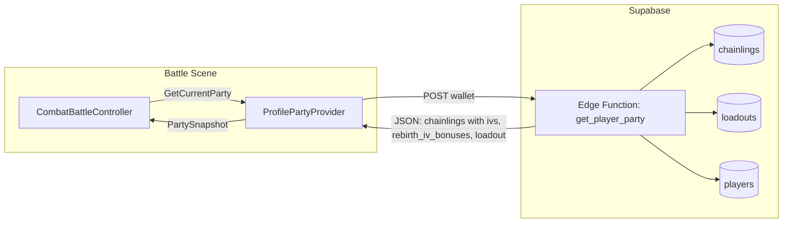

# Profile Party Provider — Backend IV Wiring

> Historical note: wallet/player ownership details in this document predate the
> 20260824 profile-native cutover. Current roster ownership and lookup use
> `player_profile_id`; see `Docs/Architecture/Account_Platform_Refactor.md`.

## Summary

Yes. The "default IVs" approach is only a fallback. The refinement stage should use the player's exact IV settings from the backend. Supabase already stores base IVs and rebirth bonuses per chainling.

---

## Supabase Schema (from MCP query)

### `chainlings` table

| Column | Type | Purpose |
|--------|------|---------|
| id | uuid | Primary key |
| player_id | uuid | FK to players |
| species_id | text | Species ID (e.g. "gilarime") |
| level | integer | Level 1–100 |
| xp | integer | XP within level |
| **ivs** | **jsonb** | Base IVs: `[MaxHP, MeleeAtk, MeleeDef, RangedAtk, RangedDef, Speed]` |
| **rebirth_iv_bonuses** | **jsonb** | Rebirth bonuses: `[0..5, 0..5, ...]` per stat |
| is_party_member | boolean | Whether in active party |
| party_slot | integer | Slot index (0=Lead, 1=Partner, 2=Bench) |
| stars | smallint | 0–5 |
| rebirth_count | smallint | Rebirth count |
| display_name | text | Optional override |
| evolution_stage | smallint | 1-based |
| entangled_flag | boolean | Entangled variant |
| is_mutated | boolean | Mutated type |
| ... | | (analytics columns) |

### `loadouts` table

| Column | Type | Purpose |
|--------|------|---------|
| chainling_id | uuid | FK to chainlings |
| slot | integer | Move slot (0–3) |
| move_item_id | uuid | FK to move_items |

### `players` table

| Column | Type | Purpose |
|--------|------|---------|
| id | uuid | Primary key |
| wallet | text | Wallet address (links to Solana) |

---

## Combat Stat Formula (do not merge bonuses into IVs)

```
final[stat] = max(1, speciesBase + ivs[stat] + cycleAutoFlat + cyclePickFlat)
```

- Base `ivs`: -10 to +10 per stat (wild-rolled; keep pure on `ChainlingSnapshot.ivs`)
- `rebirth_iv_bonuses`: allocation **counts** 0..5 per index (sum = `rebirth_count`); map to `ChainlingSnapshot.rebirthIvBonuses`
- Cycle auto from `rebirth_count`: `+1` combat stats / `+5` MaxHP per Cycle
- Cycle pick apply-side: `+1` per combat-stat point / `+5` MaxHP per MaxHP point
- Providers must **not** write `ivs[i] + rebirth_iv_bonuses[i]` into snapshot IVs

---

## Data Flow for ProfilePartyProvider



---

## Implementation Plan

### 1. Edge Function: `get_player_party`

**Input:** `{ "wallet": "base58..." }`

**Logic:**
- Resolve `players.id` by `wallet` (or `wallet_lower`)
- Query `chainlings` WHERE `player_id = ?` AND `is_party_member = true` ORDER BY `party_slot`
- For each chainling, join `loadouts` to get move IDs (via `move_items` if needed)
- Return JSON array of party chainlings with: `species_id`, `level`, `ivs`, `rebirth_iv_bonuses`, `stars`, `evolution_stage`, `display_name`, `move_ids[]`

**Output shape (example):**
```json
{
  "party": [
    {
      "species_id": "gilarime",
      "level": 25,
      "ivs": [3, -2, 1, 0, 4, -1],
      "rebirth_iv_bonuses": [1, 0, 0, 0, 0, 0],
      "stars": 2,
      "evolution_stage": 1,
      "display_name": "",
      "move_ids": ["move_001", "move_002", "move_003", "move_004"]
    }
  ]
}
```

### 2. ProfilePartyProvider (Supabase-backed)

- Implements `IPlayerPartyProvider`
- Gets current wallet from `SolanaServiceBridge.Instance?.WalletService?.PublicKey` (or equivalent)
- Calls `SupabaseClient.PostJsonAsync(config, "get_player_party", json)` with wallet
- Parses response and builds `PartySnapshot`:
  - Populate `ChainlingSnapshot.ivs` with **base** IVs only
  - Populate `ChainlingSnapshot.rebirthIvBonuses` from `rebirth_iv_bonuses` allocation counts
  - Populate `speciesId`, `rebirthCount`, `moveIds`, `evolutionStage`, `stars`, `displayName`

### 3. Fallback

- If Supabase call fails or returns empty: fall back to `ManualPartyProviderSO` or cached Solana vault data
- If backend has no IVs (legacy row): use `[0,0,0,0,0,0]` as default only for that chainling

---

## No Default IVs in Refinement

The refinement stage should **not** keep default IVs. It should:

1. Use base `ivs` and separate `rebirth_iv_bonuses` counts from Supabase when available
2. Use Solana vault `ivsSeed`-derived **base** IVs when Supabase is not the source
3. Use `[0,0,0,0,0,0]` only when neither source has IV data (e.g. new capture not yet synced)

---

## Files to Create/Modify

| File | Action |
|------|--------|
| `supabase/functions/get_player_party/` | New Edge Function |
| `Assets/Scripts/Combat/Runtime/Services/SupabaseProfilePartyProvider.cs` | New MonoBehaviour implementing `IPlayerPartyProvider` |
| Battle scene prefab | Assign `SupabaseProfilePartyProvider` to `CombatBattleController.playerPartyProviderOverride` |
