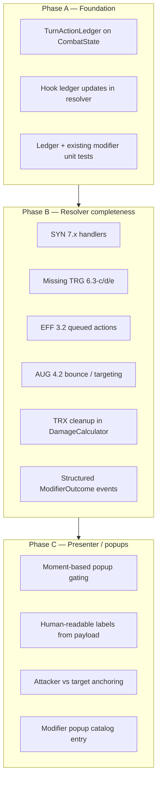

# Combat Modifier Resolver & Popup Plan

> **Purpose:** Codex / implementation planning reference.  
> **Scope:** Complete modifier resolver logic and turn-memory foundation first; then fix modifier popup presentation so flashes match **real effect moments**.  
> **Status:** Planning only — no implementation yet.  
> **Data source of truth:** `Docs/Specs/Combat/Data/Modifiers.csv`

---

## 1. Goal Summary

Combat modifiers (POT, EFF, AUG, TRX, TRG, SYN) are rolled at vending and attached to moves, but **runtime behavior and popups are out of sync** with design intent.

**Design intent (player-facing):**

| Category | Popup should appear when… |
|----------|---------------------------|
| **POT** (potency) | The stat boost **actually affected** the action — power/accuracy on **confirmed hit**; crit mods on **confirmed crit** |
| **EFF** (efficiency) | A proc **succeeds** (e.g. AP refund alongside AP gain popup) |
| **AUG** (augmentation) | The augmentation **changes** the action outcome (extra hit, bounce, etc.) |
| **TRX** (transmutation) | The move **uses** infused type or substituted stat — label on **attacker** |
| **TRG** (trigger) | Trigger condition met **and** effect applied (on-hit, on-crit, swap, HP threshold, etc.) |
| **SYN** (synergy) | Synergy predicate true at resolve time (ally attacked, partner buffed, etc.) |

**Non-negotiable ordering:**

1. **Resolver + ledger correctness** (gameplay truth)
2. **Structured modifier outcome events** (contract between engine and presentation)
3. **Presenter / popup rules** (visual truth)

Do **not** polish modifier popups on top of incomplete or turn-blind resolver logic.

---

## 2. Current State (Audit)

### 2.1 Popup pipeline today

| Step | Location | Behavior |
|------|----------|----------|
| Resolver logs event | `CombatResolver.LogModifierOutcome`, `SwapModifierResolver`, `ProcessOnKOModifiers` | `CombatEventType.ModifierTriggered` |
| Presenter gate | `Combat2BattlefieldPresenter.Pacing.cs` → `HandleModifierTriggered` | **Only shows if `evt.boolValue == true`** |
| Label | `ResolveModifierLabel(message)` | Parses **section id** (e.g. `2.1-A`) from log string — not effect text |
| Anchor | `GetView(evt.targetId)` → fallback `sourceId` | No attacker-vs-target routing by category |
| Visual profile | `CombatPopupCategory.Modifier` | `CombatPopupVisual_Modifier.asset` exists; catalog may not map category 27 — verify during Phase C |

### 2.2 When `ModifierTriggered` fires today

| Source | Timing | `boolValue` | Popup? | Problem |
|--------|--------|-------------|--------|---------|
| `BuildDamageModifierContext` | **Before hit loop** on damaging moves | `true` when POT/AUG/TRX/conditional TRG applied to context | Yes | Fires on **miss**; crit POT fires **before** crit roll |
| `ProcessAfterDamageModifiers` | After hit with `damage > 0` | `true` on OnHit/OnCrit proc success | Yes | Correct timing for TRG procs |
| `CheckAPRefund` (3.1-x) | After move resolves | `true` only on successful refund roll | Yes | Closest to desired EFF behavior |
| `ProcessOnKOModifiers` | On KO | **Unset** (defaults false) | No | Effect may apply; no popup |
| `SwapModifierResolver` | On swap in/out | **Unset** (defaults false) | No | Message prefix `[Swap modifier …]` also breaks label parser |

### 2.3 Resolver coverage vs `Modifiers.csv`

**Implemented (section-id branches in `CombatResolver.BuildDamageModifierContext` / related):**

| Sections | Category | Notes |
|----------|----------|-------|
| `2.1-x` | POT power | Pre-hit context |
| `2.2-x` | POT accuracy | Pre-hit context |
| `2.3-x` | POT crit | Pre-hit context; not gated on crit result |
| `3.1-x` | EFF AP refund | `CheckAPRefund` — proc-gated ✓ |
| `4.1-a` | AUG extra hit | Requires MULTI move |
| `4.3-a/b`, `4.6-a`, `4.7-a` | INIT/AUG barrier | Pre-hit context |
| `5.1-a` | TRX type infusion | Pre-hit context |
| `5.2-x` | TRX stat sub | Partial; see TODO in `DamageCalculator` |
| `6.1-x`, `6.2-x` | TRG on-hit/on-crit | `ProcessAfterDamageModifiers` |
| `6.3-a/b` | TRG conditional dmg | HP conditions in pre-hit context |
| `6.4-x` | TRG swap | `SwapModifierResolver` — effects partial; events broken for popups |

**Not implemented / missing (in generator pool or CSV, no engine handler):**

| Sections | Category | Design (from CSV) | Blocker |
|----------|----------|-------------------|---------|
| `3.2-a/b/c` | EFF bonus action | Repeat move / auto-use at EOT | Needs queued-action resolver ([RuntimeFollowups](COMBAT_RuntimeFollowups.md)) |
| `4.2-a` | AUG bounce | Hit bounces to adjacent target | Needs targeting expansion |
| `6.3-c` | TRG OnLowHP | Mitigation when HP &lt; 30% | No handler |
| `6.3-d` | TRG OnAllyKO | Power buff after ally KO | No modifier handler (passive trigger exists separately) |
| `6.3-e` | TRG conditional | Target missed last turn | No turn memory |
| **`7.1-a`–`7.1-d`** | **SYN team** | Partner buffed / ally mitigation / partner stage / partner status | **No SYN code in engine** |
| **`7.2-a`–`7.2-c`** | **SYN combo** | Ally attacked / target hit this turn / next ally buff | **No turn ledger** |

**Known TODOs in code:**

- `DamageCalculator.cs` — TRX stat substitution comment/TODO (context override path exists via `modifierContext.hasAtkStatOverride`)
- `Docs/Specs/Combat/COMBAT_RuntimeFollowups.md` — bonus actions, bounce/spread, synergy turn-memory explicitly deferred

### 2.4 Turn-memory gap (root cause for combo/synergy)

No engine state tracks:

- Ally used a damaging move this turn
- Target was hit this turn
- Chainling took damage this turn
- Target missed last turn
- Per-turn modifier condition re-checks between actions

Checks today are mostly **turn start**, **end of turn**, or **point-in-time during one move resolve**. Combo modifiers that require events **earlier in the same turn** cannot work without a ledger updated after each combat step.

---

## 3. Work Split Overview



| Phase | Delivers | Blocks |
|-------|----------|--------|
| **A — Ledger foundation** | Turn-action memory, hooks, tests | SYN, 6.3-e, 7.2-x |
| **B — Resolver completeness** | All CSV rows that need numeric rules; structured outcomes | Correct popups |
| **C — Presenter / popups** | Flash only on real effect moments | Player trust in modifier UX |

---

## 4. Phase A — Turn Action Ledger (Foundation)

### 4.1 Add `TurnActionLedger` (or equivalent) on `CombatState`

**Suggested fields (per turn, reset on turn advance):**

| Field | Purpose | Supports |
|-------|---------|----------|
| `teamDamagingMoveUsedThisTurn` | Any ally used damaging move | `7.2-a` |
| `chainlingIdsHitThisTurn` | Targets that received damage | `7.2-b` |
| `chainlingIdsDamagedThisTurn` | Defenders that took HP loss | Combo “hit on same turn” |
| `chainlingIdsThatActedThisTurn` | Who has consumed their action | Speed/priority shaping |
| `lastTurnMissedByTarget` | Map target → bool (cleared each turn) | `6.3-e` |

**Update hooks (minimum):**

- After hit confirmed / damage applied → record hit + damaged
- After miss logged → record miss for target context
- After damaging move completes → mark team damaging move used
- On `TurnStart` / `EndOfTurn` → reset or roll forward last-turn miss map

**Primary files:**

- `Assets/Scripts/Combat/Runtime/Data/CombatState.cs` (or adjacent combat data)
- `Assets/Scripts/Combat/Runtime/Engine/CombatResolver.cs` — hit/miss/damage paths (~1400–1620)
- `Assets/Scripts/Combat/Runtime/Engine/CombatResolver.cs` — turn start/end (~291, 334)

### 4.2 Ledger read API

Add small helpers (static or service):

```csharp
// Conceptual
bool DidAllyUseDamagingMoveThisTurn(TeamState team, int turn);
bool WasTargetHitThisTurn(string chainlingInstanceId, int turn);
bool DidChainlingTakeDamageThisTurn(string chainlingInstanceId, int turn);
bool DidTargetMissLastTurn(string chainlingInstanceId);
```

Synergy and combo checks **must** call these — not ad-hoc flags on individual moves.

### 4.3 Phase A acceptance

- [ ] Ledger resets correctly each turn
- [ ] Hit/miss/damage updates fire in multi-hit and AOE paths
- [ ] Unit tests for ledger in isolation
- [ ] No presenter changes required yet

---

## 5. Phase B — Resolver Completeness

### 5.1 Design principle: data-driven outcomes

Replace ad-hoc `LogModifierOutcome` string messages with a structured payload (new type or extended `CombatEvent`):

```csharp
// Conceptual — add to combat data layer
enum ModifierPopupMoment
{
    OnHitApplied,       // POT power/accuracy after confirmed hit
    OnCritApplied,      // POT crit / TRG on-crit
    OnProcSucceeded,    // EFF refund, chance-based TRG
    OnAlwaysActive,     // AUG/TRX that definitely altered the action
    OnSwapTrigger,
    OnSynergyMet,
    OnConditionalMet,   // HP thresholds, ally KO, etc.
}

struct ModifierOutcomePayload
{
    string sectionId;
    ModifierCategory category;
    string displayText;           // "+11% POWER", "REFUND", "SPEED"
    string anchorChainlingId;     // who gets the popup
    ModifierPopupMoment moment;
    bool gameplayApplied;         // must be true to emit
}
```

Emit **only when `gameplayApplied == true`**. Presenter consumes payload — not parsed log strings.

### 5.2 Category work items

#### POT (`2.x`) — defer popup emission to effect moment

| Task | Detail |
|------|--------|
| Keep context building in `BuildDamageModifierContext` | Power/accuracy/crit still feed `DamageCalculator` pre-hit |
| **Stop** logging `ModifierTriggered` from pre-hit context | Remove or gate `LogModifierOutcome(..., true, "Pre-damage modifier applied")` |
| After hit confirmed | Emit POT power/accuracy popup on **attacker** |
| After crit confirmed | Emit POT crit popup on **attacker** only if crit mod contributed (track in context) |

**Files:** `CombatResolver.cs` (`BuildDamageModifierContext`, hit loop ~1443–1620)

#### EFF (`3.x`)

| Section | Task |
|---------|------|
| `3.1-x` | Keep proc-gated refund; link popup to `ApGain` timing on attacker |
| `3.2-a/b/c` | Implement queued-action / EOT auto-move path per [COMBAT_RuntimeFollowups.md](../Specs/Combat/COMBAT_RuntimeFollowups.md) |
| Popup rule | Show modifier popup **only** when proc succeeds; pair refund with AP gain |

**Files:** `CombatResolver.cs` (`CheckAPRefund`), new queued-action module if needed

#### AUG (`4.x`)

| Section | Task |
|---------|------|
| `4.1-a` | Emit popup when extra hit **actually increases** hit count |
| `4.2-a` | Implement bounce targeting + reduced-power secondary hit |
| `4.3-x` | Popup when barrier bypass/penetration **changes** absorption outcome |

#### TRX (`5.x`)

| Section | Task |
|---------|------|
| `5.1-a` | Popup on attacker when type override used for damage calc |
| `5.2-x` | Finish stat sub in `DamageCalculator`; remove stale TODO if context path is canonical |
| Popup | Show substituted stat name on **attacker** (e.g. `SPEED`) once per action |

**Files:** `CombatResolver.cs`, `DamageCalculator.cs`

#### TRG (`6.x`)

| Section | Task |
|---------|------|
| `6.1-x`, `6.2-x` | Already post-hit; wire structured outcomes |
| `6.3-c` | OnLowHP mitigation when HP &lt; threshold — likely on damage or turn checkpoint |
| `6.3-d` | OnAllyKO power buff — hook ally KO event |
| `6.3-e` | Requires ledger `lastTurnMissedByTarget` |
| `6.4-x` | Fix `SwapModifierResolver` events: set `boolValue = true`, unify message prefix |
| OnKO modifiers | Fix `ProcessOnKOModifiers` to set `boolValue` and structured payload |

**Files:** `CombatResolver.cs`, `SwapModifierResolver.cs`

#### SYN (`7.x`) — new handler module

Add `SynergyModifierResolver` (or extend `BuildDamageModifierContext` with ledger predicates):

| Section | Predicate | Effect |
|---------|-----------|--------|
| `7.1-a` | Partner has buff status | Power multiplier |
| `7.1-b` | Support move used | Ally mitigation |
| `7.1-c` | Support move used | Ally random stage |
| `7.1-d` | Support + partner alive | Apply effect to partner |
| `7.2-a` | Ledger: ally damaging move this turn | Power multiplier |
| `7.2-b` | Ledger: target hit this turn | Power multiplier |
| `7.2-c` | Move used | Buff next ally move (turn-scoped flag on team) |

**Blocked until Phase A ledger exists.**

### 5.3 Section-id branching → maintainability

Current `StartsWithSection("2.1")` / `section.Equals("6.3-a")` pattern in `CombatResolver` is acceptable short-term but should trend toward:

- CSV / `ModifierDefinitionSO` driven **effect family** field, or
- Registry map: `sectionId → IModifierEffectHandler`

Document new sections in `Modifiers.csv` first; importer already maps category/trigger ([`Combat2DataImporter.cs`](../../Assets/Scripts/Combat/Editor/Importers/Combat2DataImporter.cs)).

### 5.4 Phase B acceptance

- [ ] Every **numeric** row in `Modifiers.csv` either resolves in engine or is explicitly marked metadata-only
- [ ] SYN rows pass ledger-backed tests
- [ ] No `ModifierTriggered` with `boolValue=true` for skipped/failed procs
- [ ] POT popups never fire on miss; crit POT only on crit
- [ ] Swap/KO modifiers emit valid structured outcomes
- [ ] Forensic logs preserved (`LogForensic` / `LogModifierOutcome` skipped cases can stay debug-only)

---

## 6. Phase C — Presenter & Popup Gaps

**Start only after Phase B emits structured `ModifierOutcomePayload` (or equivalent fields on `CombatEvent`).**

### 6.1 Presenter changes

| Gap | Fix |
|-----|-----|
| Early POT popups | Consume moment-gated events only — remove reliance on pre-hit `ModifierTriggered` |
| Label = section id | Map payload `displayText` from resolver (rolled % from `ModifierInstance.effectValue`) |
| Wrong anchor | Route by payload: TRX/POT/EFF/SYN on **attacker**; on-hit heal/drain on **target** or **attacker** per effect |
| Swap events ignored | Handle unified modifier outcome event; fix `boolValue` at source |
| Transmutation + damage | Two popups: stat/type on attacker, damage/heal on target (sequencing via existing presenter queue) |
| EFF refund | Modifier popup + existing `ApGain` popup on same actor — coordinate hold timing in `Combat2BattlefieldPresenter.Pacing.cs` |

**Primary files:**

- `Assets/Scripts/Combat/Runtime/Presentation/Combat2BattlefieldPresenter.Pacing.cs` — `HandleModifierTriggered`
- `Assets/Scripts/Combat/Runtime/Presentation/Combat2BattlefieldPresenter.Popups.cs` — category spawn helpers
- Optional: `ModifierPopupLabelResolver.cs` under `Assets/Scripts/Combat/Runtime/Presentation/`

### 6.2 Popup data / catalog

| Task | Detail |
|------|--------|
| Add `CombatPopupCategory.Modifier` to catalog | `CombatPopupVisualCatalog.asset` — category index 27 |
| Label formatting | Prefer dynamic text from payload over section id |
| Optional profiles | Sub-styles per category (POT vs TRG) via metadata if needed later |

**Files:**

- `Assets/Data/Combat/PopUps/VisualCatalog/CombatPopupVisualCatalog.asset`
- `Assets/Data/Combat/PopUps/Profiles/CombatPopupVisual_Modifier.asset`
- `Assets/Scripts/Combat/Editor/CombatPopupVisualProfileGenerator.cs`

### 6.3 Phase C acceptance

- [ ] Modifier popup shows **human-readable effect**, not raw section id
- [ ] Popups appear only when resolver marks `gameplayApplied`
- [ ] TRX stat sub popup on attacker; damage on defender
- [ ] AP refund shows modifier flash + AP gain when proc succeeds
- [ ] Swap modifiers show popup when effect applies
- [ ] No popup on miss for POT; no crit mod popup without crit

---

## 7. Testing Strategy

### 7.1 Engine tests (priority)

Add under `Assets/Scripts/Combat/Tests/`:

| Test | Validates |
|------|-----------|
| `TurnActionLedgerTests` | Hit/miss/turn reset |
| `SynergyModifierTests` | 7.2-a/b with scripted turn order |
| `PotencyPopupMomentTests` | No outcome event on miss; crit mod only on crit |
| `EfficiencyRefundTests` | Proc fail = no modifier outcome |
| `SwapModifierOutcomeTests` | 6.4-x emits valid event with `boolValue` |
| `TransmutationStatSubTests` | Atk stat override + outcome on attacker |

Reuse patterns from `CombatPopupVisualTests.cs`, `CombatRuntimeFixTests.cs`.

### 7.2 Manual QA matrix

| Scenario | Expected |
|----------|----------|
| Damaging move + POT power, **miss** | No modifier popup |
| Damaging move + POT power, **hit** | Modifier popup on attacker |
| Move + crit POT, non-crit hit | No crit mod popup |
| Move + crit POT, crit hit | Crit mod popup on attacker |
| EFF refund proc fail | No modifier popup |
| EFF refund proc success | Modifier popup + AP gain |
| Swap-in 6.4-b (+AP) | Popup on swapped-in chainling |
| Ally acts first, combo 7.2-a second | Second mon gets synergy boost + popup |
| Slow mon combo requiring “hit this turn” | Popup only if damaged earlier same turn |

---

## 8. Implementation Order (Codex checklist)

### Sprint 1 — Foundation
1. [ ] `TurnActionLedger` data + reset hooks
2. [ ] Wire ledger updates in hit/miss/damage/end-of-turn paths
3. [ ] Unit tests for ledger

### Sprint 2 — Resolver gaps (no popup polish yet)
4. [ ] `SynergyModifierResolver` + 7.1/7.2 handlers (ledger-backed)
5. [ ] TRG gaps: 6.3-c, 6.3-d, 6.3-e
6. [ ] Fix swap/KO modifier event emission (`boolValue`, message format)
7. [ ] Defer POT `ModifierTriggered` from pre-hit context (stop false-positive popups)
8. [ ] `ModifierOutcomePayload` on `CombatEvent` (or sibling event type)

### Sprint 3 — Remaining modifier mechanics
9. [ ] AUG 4.2 bounce / targeting expansion (coordinate with RuntimeFollowups)
10. [ ] EFF 3.2 queued-action path
11. [ ] TRX `DamageCalculator` cleanup / single canonical stat-sub path

### Sprint 4 — Presenter
12. [ ] `HandleModifierTriggered` → consume structured payload
13. [ ] Anchor + label routing by category/moment
14. [ ] Catalog entry for `Modifier` category
15. [ ] Pacing coordination with AP gain / damage popups

### Sprint 5 — QA & docs
16. [ ] Automated tests listed in §7.1
17. [ ] Update `COMBAT_RuntimeFollowups.md` — mark completed items
18. [ ] Manual QA matrix §7.2

---

## 9. Key Codebase References

| Path | Relevance |
|------|-----------|
| `Docs/Specs/Combat/Data/Modifiers.csv` | Source of truth for sections, categories, triggers |
| `Docs/Specs/Combat/COMBAT_RuntimeFollowups.md` | Deferred bonus-action, bounce, synergy items |
| `Assets/Scripts/Combat/Runtime/Engine/CombatResolver.cs` | `BuildDamageModifierContext`, hit loop, `CheckAPRefund`, `LogModifierOutcome` |
| `Assets/Scripts/Combat/Runtime/Engine/SwapModifierResolver.cs` | 6.4 swap modifiers |
| `Assets/Scripts/Combat/Runtime/Engine/DamageCalculator.cs` | Damage/crit/hit; TRX TODO |
| `Assets/Scripts/Combat/Runtime/Services/MoveModifierGenerator.cs` | Full section pool including 7.x |
| `Assets/Scripts/Combat/Runtime/Data/MoveEnums.cs` | `ModifierCategory`, `ModifierTriggerCondition` |
| `Assets/Scripts/Combat/Runtime/ScriptableObjects/ModifierDefinitionSO.cs` | Imported modifier metadata |
| `Assets/Scripts/Combat/Runtime/Presentation/Combat2BattlefieldPresenter.Pacing.cs` | `HandleModifierTriggered` |
| `Assets/Scripts/Combat/Runtime/Engine/CombatEventLog.cs` | `CombatEvent` struct |
| `Assets/Data/Combat/PopUps/Profiles/CombatPopupVisual_Modifier.asset` | Modifier popup visual profile |

---

## 10. Explicit Non-Goals (This Plan)

- Cosmetic/ranked-only modifier rows without numeric combat rules
- Move-select UI modifier overview changes (already in `CombatSelectionCoordinatorUGUI`)
- Vending / candy machine roll logic (values already on `ModifierInstance`)
- Combat SFX orchestration for modifiers (separate plan in `Docs/Guides/COMBAT_SFX_*`)

---

## 11. Review Gate Before Merge

1. **Gameplay:** Scripted battles prove SYN/combo modifiers can fire mid-turn when conditions met.
2. **Events:** No `ModifierTriggered` with `boolValue=true` unless an effect actually applied.
3. **UX:** Modifier popups use readable labels and correct anchors.
4. **Regression:** Existing damage/heal/crit/AP popups unchanged in timing.
5. **Docs:** `COMBAT_RuntimeFollowups.md` updated to reflect completed vs remaining rows.

---

## 12. Relationship to Other Plans

| Plan | Relationship |
|------|--------------|
| [COMBAT_POPUP_OVERLAY_CAMERA_PLAN.md](../Camera/COMBAT_POPUP_OVERLAY_CAMERA_PLAN.md) | Orthogonal — DoF/render path for popups; do after or in parallel with Phase C |
| [COMBAT_SFX_FOUNDATION_PLAN.md](../Guides/COMBAT_SFX_FOUNDATION_PLAN.md) | Modifier outcome events can later feed SFX orchestrator |
| [COMBAT_RuntimeFollowups.md](../Specs/Combat/COMBAT_RuntimeFollowups.md) | This plan **implements** several listed follow-ups |

**Recommended Codex execution:** Phase A → B → C sequentially; overlay camera optional during Phase C QA.
