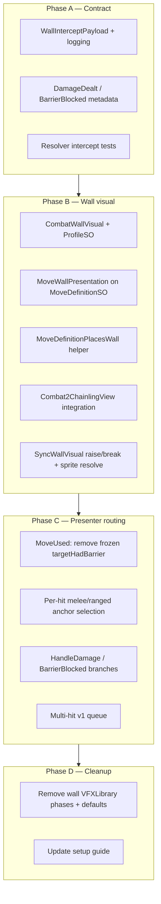

# Combat Wall Visual & Targeting Plan

> **Purpose:** Codex / implementation planning reference for lightweight **wall** presentation (single sprite + DOTween) and correct **attack targeting** when walls/mitigation/barriers are active, bypassed, or broken mid-move.  
> **Abstract companion:** [COMBAT_WALL_VISUAL_AND_TARGETING_PLAN_v2.md](COMBAT_WALL_VISUAL_AND_TARGETING_PLAN_v2.md) — goal-oriented direction without implementation detail.  
> **Scope:** Wall-only presentation and resolver→presenter intercept contract. **Does not** change chainling move VFX (`Cast` / `Projectile` / `Impact`), presentation tracks, or `CombatMoveVFX` attack prefabs.  
> **Status:** Planning only — no implementation yet.  
> **Terminology:** **Wall** = player-facing label for both `% mitigation windows` and **full-absorb barriers** unless a rule explicitly distinguishes them.

---

## 1. Goal Summary

Replace deprecated wall/barrier **prefab-phase VFX** with one instantiated **`CombatWallVisual`** prefab per slot (`BarrierAnchor`), animated via DOTween:

| Moment | Animation intent |
|--------|------------------|
| **Raise** | Scale **Y** from 0 → 1, pivot bottom-center, ease + slight overshoot (rises from ground) |
| **Hit** | Small **X** shove, scale Y up briefly, two quick recoil bounces, return to rest |
| **Break** | **No hit tween** on the breaking strike; play **sink** (scale Y → 0 into ground) then clear visual |

**Targeting intent:** While a wall intercepts attacks, melee lunges and ranged projectiles **aim at `BarrierAnchor`**, not the chainling body — **unless** that hit bypasses the wall.

**Non-negotiable ordering:**

1. **Resolver truth** — per-hit intercept mode (wall / bypass / break-through / body)
2. **Structured wall outcome events** (contract to presenter)
3. **`CombatWallVisual` + presenter routing** (animation + anchors)
4. **Deprecation cleanup** — wall-only `CombatVFXLibrary` phases and presenter fallback prefabs

Do **not** polish wall DOTween on top of a frozen `targetHadBarrier` snapshot from move start (today’s main presentation bug for multi-hit).

---

## 2. Current State (Audit)

### 2.1 What already works (mostly done)

| Area | Location | Behavior |
|------|----------|----------|
| Wall state per slot | `Combat2BattlefieldPresenter.SyncPersistentBarrierVisual` | Polls `CombatState` (~`0.1s`) + `_barrierActiveByInstanceId` |
| “Has wall” detection | `HasActiveBarrierState` | Full `barriers` **or** mitigation whose `stackKey`/`sourceTag` contains `wall` / `barrier` |
| Melee strike anchor | `ResolveMeleeStrikeAnchor` | `BarrierAnchor` when `targetHadBarrier` at **move start** |
| Projectile end | `SpawnPhaseVfxNow` | `impactTarget = BarrierAnchor` when `targetHadBarrier` |
| Impact focus / popups | `FocusImpactTarget`, `ResolvePopupAnchorPosition` | Prefer barrier anchor when `targetHadBarrier` |
| Raise/break text | `PlayBarrierFeedbackRoutine` | `WallRaised` / `WallBroken` popups + outline flash |
| Barrier block event | `BarrierBlocked` → `HandleBarrierBlocked` | `BLOCKED` popup + optional `BarrierImpact` prefab |

### 2.2 What is missing or wrong

| Gap | Impact |
|-----|--------|
| **No wall sprite animation** | `SetPersistentBarrierVisual` only `Instantiate`s static prefab |
| **`targetHadBarrier` frozen at `MoveUsed`** | Multi-hit: wall can break on hit 2; hits 3+ still use wall routing and wall hit logic |
| **No bypass in presenter** | `CheckBarrierBypass` is resolver-only; visuals always lunge to wall if wall existed at move start |
| **No per-hit intercept metadata** | `DamageDealt` has no `hitIndex`, bypass flag, break-through flag, mitigation amount |
| **Chainling always `PlayHitReaction` on damage** | Even when player expects wall to absorb the “beat” |
| **Break vs mitigate not distinguished** | Same hit can reduce damage (mitigation) **and** consume last hit budget — different stories, same presentation |
| **Mitigation expiry = SystemMessage only** | Presenter learns wall dropped via poll delay, not synchronously with hit |
| **Deprecated wall prefab paths still wired** | `defaultPersistentBarrier*` + `CombatVFXLibrary` `PersistentBarrier` / `BarrierImpact` / `BarrierBreak` |

### 2.3 Resolver hit order (reference)

Per hit in `CombatResolver` damaging loop (`hit` = 0..`hitCount-1`):

1. Roll accuracy → damage calc (includes **% mitigation** in `DamageCalculator`)
2. `CheckBarrierBypass(attacker, move, chemResult, hitIndex, modifierContext, turn)`
3. `ApplyBarrierAbsorption` (+ optional **barrier penetration** partial damage)
4. If full block (`incomingDamage > 0 && damage == 0`) → `BarrierBlocked`, **`continue`** (no `DamageDealt`)
5. Apply HP damage, `LogDamage`
6. `ConsumeMitigationHitBudgets()` — decrements **hit-limited** mitigation sources

**Bypass sources today** (`CheckBarrierBypass`) — **not** melee vs ranged specific:

| Source | Scope |
|--------|--------|
| `Relay` status | Next hit, consumed |
| `Unsealed` status | 50% roll |
| Modifier `4.3-b` | First hit only, guaranteed |
| Modifier `4.6-a` (rolled) | First hit only |

**Contact type:** `MoveInstance.contactType` (`Contact` / `Projectile` / `None`) is **not** used in `CheckBarrierBypass`. `firewall_passive` only affects **passive mitigation %** vs projectiles — separate from bypass.

**Future-proofing:** New bypass effects should declare **eligibility** (e.g. `ContactOnly`, `ProjectileOnly`, `AllHits`, `FirstHitOnly`) in data; resolver and presenter must read the same flags.

---

## 3. Design Principles

### 3.1 Two wall mechanics (same visual, different rules)

| Mechanic | State | On hit | Break condition |
|----------|--------|--------|-----------------|
| **Mitigation window** | `mitigationSources` (e.g. `barrier_wall`) | Damage reduced; may still deal HP | Hit budget and/or turn timer |
| **Full absorb barrier** | `barriers` | Can zero damage → `BarrierBlocked` | Hits remaining / damage threshold / turns |

Presentation uses **one** `CombatWallVisual` prefab; optional tint/scale via `CombatWallVisualProfileSO` per `sourceTag` (`barrier_wall`, `ice_wall`, …) later.

### 3.2 Wall vs move VFX (do not mix)

| System | Keep? | Role |
|--------|-------|------|
| `CombatVFXLibrary` **Cast / Projectile / Impact** | **Yes** | Attacker move identity (slashes, bolts, etc.) |
| `CombatPresentationTrackSO` / `SpriteFlipbookVfxPlayer` | **Yes** | Frame-timed attack flair on chainling |
| `CombatMoveVFX` | **Yes** | Move prefab lifecycle + projectile motion |
| `CombatVFXLibrary` **PersistentBarrier / BarrierImpact / BarrierBreak** | **Remove** | Replaced by `CombatWallVisual` |
| Presenter `defaultPersistentBarrier*` / `defaultBarrierImpact*` / `defaultBarrierBreak*` | **Remove** | Replaced by single wall prefab reference |

### 3.3 Presentation truth rule

> **Animation follows resolver intercept mode for that hit index — not wall state at move start.**

---

## 4. Intercept Modes & Scenario Matrix

Define enum **`WallInterceptMode`** (resolver → event payload):

| Mode | Meaning | Wall hit anim? | Wall break anim? | Body hit anim? | Targeting anchor |
|------|---------|----------------|------------------|----------------|------------------|
| `None` | No wall active | — | — | If damage | Body |
| `WallMitigated` | Wall up; damage dealt after mitigation/barrier math | **Yes** | No | **Yes** (reduced damage) | Wall for attack beat; damage popup on body or wall per UX |
| `WallBlocked` | Full absorb; no HP loss | No (optional micro-shake) | No | No | Wall |
| `WallBrokenThrough` | Wall consumed/broken **on this hit**; HP damage applies | **No** | **Yes** (sink) | **Yes** (post-break damage) | Wall for move wind-up; **body** for damage beat |
| `Bypass` | Bypass rolled true; wall ignored for this hit | No | No | If damage | **Body** |
| `WallHitNoDamage` | Hit budget consumed, 0 damage (edge) | Optional light hit | If budget exhausted | No | Wall |

### 4.1 Same-turn break + damage (user-critical)

**Case A — Break-through (one hit):** Last hit budget or barrier breaks **and** this hit deals HP damage.

- Example: 1-hit wall, attack deals 30 → wall breaks, 30 to body.
- **Sequence:** `PlayBreak()` only → then normal **chainling** damage sequence (`PlayHitReaction`, impact VFX on body anchor, damage popup).
- **Do not** play `PlayHit()` on the same strike.

**Case B — Mitigate + damage (wall still up):** Wall still active after hit; damage reduced but &gt; 0.

- Example: 25% mitigation wall, 40 raw → 30 to body, 2 hits remaining.
- **Sequence:** `PlayHit()` on wall → body takes mitigated damage beat (smaller popup / optional softer recoil).

**Case C — Mitigate + break on same hit:** Damage reduced **and** hit budget reaches 0 on same strike.

- Treat as **Case A** if HP damage &gt; 0 after hit (break-through dominates).
- If damage == 0 but budget exhausted: `PlayBreak()` only (wall expired without body damage).

**Case D — Full block:** `BarrierBlocked`, no `DamageDealt`.

- **Sequence:** Brief wall pulse or `BLOCKED` popup; **no** break sink unless barrier instance removed.

### 4.2 Bypass-aware routing (melee vs ranged)

| Layer | Responsibility |
|-------|----------------|
| **Resolver** | Compute `bypassBarrier` per hit; log `contactType` + `moveCategory` in payload for debugging and future rules |
| **Presenter `MoveUsed`** | **Do not** permanently set `targetHadBarrier` for whole move; store `moveId` + max hits only |
| **Per-hit handler** | Read `WallInterceptMode` on `DamageDealt` / `BarrierBlocked` / `WallExpired` |

**Melee (`DamagingMelee`):**

- If hit 0 bypass → lunge to `MeleeStopAnchor` / `ImpactAnchor`.
- If hit 0 wall → lunge to `BarrierAnchor`.
- **Multi-hit mid-break (hard):** see §5.

**Ranged (`DamagingRanged`):**

- Projectile `to` position from **per-hit** intercept mode, not move-start snapshot.
- Cast/release timing unchanged; only **impact target transform** changes per hit.

**Future bypass by contact:** When CSV/modifiers add “bypass only ranged”:

- Extend `CheckBarrierBypass(...)` with `ContactType` / `MoveCategory` predicate.
- Mirror in `WallInterceptPayload.bypassReason` + `bypassAppliesToContactType`.

### 4.3 Modifier barrier penetration (`4.7-a` etc.)

When `barrierPenetrationPercent` &gt; 0 and not bypassed:

- Resolver may deal partial damage through full absorb (`penetrationDamage`).
- Presentation: treat as **`WallBrokenThrough`** or **`WallMitigated`** with `partialPenetration: true` — **no** full `BLOCKED`; optional single break pulse if barrier depleted.

---

## 5. Multi-Hit Moves & Mid-Wall Break

### 5.1 Problem statement

Today:

1. One `MoveUsed` → one melee lunge to anchor chosen at **start**.
2. Multiple `DamageDealt` / `BarrierBlocked` events share the same `moveId`.
3. `MovePresentationContext.targetHadBarrier` never updates when hit budget expires on hit 2.

Example: **4-hit move** vs **2-hit wall**:

| Hit | Resolver | Desired UX |
|-----|----------|------------|
| 1 | Mitigated damage, budget 2→1 | Wall `PlayHit()` |
| 2 | Mitigated damage, budget 1→0 (wall expires) | Wall `PlayHit()` **or** break-only if also break-through — see §4.1 |
| 3 | Body damage | **No** wall hit; body reaction |
| 4 | Body damage | Body reaction |

### 5.2 Recommended presentation strategy (phased)

**v1 — Event-driven beats (minimum correct):**

- Keep **single** melee lunge to initial anchor (wall if any wall at hit 0).
- For each subsequent `DamageDealt` / `BarrierBlocked`:
  - Drive `CombatWallVisual` from **intercept payload**.
  - After `WallBrokenThrough`, call `SyncWallVisual` immediately (not only poll).
- Body hits after break: play `PlayHitReaction` on chainling; **do not** re-lunge in v1.

**v2 — Split move presentation (optional polish):**

- For `hitCount > 1` and wall with hit budget:
  - Sub-routine: **wall phase** (hits while `wallActive`) → **break** → **body phase** (remaining hits).
  - Optional second lunge from wall anchor to body anchor for melee (expensive but clearest).

**v3 — Per-hit projectile re-emit** (ranged):

- Re-spawn projectile VFX per hit with updated `to` transform (wall vs body).

### 5.3 Animation queue / tween safety

| Risk | Mitigation |
|------|------------|
| Hit spam stacks tweens | `DOKill` on wall root; `PlayHit` ignores if break playing |
| Break during hit | `PlayBreak` cancels hit sequence |
| Poll sync 0.1s late | On `WallExpired` / budget consume event, force `SyncWallVisual` + presenter notify |
| Sfx double-fire | Route wall SFX from intercept mode, not `BarrierImpact` prefab |

### 5.4 Suggested multi-hit timeline (4-hit, 2-hit wall, all connect)

```
MoveUsed → lunge to Wall
  Hit1 DamageDealt (WallMitigated)     → PlayHit()
  Hit2 DamageDealt (WallBrokenThrough) → PlayBreak() → body PlayHitReaction + damage popup
  Hit3 DamageDealt (Body)              → body reaction only
  Hit4 DamageDealt (Body)              → body reaction only
Move end → attacker return lunge
```

If hit 2 is **mitigated but not broken** (budget still &gt; 0): two `PlayHit()` then body phase as above.

If hit 2 is **0 damage** but breaks budget: `PlayBreak()` only, then hits 3–4 on body.

---

## 6. Event Contract (Resolver → Presenter)

### 6.1 `WallInterceptPayload` (JSON in `CombatEvent.metadataJson`)

```json
{
  "hitIndex": 0,
  "totalHits": 4,
  "interceptMode": "WallMitigated",
  "wallActiveBeforeHit": true,
  "wallActiveAfterHit": true,
  "bypassBarrier": false,
  "bypassReason": "",
  "contactType": "Contact",
  "moveCategory": "DamagingMelee",
  "mitigationPercent": 0.25,
  "rawDamage": 40,
  "finalDamage": 30,
  "barrierFullyBlocked": false,
  "mitigationSourcesExpired": 0,
  "wallSourceTag": "barrier_wall"
}
```

**Emit on:**

| Event | When |
|-------|------|
| `DamageDealt` | Every damaging hit with payload |
| `BarrierBlocked` | Full absorb; `interceptMode = WallBlocked` |
| **New:** `WallExpired` | Mitigation/barrier removed without body damage on that step (optional, for sync) |

**Logging site:** `CombatResolver` hit loop, immediately after barrier/mitigation resolution and budget consume.

### 6.2 Presenter consumption

| Handler | Change |
|---------|--------|
| `HandleMoveUsed` | Remove frozen `targetHadBarrier` from routing; use payload on each hit |
| `HandleDamage` | Parse payload → wall/body anim branch |
| `HandleBarrierBlocked` | Wall pulse / `BLOCKED`; no deprecated impact prefab |
| `SyncPersistentBarrierVisual` | Raise on `wallActiveAfter` transition; break from payload or state diff |

### 6.3 `MovePresentationContext` revision

```csharp
// Keep for move VFX / category / definition
// Remove: bool targetHadBarrier (move-wide)
// Add optional: int expectedHits (from move at MoveUsed)
```

Per-hit routing reads **`WallInterceptPayload`** only.

---

## 7. `CombatWallVisual` Specification

### 7.1 Prefab structure

```
CombatWallVisual (root, CombatWallVisual.cs)
└── Visual (SpriteRenderer, pivot bottom-center)
```

- Assigned on presenter or `Combat2ChainlingView` as **`wallVisualPrefab`** (replaces three default barrier prefabs).
- Parent: `BarrierAnchor` on `Combat2Battlefield.prefab` slots (already exist per team slot).

### 7.2 API

| Method | Behavior |
|--------|----------|
| `ApplyArt(MoveWallPresentation art, MoveWallVisualProfileSO fallback)` | Set sprite/material/tint/scale before visible raise |
| `Raise()` | `localScale.y: 0 → 1`, `Ease.OutBack` or configurable overshoot |
| `PlayHit()` | X shove + Y stretch + dual recoil; kill prior hit tweens |
| `PlayBreak(Action onComplete)` | **No hit**; Y scale to 0; destroy/hide; invoke callback |
| `ForceHide()` | Kill tweens; disable (swap/KO/clear) |

### 7.3 `CombatWallVisualProfileSO`

**Global animation tuning only** — not per-move art.

Tunable: durations, eases, shove distance, recoil strengths, facing mirror (use slot team facing), **default wall sprite** (fallback when a move omits custom art).

Per-move sprites live on `MoveDefinitionSO` (§7.5).

### 7.4 Popups (keep)

- `WallRaised` / `WallBroken` text + outline flash — complementary to sprite.
- `Blocked` on `WallBlocked` only.

### 7.5 Move-authored wall art (`MoveDefinitionSO`)

Wall sprites are **per move**, stored on the move definition asset designers already edit (`Assets/Data/Combat/Moves/Move_*.asset`). Runtime lookup uses the existing **`sourceTag` / `wallSourceTag` = `moveId`** chain (see `UtilityEffectExecutor` → `ResolveMoveDefinitionAsset`).

#### 7.5.1 New data on `MoveDefinitionSO`

Add under existing **`[Header("Presentation")]`** (alongside `presentationTrack`, fallback SFX):

```csharp
[Serializable]
public struct MoveWallPresentation
{
    [Tooltip("Billboard sprite for the persistent wall. Null = global default from CombatWallVisualProfileSO.")]
    public Sprite wallSprite;

    [Tooltip("Optional material override for wallSprite.")]
    public Material wallMaterial;

    [Tooltip("Local scale multiplier applied after raise tween (default 1,1).")]
    public Vector2 wallSpriteScale;

    [Tooltip("Optional tint. Alpha 0 = no tint.")]
    public Color wallTint;
}

public MoveWallPresentation wallPresentation;
```

**Do not add a manual “is wall move” checkbox.** Wall-move detection is **derived** at edit time and runtime (§7.5.2).

#### 7.5.2 Utility / tag-derived “is wall move” (source of truth)

A move **places a wall** when **any** of the following is true:

| Rule | Check |
|------|--------|
| **Utility opcode** | `utilityEffects` contains `UtilityEffectType.MitigationWindow` **or** `UtilityEffectType.FullAbsorbBarrier` |
| **Tag** | `tags` contains `WALL` or `FULL_ABSORB_WALL` (case-insensitive) |

Implement as shared helper (runtime + editor):

```csharp
public static bool MoveDefinitionPlacesWall(MoveDefinitionSO def)
{
    if (def == null) return false;
    // utilityEffects scan: MitigationWindow | FullAbsorbBarrier
    // tags scan: WALL | FULL_ABSORB_WALL
}
```

**Not wall moves** (no persistent wall visual from move data):

- Passives that only mitigate without a utility wall opcode (e.g. `defensive_reflex`, `firewall_passive`) — no `MoveWallPresentation` required.
- Support moves without wall utilities (heals, AP, stages).

**Editor UX (no checkbox):**

- Custom inspector or `MoveDefinitionSO` editor: show **`wallPresentation`** block **only when** `MoveDefinitionPlacesWall(def)` is true.
- Validation warnings:
  - Wall utility/tag present but **`wallSprite` null** → info: uses global default.
  - **`wallSprite` set** but move does **not** place a wall → warning: orphan art.
  - Wall utility present, empty `utilityEffects` on asset (importer drift) → warning: fix data import.

#### 7.5.3 Runtime sprite resolution

On **`Raise()`** / wall state sync:

1. Read `wallSourceTag` from active mitigation/barrier (`sourceTag` on state, already `move.definitionId`).
2. `MoveDefinitionSO def = ResolveMoveDefinitionAsset(wallSourceTag)`.
3. Apply `def.wallPresentation` if non-null sprite; else `CombatWallVisualProfileSO.defaultWallSprite`.
4. Pass resolved sprite + optional material/tint/scale into `CombatWallVisual.ApplyArt(...)` before raise tween.

**Stacking:** `ResolveBarrierSourceTag` returns the **latest** active source — that move’s sprite wins when walls refresh.

**Cast / attack VFX unchanged:** `presentationTrack` remains for frame-timed **chainling attack** flair only; do not reuse it for the persistent grounded wall.

#### 7.5.4 Authoring workflow

1. Ensure move has wall utility on asset (re-import `Moves.csv` or hand-fill `utilityEffects`).
2. Open `Move_barrier_wall.asset` (etc.) → **Presentation → Wall Presentation** → assign `wallSprite`.
3. Optional: per-move tint/scale for type identity (`ice_wall` vs `ember_wall`).
4. Play-test: cast move on ally → correct sprite rises on `BarrierAnchor`.

**CSV / importer (later, non-blocking):** optional column e.g. `WallSpriteId` or art path; until then, sprites are set on move assets in Unity.

#### 7.5.5 Separation of concerns

| Concern | Owner |
|---------|--------|
| **Which sprite** | `MoveDefinitionSO.wallPresentation` |
| **Raise / hit / break motion** | `CombatWallVisual` + `CombatWallVisualProfileSO` |
| **Whether move can place a wall** | Derived from `utilityEffects` + tags |
| **Move cast/projectile/impact VFX** | `CombatVFXLibrary` / `presentationTrack` (unchanged) |

---

## 8. Deprecation & Cleanup (Wall-Only)

### 8.1 Remove or stop using

| Item | File(s) |
|------|---------|
| `defaultPersistentBarrierVfxPrefab` | `Combat2BattlefieldPresenter.cs` |
| `defaultBarrierImpactVfxPrefab` | same |
| `defaultBarrierBreakVfxPrefab` | same |
| `ResolveBarrierPhasePrefab` | same |
| `SpawnPhaseVfx` cases for `PersistentBarrier`, `BarrierImpact`, `BarrierBreak` when used **only** for wall feedback | same |
| `CombatVFXLibrary.VFXPhase` entries: `PersistentBarrier`, `BarrierImpact`, `BarrierBreak` | `CombatVFXLibrary.cs` + any library assets |
| `SetPersistentBarrierVisual(GameObject)` | `Combat2ChainlingView.cs`, `ICombatSlotView.cs` |

### 8.2 Keep unchanged

| Item | Notes |
|------|-------|
| `CombatVFXLibrary` Cast / Projectile / Impact | Move identity |
| `GetEntryWithFallback` for move definition id | Attack VFX |
| `CombatPresentationDirector` / tracks | Chainling animations |
| `CombatMoveVFX` | Projectile paths for **moves** |
| `HandleMoveUsed` cast/projectile spawn | Still fires; impact target uses per-hit payload |
| `CombatPopupVisual_WallRaised` / `WallBroken` / `Blocked` | Popup catalog |

### 8.3 Migration steps

1. Add `CombatWallVisual` prefab + profile SO (global tweens + default sprite).
2. Add `MoveWallPresentation` to `MoveDefinitionSO`; author sprites on wall move assets.
3. Wire presenter `wallVisualPrefab` (single shared prefab; art swapped per move).
4. Implement payload logging in resolver.
5. Switch presenter handlers to payload-driven logic.
6. Delete deprecated fields and enum phases; fix compile in tests/previewer.
7. Update [Combat_VFX_Presentation_Setup_Guide.md](Combat_VFX_Presentation_Setup_Guide.md) — wall section points to this plan.

---

## 9. Work Split Overview



---

## 10. Phase Details & Acceptance

### Phase A — Intercept contract (gameplay truth)

**Tasks:**

1. Add `WallInterceptMode` + `WallInterceptPayload` (Combat runtime data).
2. In resolver hit loop, after barrier/mitigation/budget:
   - Classify intercept mode (§4.1 decision tree).
   - Attach `metadataJson` to `LogDamage` / `LogBarrierBlocked`.
3. Log `contactType` + `moveCategory` on every payload.
4. Optional: `WallExpired` when `ConsumeMitigationHitBudgets` removes sources and no damage on that step.
5. Unit tests: bypass first hit only, blocked, mitigated, break-through, multi-hit budget.

**Acceptance:**

- [ ] Payload `hitIndex` / `totalHits` match resolver loop
- [ ] `Bypass` hits never report `wallActiveBeforeHit` as intercepting
- [ ] Break-through same hit: `WallBrokenThrough`, `finalDamage > 0`, `wallActiveAfterHit == false`
- [ ] Mitigated hit: `WallMitigated`, wall can remain active

### Phase B — `CombatWallVisual` + move-authored art

**Tasks:**

1. Implement DOTween raise / hit / break per §7.
2. Facing-aware X shove (mirror by team / `Combat2ChainlingView` facing).
3. Replace `SetPersistentBarrierVisual` with `EnsureWallVisual` / `GetWallVisual`.
4. Add `MoveWallPresentation` to `MoveDefinitionSO` (§7.5.1).
5. Add `MoveDefinitionPlacesWall` helper (utility + tag derived, §7.5.2).
6. Editor: conditional `wallPresentation` block + validation warnings (no checkbox).
7. On raise: resolve sprite via `wallSourceTag` → `MoveDefinitionSO` → fallback profile default (§7.5.3).
8. Assign wall prefab + profile on test harness presenter; assign distinct sprites on `barrier_wall` / `ice_wall` assets for QA.

**Acceptance:**

- [ ] Raise/break visible on `BarrierAnchor` in isolation
- [ ] `PlayBreak` does not call `PlayHit`
- [ ] Rapid `PlayHit` does not stack broken tweens
- [ ] `barrier_wall` and `ice_wall` show **different** sprites when both authored
- [ ] Move with wall utility but null `wallSprite` uses global default without error
- [ ] Move with `wallSprite` but no wall utility logs editor warning

### Phase C — Presenter per-hit routing

**Tasks:**

1. `HandleMoveUsed`: stop using move-wide `targetHadBarrier` for anchors.
2. `HandleDamage`: branch on `interceptMode` (§4 matrix).
3. `HandleBarrierBlocked`: wall blocked UX without deprecated impact prefab.
4. Immediate `SyncWallVisual` on payload transitions (not poll-only).
5. Multi-hit v1: §5.2 timeline.
6. Ranged: per-hit projectile target from payload (minimum: correct impact anchor on damage beat).

**Acceptance:**

- [ ] Bypass: melee lunge to body; ranged projectile to body
- [ ] Break-through: break anim only, then body damage reaction
- [ ] Mitigated: wall hit + body damage with reduced amount
- [ ] 4-hit vs 2-hit wall: hits 1–2 wall, 3–4 body (v1 lunge compromise documented)

### Phase D — Deprecation & docs

**Tasks:**

1. Remove §8.1 items; fix compile.
2. Strip wall phases from any `CombatVFXLibrary` assets in project.
3. Update setup guide; link this plan from `COMBAT_RuntimeFollowups.md` if wall items listed.

**Acceptance:**

- [ ] No references to `PersistentBarrier` / `BarrierImpact` / `BarrierBreak` for wall feedback
- [ ] Move cast/projectile/impact unchanged in manual QA
- [ ] Animation previewer still works for move VFX entries

---

## 11. Testing Strategy

### 11.1 Automated (resolver + payload)

| Test | Validates |
|------|-----------|
| `WallIntercept_BypassFirstHitOnly` | Modifier 4.3-b / 4.6-a: hit0 `Bypass`, hit1 `WallMitigated` if wall up |
| `WallIntercept_ChemistryBypass` | All hits bypass when chem adv |
| `WallIntercept_MitigatedDamage` | `WallMitigated`, damage &gt; 0, wall remains |
| `WallIntercept_BreakThrough` | Last budget hit, damage &gt; 0, `WallBrokenThrough` |
| `WallIntercept_FullBlock` | `BarrierBlocked`, no `DamageDealt` |
| `WallIntercept_MultiHit_2HitWall_4HitMove` | Payload hit indices + modes 1,2 wall then 3,4 body |
| `WallIntercept_PenetrationPartial` | Penetration damage with barrier depleted |
| `MoveDefinitionPlacesWall_UtilityDerived` | MitigationWindow / FullAbsorbBarrier → true; GainAP only → false |
| `MoveDefinitionPlacesWall_TagDerived` | `WALL` / `FULL_ABSORB_WALL` tags → true |
| `WallVisual_ResolveSpriteFromMoveDef` | `wallSourceTag` maps to correct `wallPresentation.wallSprite` |

Add under `Assets/Scripts/Combat/Tests/`.

### 11.2 Manual QA matrix

| Scenario | Expected |
|----------|----------|
| `barrier_wall` raised | Y-rise from ground + WALL popup + **move-authored sprite** |
| `ice_wall` vs `barrier_wall` on different slots | Distinct sprites per move definition |
| Melee into wall (mitigated) | Lunge to wall, wall hit tween, body damage popup (reduced) |
| Ranged into wall | Projectile to wall anchor, wall hit tween |
| Full block | BLOCKED, no body recoil |
| Bypass modifier, melee | Lunge to body, no wall hit |
| Bypass modifier, ranged | Projectile to body |
| 1-hit wall, attack breaks + damages | Break sink only → body hit (no wall hit on break strike) |
| 4-hit move vs 2-hit wall | Two wall hits → break → two body hits |
| Wall expires on timer (EOT) | Break sink at tick without attack |
| Swap out target with wall | Wall `ForceHide`, no stuck tweens |

### 11.3 Contact-type readiness (future)

| Scenario | Expected when implemented |
|----------|---------------------------|
| “Bypass projectile only” mod | Melee still hits wall; ranged bypasses |
| `firewall_passive` | Not bypass — only mitigation vs projectiles |

Document new bypass predicates in `CheckBarrierBypass` and mirror in payload `bypassReason`.

---

## 12. Implementation Order (Codex Checklist)

### Sprint 1 — Contract
1. [ ] `WallInterceptMode` + `WallInterceptPayload`
2. [ ] Resolver classification + `metadataJson` on damage/block events
3. [ ] Resolver unit tests (§11.1)

### Sprint 2 — Visual component + move art
4. [ ] `CombatWallVisual` + `CombatWallVisualProfileSO` (tweens + default sprite fallback)
5. [ ] `MoveWallPresentation` on `MoveDefinitionSO` + `MoveDefinitionPlacesWall` helper
6. [ ] Move definition custom editor (conditional wall block, validation)
7. [ ] `Combat2ChainlingView` wall prefab slot + sprite resolve on raise
8. [ ] Raise/break sync from state + events; author sprites on wall move assets

### Sprint 3 — Presenter
9. [ ] Per-hit anchor routing (bypass / wall / body)
10. [ ] `HandleDamage` / `HandleBarrierBlocked` intercept branches
11. [ ] Multi-hit v1 timeline (§5.4)
12. [ ] Manual QA §11.2

### Sprint 4 — Cleanup
13. [ ] Remove deprecated wall VFX (§8)
14. [ ] Update Combat VFX setup guide (wall art on move SO; move VFX unchanged)
15. [ ] Optional v2: re-lunge / per-hit projectile polish

---

## 13. Key Codebase References

| Path | Relevance |
|------|-----------|
| `Assets/Scripts/Combat/Runtime/Presentation/Combat2BattlefieldPresenter.cs` | `SyncPersistentBarrierVisual`, `HandleMoveUsed`, `HandleDamage`, anchors |
| `Assets/Scripts/Combat/Runtime/Presentation/Combat2ChainlingView.cs` | `BarrierAnchor`, `SetPersistentBarrierVisual`, `PlayMeleeAttack` |
| `Assets/Scripts/Combat/Runtime/Presentation/CombatVFXLibrary.cs` | Phases to deprecate vs keep |
| `Assets/Scripts/Combat/Runtime/Presentation/Combat2BattlefieldPresenter.Pacing.cs` | Wall popups + outline flash |
| `Assets/Scripts/Combat/Runtime/ScriptableObjects/MoveDefinitionSO.cs` | **`MoveWallPresentation`**, presentation header |
| `Assets/Scripts/Combat/Runtime/Data/MoveEnums.cs` | `UtilityEffectType.MitigationWindow`, `FullAbsorbBarrier` |
| `Assets/Scripts/Combat/Runtime/Engine/UtilityEffectExecutor.cs` | Sets `sourceTag = move.definitionId` on wall apply |
| `Assets/Data/Combat/Moves/Move_*.asset` | Per-move `wallPresentation.wallSprite` authoring |
| `Assets/Scripts/Combat/Runtime/Engine/CombatResolver.cs` | Hit loop, `CheckBarrierBypass`, `ConsumeMitigationHitBudgets` |
| `Assets/Scripts/Combat/Runtime/Data/ChainlingInstance.cs` | Mitigation + barrier state |
| `Assets/Scripts/Combat/Runtime/Engine/CombatEventLog.cs` | `CombatEvent`, `LogDamage`, `LogBarrierBlocked` |
| `Assets/Prefabs/Combat/Combat2Battlefield.prefab` | Per-slot `BarrierAnchor` transforms |
| `Assets/Data/Combat/PopUps/Profiles/CombatPopupVisual_Wall*.asset` | Popup profiles |
| `Docs/Combat/Combat_VFX_Presentation_Setup_Guide.md` | Chainling/move VFX (unchanged) |
| `Docs/Combat/COMBAT_MODIFIER_RESOLVER_AND_POPUP_PLAN.md` | Parallel pattern for structured payloads |

---

## 14. Explicit Non-Goals (This Plan)

- Re-importing `Moves.csv` utility data (`ap_boost`, etc.) — separate data pass
- New wall **species** in CSV beyond existing mitigation/barrier opcodes
- Graph VFX wall effects (`CombatPresentationDirector` graph dispatch)
- Changing combat damage formulas or hit budgets (except documenting `hitBudget: 0` → unlimited fix if still broken)
- KO / faint wall cleanup beyond `ForceHide`

---

## 15. Review Gate Before Merge

1. **Truth:** Payload modes match resolver for bypass, mitigate, block, break-through, multi-hit.
2. **UX:** Break-through does not play wall hit on the breaking strike.
3. **Targeting:** Bypass uses body anchors; non-bypass uses wall for melee/ranged impact beat.
4. **Regression:** Move cast/projectile/impact VFX and presentation tracks unchanged.
5. **Cleanup:** No wall-only `CombatVFXLibrary` phases or triple default prefabs remain.
6. **Art:** Per-move wall sprites on `MoveDefinitionSO`; detection utility/tag-derived (no manual checkbox).
7. **Docs:** Setup guide updated; test harness has wall prefab assigned; at least two wall moves have distinct sprites for QA.

---

## 16. Relationship to Other Plans

| Plan | Relationship |
|------|--------------|
| [COMBAT_MODIFIER_RESOLVER_AND_POPUP_PLAN.md](COMBAT_MODIFIER_RESOLVER_AND_POPUP_PLAN.md) | Same **structured payload** pattern; barrier bypass modifiers (4.3-b, 4.6-a) must align with `WallInterceptPayload` |
| [COMBAT_POPUP_OVERLAY_CAMERA_PLAN.md](../Camera/COMBAT_POPUP_OVERLAY_CAMERA_PLAN.md) | Orthogonal — wall popups benefit from sharp overlay |
| [Combat_VFX_Presentation_Setup_Guide.md](Combat_VFX_Presentation_Setup_Guide.md) | Update wall section only; move/profile tracks stay |
| [COMBAT_RuntimeFollowups.md](../Specs/Combat/COMBAT_RuntimeFollowups.md) | Multi-hit + barrier interactions |

**Recommended Codex execution:** Phase A (contract) → B (visual) → C (presenter) → D (cleanup). Do not implement DOTween wall before intercept payload exists.
