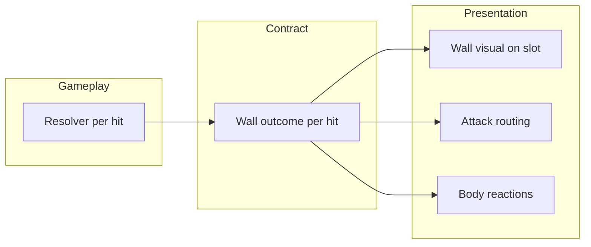

# Combat Wall Visual & Targeting — Abstract Plan (v2)

> **Purpose:** Goal-oriented direction for wall presentation and attack targeting.  
> **Audience:** Design, Codex planning, implementation leads — use this to align on *why* and *what good looks like* before diving into files.  
> **Detailed companion:** [COMBAT_WALL_VISUAL_AND_TARGETING_PLAN.md](COMBAT_WALL_VISUAL_AND_TARGETING_PLAN.md) (v1 — concrete audit, contracts, checklists).  
> **Status:** Direction note. Wall presentation shipped after this was written (`CombatWallVisual`). This file is the goal statement, not a task list.

---

## 1. North Star

Players should **see and feel** when a wall is up, when an attack hits it, when it breaks, and when something gets through — without guessing from damage numbers alone.

Walls are a **defensive intercept layer** in front of the chainling. Attacks that respect the wall **play to the wall**; attacks that bypass it **play to the body**. Presentation must follow **what actually happened on each hit**, not what was true when the move started.

We unify **mitigation windows** and **full barriers** under one player-facing idea: **wall**. Same visual language; resolver still distinguishes rules underneath.

---

## 2. What We Are Building (Outcomes)

### 2.1 One lightweight wall on each slot

- A **single sprite** per active wall, parented at the slot’s barrier anchor.
- **Motion carries meaning** (DOTween): rise from ground, react on hit, sink on break — not flipbook prefab phases or per-move impact libraries for the wall itself.
- **Per-move identity** comes from the **move that created the wall** (sprite/tint on the move definition), not from a separate VFX catalog entry per wall move.

### 2.2 Three wall moments (player-readable)

| Moment | Player should read… | Animation character (from design intent) |
|--------|---------------------|------------------------------------------|
| **Raise** | “Something just went up between us.” | Grows from the ground, slight ease/overshoot — grounded, not a pop-in overlay. |
| **Hit** | “That connected with the wall.” | Shove back, brief stretch upward, quick recoil — the wall took the blow. |
| **Break** | “The wall is gone.” | **Not** a hit reaction on the breaking strike; sink back into the ground, then combat continues on the body. |

### 2.3 Attacks route to the intercept

While a wall is **actively intercepting** a hit:

- **Melee** closes on the **wall**, not the chainling silhouette.
- **Ranged** **lands on the wall**, not the body target.
- **Bypass** (modifiers, chemistry, statuses, future contact-specific rules) restores **body targeting** for that hit only.

Move identity VFX (cast, slash, bolt, impact sparks) **stay as they are** — we are only changing **where the beat lands** and **what object reacts**.

---

## 3. Core Principles

### 3.1 Gameplay truth before animation polish

Wall visuals must reflect **resolver outcomes per hit**. If we animate against a snapshot taken at move start, multi-hit and mid-move breaks will lie to the player.

**Order of work:** classify each hit → emit a clear outcome → animate from that outcome.

### 3.2 One story per hit

Each strike should have an unambiguous narrative:

- **Mitigated through wall** — wall reacts; body may still take **reduced** damage.
- **Fully blocked** — wall absorbs; body does not take the hit beat.
- **Break-through** — wall ends on this hit; **no** wall hit animation on that same strike; body takes the post-break beat.
- **Bypass** — wall ignored for this hit; normal body targeting and reactions.

These are **different stories**. Conflating “break + damage” with “mitigate + chip” erodes trust in defensive play.

### 3.3 Walls are not move VFX

Persistent wall = **slot state presentation**.  
Move VFX = **attacker expression**.

Do not fold wall lifecycle into `CombatVFXLibrary` barrier phases or attack presentation tracks. Retire wall-specific prefab fallbacks; preserve chainling attack pipelines entirely.

### 3.4 Authoring follows data, not checkboxes

A move **is** a wall move when its **utilities or tags** say it places a wall — not when a designer toggles an unrelated flag. Art fields appear when data says the move belongs to this family; warn when art and data disagree.

---

## 4. Strategic Depth We Are Supporting

### 4.1 Bypass as a readable counter-play

Bypass effects matter because players **see** the attack go to the body while the wall is still visible (or they see the wall ignored on the first hit only). Presentation must respect **per-hit** bypass, including effects that apply only to **first hit**, **ranged only**, or **melee only** as those rules are added.

Today bypass is largely hit-index and status driven; **contact-type-aware bypass** should be a first-class extension without rewriting the wall system again.

### 4.2 Multi-hit as a sequence, not one lump

Hit-budget walls create tactical moments: a **3-hit or 4-hit move** can chew through a **2-hit wall** and still have remaining strikes reach the chainling.

**Good UX (target):**

1. Early hits — wall hit reactions; damage may be reduced.
2. Breaking hit — break/sink (not a redundant wall hit if the strike also ends the wall and damages the body).
3. Remaining hits — body targeting and normal hit reactions.

We accept that **perfect melee re-lunging** for every post-break hit may be a later polish tier; **correct outcome storytelling** (wall vs body per hit) is the requirement.

### 4.3 Break vs mitigate on the same turn

Players will notice if a wall **breaks and damages** in one strike but looks like a **soft wall tap** followed by unrelated damage. Direction:

- **Break-through:** break animation → then body consequence.
- **Mitigate while standing:** wall hit → reduced body consequence.
- **Break with no body damage:** sink only (budget/timer expired without a damaging beat).

---

## 5. System Shape (Conceptual, Not Prescriptive)

- **Resolver** decides intercept mode and wall lifecycle changes.
- **Contract** carries enough per-hit context for presentation (index, bypass, break, mitigate, wall source move).
- **Wall visual** owns raise / hit / break motion and move-authored sprite.
- **Attack routing** chooses wall vs body anchor from **that hit’s** outcome.
- **Body reactions** run when the body actually took the beat — not by default on every damage event.

Existing slot **barrier anchors** and much of **melee/projectile aim logic** already point at the right idea; the gap is **per-hit truth** and **animated wall state**, not greenfield architecture.

---

## 6. Move Identity & Art

- **Sprite** (and optional tint/scale) lives on the **move definition** for moves that place walls.
- At runtime, the active wall remembers **which move created it**; presentation loads that move’s art.
- **Global defaults** cover missing art; distinct moves (`barrier_wall`, `ice_wall`, …) should be visually distinguishable when authored.
- **Animation timing** stays shared/global so all walls feel like one system with different skins.

---

## 7. What We Retire vs Keep

| Retire (wall-only legacy) | Keep (attack / chainling) |
|---------------------------|---------------------------|
| Separate persistent/impact/break wall prefab chains | Move cast, projectile, impact VFX |
| Wall phases in the move VFX library used only for shields | Presentation tracks on species/moves |
| Static prefab spawn with no lifecycle animation | Popups (`WALL`, `BROKEN`, `BLOCKED`) as optional text layer |
| Move-start-only “had barrier” routing for entire attack | Outline flash / pacing profile colors |

---

## 8. Success Criteria (Review Gate)

1. **Readable:** A playtester can tell wall up / wall hit / wall broken / bypass / body hit without reading the log.
2. **Honest:** Multi-hit that breaks a hit-budget wall mid-move shows wall phase then body phase.
3. **Differentiated:** Break-through does not double-play wall hit + break on the same strike.
4. **Strategic:** Bypass builds visibly go to the body; non-bypass goes to the wall for melee and ranged.
5. **Lightweight:** One sprite system per slot; no wall-specific prefab library to maintain.
6. **Isolated:** Chainling attack VFX and frame-authored move presentation unchanged.
7. **Data-driven art:** Wall moves get sprites from move definitions; wall-move detection is utility/tag derived.

---

## 9. Phasing (Goals, Not Sprints)

| Phase | Goal |
|-------|------|
| **A — Truth** | Each hit exposes enough outcome for presentation to choose wall vs body and hit vs break vs bypass. |
| **B — Wall object** | Animated wall on slot with move-authored sprite and shared motion profile. |
| **C — Routing** | Presenter follows per-hit outcomes; multi-hit sequences tell wall-then-body stories. |
| **D — Cleanup** | Remove deprecated wall VFX paths; document authoring for designers. |

Optional later tiers: re-lunge melee after break, per-hit projectile re-aim polish, contact-specific bypass in data.

---

## 10. Open Questions (Resolve During v1 Implementation)

- After wall break on a multi-hit melee, is **attacker position frozen at wall** acceptable for v1 if body hits still read clearly?
- Should **mitigated chip damage** show popup on body, wall, or both?
- Do we need a dedicated **wall expired** beat when timer runs out without an attack?
- When two wall moves refresh the same slot, is **latest move’s sprite** always correct for design?

---

## 11. Relationship to Other Work

| Doc | Relationship |
|-----|--------------|
| [COMBAT_WALL_VISUAL_AND_TARGETING_PLAN.md](COMBAT_WALL_VISUAL_AND_TARGETING_PLAN.md) | **v1** — implementation detail, payloads, file references, QA matrices |
| [COMBAT_MODIFIER_RESOLVER_AND_POPUP_PLAN.md](COMBAT_MODIFIER_RESOLVER_AND_POPUP_PLAN.md) | Parallel pattern: structured outcomes before presentation; barrier bypass modifiers must align |
| [Combat_VFX_Presentation_Setup_Guide.md](Combat_VFX_Presentation_Setup_Guide.md) | Update wall section only; move/species VFX guide stays |
| Moves data / importer | Wall utilities must exist on assets for walls to function; art is authored on move SO |

---

## 12. One-Line Summary

**Make walls a honest, animated intercept in front of each slot — motion from a single sprite, identity from the move that raised it, attack aim from per-hit resolver truth — without touching how chainlings perform their moves.**
