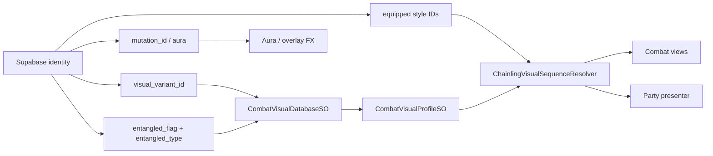

# Combat Visual Authoring Pipeline

## Source Of Truth

Combat body variants, entangled type art, and animation cosmetics resolve from stable IDs, not scene references.



Hierarchy:

1. **Species** — combat data (`SpeciesDefinitionSO`)
2. **Variant** — cosmetic skin (`visualVariantId`, including required `base`)
3. **Entangled** — fully baked variant × type body profiles when `entangled_flag` is true

`visualVariantId` is never rewritten to `"entangled"`. Entangled is a separate flag + type.

Mutation is a third independent rarity layer (aura / glow / particles), not baked body art.

## Asset Layout

```
Assets/Data/Combat/ChainlingSpecies/Visual/<Species>/
  base/
    Visual_<Species>_base.asset
    Entangled/
      Visual_<Species>_base_Node.asset
      ...
  <variantId>/
    Visual_<Species>_<variantId>.asset
    Entangled/
      Visual_<Species>_<variantId>_<Type>.asset
```

Optional catalog: `ChainlingSpeciesVisualSetSO` (species → variants → entangled profiles).  
Each catalog variant has a **rarity tier label** (Common…Mythic). It does **not** store spawn weight.  
Flat registration also works on `CombatVisualDatabaseSO` entries (`speciesId`, `visualVariantId`, `entangledType`).

## Resolve Rules

`CombatVisualDatabaseSO.GetProfile(speciesId, visualVariantId, entangledType)`:

1. Exact variant × type (when entangled)
2. Variant base (non-entangled profile)
3. Species `base` variant
4. Database fallback profile

## Encounter Rarity (stacked)

Independent rolls in `EncounterRollService`:

| Layer | Lever | Notes |
|---|---|---|
| Entangled | `WildRollConfig.entangledChance` (+ zone override) | One chance; type uniform from allow-list |
| Variant | `WildVariantRarityTableSO` (+ zone/area tier multipliers) | `rarity` = odds-tier label; `weight` = numeric spawn odds |
| Mutation | `WildMutationRarityTableSO` (+ tier multipliers) | Include Common `none`; non-none → `auraId` |

A wild Chainling can be rare skin + entangled + mutated at once (product of odds).

## Adding A Body Variant

1. Open `Assets/Data/Combat/ChainlingSpecies/Visual/Database/CombatVisualDatabase.asset`.
2. Body Variant Tools → duplicate source as variant (`base` required per species).
3. Fill baseline animation slots on the new profile.
4. Click **Ensure Entangled Type Slots** to scaffold baked type profiles under `Entangled/`.
5. Drop sprites into those profiles as art lands.
6. Run **Validate Registered Profiles**.
7. Register the skin on a `ChainlingSpeciesVisualSetSO` with catalog rarity (tier label only).
8. Add the same id to a `WildVariantRarityTableSO` with spawn `weight`. Table `rarity` is the odds-tier used by encounter multipliers — keep it aligned with the catalog tier.
9. Run **Tools/Chainbound/Combat/Validate Variant Catalog**.

## Adding Mutation FX

1. Author an aura/overlay cosmetic with a stable `mutationId`.
2. Add it to `WildMutationRarityTableSO` with a rarity + weight (`none` stays Common-dominant).
3. Assign the table on area/zone encounter config.

## User-Facing Animation Slots

| Slot | Baseline profile field | Equipped identity field |
|---|---|---|
| Variant | `visualVariantId` via `CombatVisualDatabaseSO` | `visualVariantId` |
| Entangled body | variant × `entangledType` profile | `entangled_flag` + `entangled_type` |
| Mutation FX | aura/overlay definitions | `mutation_id` / `auraId` |
| Idle Loop | `idleSequence` | `idleStyleId` |
| Idle Flourish | profile alternate or cosmetic metadata | `idleFlourishId` |
| Swap In | `swapInSequence` | `swapInFxId` |
| Swap Out | `swapOutSequence` | `swapOutFxId` |
| KO | `koSequence`, falling back to `swapOutSequence` when empty | `koFxId` |
| Melee Strike | `meleeAttackSequence` | `meleeAttackStyleId` |
| Ranged Strike | `rangedAttackSequence` | `rangedAttackStyleId` |
| Hit Reaction | `hitSequence` | `hitReactionStyleId` |
| Attacker KO Taunt | profile alternate or cosmetic metadata | `attackerKoStyleId` |
| Victory | victory pose cosmetic metadata | `victoryPoseId` |

## Animation Alternates

Profile alternates let one equipped cosmetic ID resolve to different sprite strips per body variant. Resolution priority:

1. Current `CombatVisualProfileSO.animationAlternates` matching `(slot, equippedStyleId)`.
2. Embedded cosmetic body/pose sequence as migration fallback.
3. Current profile baseline sequence.
4. KO only: profile `swapOutSequence` if `koSequence` is empty.

## Backend Boundary

Supabase persists:

- `visual_variant_id` — cosmetic skin
- `entangled_flag` + `entangled_type`
- `mutation_id` (+ `visual_identity.aura_id` when mutated)
- Remaining equipped cosmetic ids in `visual_identity` JSON

Migration: `Supabase/migrations/20260812010000_chainling_entangled_type_and_mutation_id.sql`.

## On-Chain Boundary

Current Solana/Anchor code does not store combat visual identity or animation cosmetics. This pipeline is Supabase and Unity-catalog driven.
