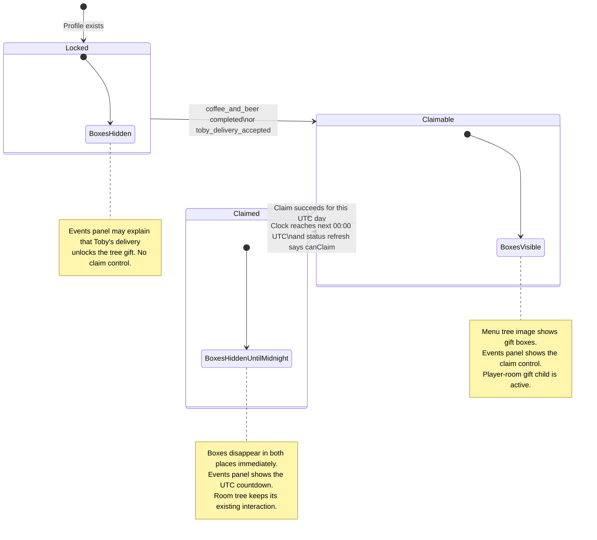
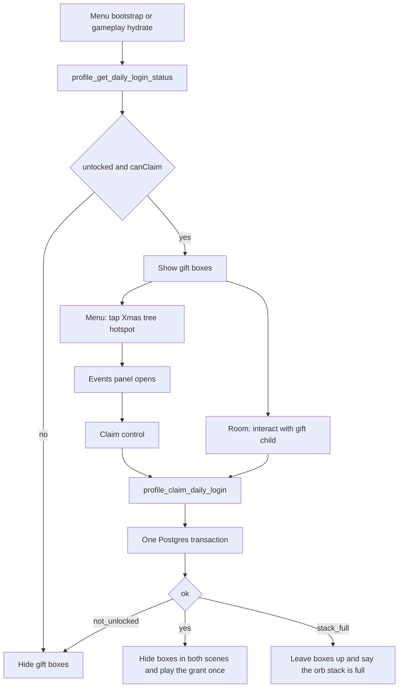

# Daily login gift v1

**Status:** Implemented (v1), not yet deployed to the hosted project. See "Implementation notes" at the end.
**Locked:** 2026-10-29
**Audience:** The agent implementing this. Read this file before writing code.

Player-facing name: **daily gift**. Internal name: daily login. One claim per profile per UTC day, after The Professor's Order is complete. The gift is **10 RAM** and **1 Signal Orb** (`signal_orb`).

## Skills for the implementing agent

Use this set, in this order:

1. `systems-first-architecture` — one service, two dumb presenters. No story branch inside the claim function.
2. `chainbound-economy-playbook` — RAM stays the currency. This gift is a small faucet with a hard once-per-UTC-day lock.
3. `supabase` and `supabase-postgres-best-practices` — before writing the migration, function, or RLS.
4. `unity-mobile-psg1-ui` — claim control must work with touch and gamepad. No hover-only affordance.
5. `unity-cli` — if a Unity Editor is connected, wire `main_menu.unity`, `player_room.unity`, and `EventsPanel.prefab` through it. Do not hand-edit those YAML files while the Editor can take the change.

Do not use a Solana skill. This path does not touch the Anchor program, wallet instructions, or `ClosedBetaFeaturePolicy`.

## Locked decisions

| Question | Decision |
|---|---|
| When does the gift reset? | **Fixed UTC calendar day.** Window key is `(now() AT TIME ZONE 'UTC')::DATE`. The next gift exists at **00:00 UTC**, not 24 hours after the previous claim. |
| Does the 10 RAM count toward the 100/UTC-day earn cap? | **No.** Same class as a shop purchase. Credit `player_profiles.ram_balance`, write a settled ledger row, and **do not** read or write `ram_daily_earnings`. A profile already at 100 earned RAM still receives 10. |
| What completes the coffee quest? | The whole quest `coffee_and_beer` (The Professor's Order), not the `fetch_coffee` objective alone. Toby's handoff is the end of that quest. |
| Streak / reward pass | **Persist the streak. Do not show it.** v1 always pays 10 RAM + 1 Signal Orb. |

A claim at 23:55 UTC and another at 00:05 UTC are two legal claims. That is the accepted shape of a midnight reset.

## Out of scope

- Streak UI, a 7-day stamp card, escalating rewards, or a paid reward pass.
- Push notifications.
- A world flag meaning "claimed today". World flags are booleans and have no day clock.
- `Step_ApplyQuestReward`, `chainbound_quest_rewards`, or `profile_apply_quest_reward_tx`. That path is one-shot per `reward_id` and **counts quest RAM toward the 100 cap**.
- A client-supplied RAM amount or item id. The server settings row owns both.
- New asmdefs. New folders. Anchor / Seeker / closed-beta policy edits.
- Replacing the Xmas tree art, the events news feed, or the tree's existing interaction profile.

## What already exists (use these, do not reinvent them)

| Piece | Where | Use |
|---|---|---|
| Quest id | `Quest_CoffeeAndBeer.asset` → `coffee_and_beer` | Server eligibility. `autoCompleteWhenObjectivesComplete` is on. `coffee_toby_objective.asset` completes `deliver_to_toby`. |
| Unlock flag | `world.coffee.toby_delivery_accepted`, set by `coffee_toby_accepted_flag.asset` in `coffee_toby_handoff_sequence` | Second eligibility fact. It is stored in `player_profiles.progression_state` and hydrated by `ProfileWorldFlagStateService`. |
| Quest rows | `public.profile_quest_states` | `lifecycle = 'completed'` for `coffee_and_beer`. |
| Item grant | `public.profile_apply_profile_item_delta_tx` | Grants `signal_orb`. Catalog max stack is **99**. The function **clamps** at max stack and still returns `ok`. It does not fail. |
| RAM ledger | `public.ram_ledger_operations` | Every balance change needs a settled row or `ram_v2_audit_service` breaks. `wallet_address` is nullable (`20261009010622`). |
| Cap table | `public.ram_daily_earnings` | Battle and quest RAM only. This feature must not touch it. |
| Reviewed RAM writers | `Supabase/functions/_shared/ram_ledger_guard_test.ts` | A new migration that writes `ram_balance` must be added to `allowedWriters` or this test fails. |
| Quest reward client | `Assets/Scripts/Combat/Runtime/Services/QuestRewardService.cs` | Copy the auth, balance-store, and inventory-invalidation pattern. Do not call it. |
| Edge auth | `resolveAuthenticatedProfile` in `Supabase/functions/_shared/account_helpers.ts` | The JWT profile is the caller. Ignore a client-sent profile id as authority. Pattern: `Supabase/functions/profile_apply_quest_reward/index.ts`. |
| Main menu tree | `MainMenuSequenceController2.xmasTreeHotspot` opens `EventsPanelController` | Keep that. The events panel is a news feed (`MainMenuEventsFeedSO`). Add a gift block under the feed. |
| Player room tree | `player_room.unity` object `XmasTree` | It already has a quest interaction bridge whose `defaultProfile` is `chainbound_intro_monitor_profile`. Leave that profile alone. |
| Menu vs gameplay hydration | Main menu runs `MainMenuFlowOrchestrator.BootstrapProfile`. `QuestService` hydrates later, in gameplay, via `NarrativeProfileStateCoordinator`. | The menu **cannot** ask `QuestService` whether coffee is done. Both scenes ask the daily-login status RPC. |

## Eligibility

Unlocked when either fact is true on the server:

- `profile_quest_states` has `quest_id = 'coffee_and_beer'` and `lifecycle = 'completed'`, or
- `player_profiles.progression_state->>'world.coffee.toby_delivery_accepted'` is boolean `true`.

Check both. The handoff sequence writes the flag and the quest completion through separate outboxes, so one can land first. A profile that only finished `fetch_coffee` stays locked.

Until the status RPC returns `unlocked = true` and `canClaim = true`, gift boxes stay hidden. A failed or missing status fetch **hides** the boxes. Do not show a claimable gift you have not confirmed.

## Player flow

Claiming from either surface spends the same UTC day. The other surface hears one service event and removes its boxes. Do not keep a second local "claimed" flag.

## Server

### Settings row

`public.daily_login_settings`, one row:

| Column | v1 value |
|---|---|
| `singleton` | `true` (primary key, check constraint forces the single row) |
| `enabled` | `true` |
| `ram_amount` | `10` |
| `item_id` | `signal_orb` |
| `item_quantity` | `1` |
| `quest_id` | `coffee_and_beer` |
| `unlock_flag_key` | `world.coffee.toby_delivery_accepted` |

RLS on, revoke from `PUBLIC` / `anon` / `authenticated`, grant to `service_role` only. The claim function reads this row. Changing the gift later is an update to this row, not a client change.

### Claim history

`public.profile_daily_login_claims`:

| Column | Notes |
|---|---|
| `player_profile_id` | FK to `player_profiles` |
| `utc_day` | `DATE`. Together with the profile id this is the primary key. |
| `streak_after` | Integer stored for a later pass. v1 does not display it. |
| `ram_amount` | Amount credited (10). |
| `item_id`, `item_quantity` | What was granted. |
| `operation_id` | Ledger operation id. |
| `claimed_at` | `timestamptz`, default `now()`. |

Also keep one summary row per profile, `public.profile_daily_login`:

| Column | Notes |
|---|---|
| `player_profile_id` | Primary key. |
| `last_claim_utc_day` | Last successful day. |
| `current_streak` | See streak rule below. |
| `longest_streak` | Max of `current_streak`. |
| `total_claims` | Increment by 1. |

Streak rule, applied inside the claim transaction and not shown in v1 UI:

- If `last_claim_utc_day` is exactly yesterday's UTC date, `current_streak` becomes `current_streak + 1`.
- Otherwise `current_streak` becomes `1`.
- A missed UTC day resets the stored streak. There is no 48-hour grace in v1.

### Claim transaction

Function: `public.profile_claim_daily_login_tx(p_profile_id UUID) RETURNS JSONB`.

`SECURITY DEFINER`, `search_path = public`. Revoke from `PUBLIC` / `anon` / `authenticated`. Grant execute to `service_role` only.

`v_day := (now() AT TIME ZONE 'UTC')::DATE`. The client clock is not an input.

Do every reject **before** the first insert. A later `RETURN jsonb` error does **not** roll back earlier writes in the same function. After the first insert, failures must `RAISE EXCEPTION` so the claim row, item mutation, and RAM credit roll back together.

Order:

1. Reject a null profile, missing profile, or `enabled = false` (`disabled`).
2. `SELECT ... FROM player_profiles WHERE player_profile_id = p_profile_id FOR UPDATE`.
3. Eligibility. Fail with `not_unlocked` when both the quest and the flag are absent.
4. If a claim row exists for `(p_profile_id, v_day)`, return `ok: true`, `already_claimed: true`, the stored RAM amount, and the current balance. Do not grant again.
5. Read `signal_orb` quantity. If `quantity >= max_stack`, return `ok: false`, `error: stack_full`. Do **not** insert a claim. The player can use an orb and claim later the same UTC day. `profile_apply_profile_item_delta_tx` would otherwise clamp to 99, return `ok`, and eat the day for 0 orbs.
6. Insert the claim row. Primary key `(player_profile_id, utc_day)` is the lock against a double claim.
7. Call `profile_apply_profile_item_delta_tx` with idempotency key `daily-login:` concatenated with `v_day::text`, grants `[{item_id, item_quantity}]`, consumes `[]`. If `ok` is not true, `RAISE EXCEPTION`.
8. Build `operation_id` the same way quest rewards do: `md5(profile_id || ':daily-login:' || v_day)` formatted as a UUID. Insert one settled `ram_ledger_operations` row:
   - `operation_kind = 'daily_login'`
   - `direction = 'credit'`
   - `amount = ram_amount` (must be `> 0`; the ledger check rejects 0)
   - `state = 'settled'`
   - `wallet_address = NULL`
   - `cluster` from `battle_reward_settings.singleton`, and it must be `devnet` or `mainnet-beta`
   - metadata: `utc_day`, `idempotency_key`, `reward = daily_login`, `streak_after`
9. `UPDATE player_profiles SET ram_balance = ram_balance + ram_amount` with the same `<= 4294967295` guard quest rewards use. Overflow raises.
10. Upsert `profile_daily_login` with the streak rule.
11. Return `ok: true`, `already_claimed: false`, `utc_day`, `next_claim_at` (start of the next UTC day, as `timestamptz`), `server_now`, `ram_balance`, `ram_balance_version`, `ram_amount`, `item_id`, `item_quantity`, `streak_after`.

Do not open a `ram_daily_earnings` row. Do not add the 10 to `earned`.

Lock order: `player_profiles` → claim insert → item delta (that function locks stacks) → `ram_ledger_operations` → balance update. Never lock `ram_daily_earnings` here.

### Status read

`public.profile_get_daily_login_status_tx(p_profile_id UUID) RETURNS JSONB`.

Read-only. Same eligibility rule. Return:

| Field | Meaning |
|---|---|
| `ok` | Profile exists. |
| `enabled` | Settings row. |
| `unlocked` | Coffee quest or Toby flag. |
| `canClaim` | `unlocked` and no claim row for today's UTC date. |
| `utcDay` | Today's UTC date. |
| `serverNow` | `now()`. |
| `nextClaimAt` | Start of the next UTC day when today is already claimed. Null when `canClaim` is true. |
| `currentStreak` | From the summary row, or 0. The client stores it and does not render it. |
| `ramAmount`, `itemId`, `itemQuantity` | From the settings row, so the panel can label the gift before the claim. |

### Edge functions

Follow `profile_apply_quest_reward`:

- `Supabase/functions/profile_get_daily_login_status/index.ts`
- `Supabase/functions/profile_claim_daily_login/index.ts`

`requirePost`, `resolveAuthenticatedProfile`, then the RPC. Map the JSON keys to the snake_case shape `QuestRewardService` already expects from `JsonUtility` (`ram_balance`, `ram_balance_version`, `already_claimed`, `can_claim`, `server_now`, `next_claim_at`, `item_id`, `item_quantity`, `ram_amount`, `error`).

`stack_full` and `not_unlocked` are 409 responses with `ok: false`. `already_claimed` is 200 with `ok: true`.

## Client

### Assembly

`DailyLoginRewardService` lives in `Assets/Scripts/Combat/Runtime/Services/`, next to `QuestRewardService.cs`. That folder compiles into `Chainbound.Combat.Runtime`.

Presenters and scene components live in `Assembly-CSharp`:

- `Assets/Scripts/UI/DailyLoginGiftVisual.cs` — toggles a serialized child from the service.
- `Assets/Scripts/UI/DailyLoginClaimPresenter.cs` — shows both grants.
- `Assets/Scripts/World/DailyLoginTreeGift.cs` — room interact volume.
- Edits to `Assets/Scripts/UI/MainMenu/EventsPanelController.cs`.

`Chainbound.Combat.Runtime` must not reference `SignalJam.UI.MenuNavigation` or `ItemObtainPresenter`. The service exposes state and events. UI listens.

`ItemObtainPresenter.Show(itemId, quantity)` can show the orb only. Do not call it twice and drop the RAM line. `DailyLoginClaimPresenter` shows both lines: `10 RAM` and `Signal Orb x1`. Match the obtain panel's visual language if that is cheap. One dismiss control, touch and gamepad Submit / Interact.

### Service

`DailyLoginRewardService` is a single `DontDestroyOnLoad` (or GameServices child) MonoBehaviour, created the same way as `QuestRewardService.EnsureInstance`.

State:

- `Unlocked`, `CanClaim`, `Enabled`
- `ServerNowUtc`, `NextClaimAtUtc`, `UtcOffset` (`serverNow - DateTime.UtcNow` at the moment the payload arrived)
- `RamAmount`, `ItemId`, `ItemQuantity`
- `CurrentStreak` (not for UI)
- `RefreshAsync()` and `ClaimAsync()`

Events: `OnStatusChanged`, `OnClaimSucceeded` (first grant only), `OnClaimRejected(error)`.

`OnClaimSucceeded` fires when `already_claimed` is false. A replay with `already_claimed: true` only refreshes status so boxes hide, and does not play the ceremony again.

On success, do what `QuestRewardService` does: `PlayerRamBalanceStore.TryApplyAuthoritative`, `PlayerProfileReadStore` inventory stale, `CoreBagItemInventoryService.ClearItemInventoryCache`.

Refresh:

- After main-menu `BootstrapProfile` succeeds.
- After `NarrativeProfileStateCoordinator` becomes ready in gameplay.
- When `ProfileWorldFlagStateService.OnFlagChanged` reports `world.coffee.toby_delivery_accepted`. That covers walking from the lab back to the room in the same session, before a full reboot.
- When the events panel opens.
- When the estimated server time reaches `NextClaimAtUtc`.
- On application resume.

Estimated server time is `DateTime.UtcNow + UtcOffset`. Crossing that timestamp **requests status**. It does not show the boxes by itself. The phone clock never grants the gift.

While a claim is in flight, ignore a second tap (`collectInFlight` on `WorldPickupGrant` is the pattern). Hold an `InputLockHandle` from `InputLockService` during the room claim.

### Main menu

`xmasTreeHotspot` still opens the events panel. Add a child under that hotspot, assigned to `DailyLoginGiftVisual`. Active only when `CanClaim` is true.

`EventsPanelController` keeps the news title and body. Below that:

| Status | Panel |
|---|---|
| Not loaded, or request failed | No gift block. |
| Loaded, not unlocked | Short line: the tree gift opens after Toby's delivery. No button. |
| Unlocked, `CanClaim` | Gift box graphic and one button: claim 10 RAM and 1 Signal Orb. Gamepad can focus it. |
| Unlocked, already claimed | Gift graphic hidden. One line: next gift at the UTC countdown `HH:MM:SS`, ticked from the server offset. |

The menu claim button calls `ClaimAsync`. Success hides the hotspot boxes and the panel graphic in the same event.

### Player room

Under `XmasTree`, add a child for the gift meshes and a **separate** interact volume. `DailyLoginTreeGift` enables that child only when `CanClaim` is true.

Do not change `XmasTree`'s `defaultProfile` (`chainbound_intro_monitor_profile`). When the gift child is off, the tree's existing interaction stays as authored. Do not add a "come back tomorrow" dialogue on the tree in v1. The countdown lives on the events panel.

On interact: lock input, `ClaimAsync`, then the claim presenter. `stack_full` copy: "Your Signal Orb stack is full. Use one, then claim today's gift." Leave the boxes up.

There is no gift-box sprite in `Assets/Sprites` today. A placeholder sprite is enough to ship the behavior. Put menu art beside the existing Xmas tree frames under `Assets/Sprites/UI/MainMenu/MainMenuRefactor/XmasTree/`. Put the room visual beside `Assets/Sprites/Loomville/Player_Room/`. Do not block the service and SQL on final art.

## Tests

### pgTAP

New suite `Supabase/tests/daily_login_reward_v1.sql`, same style as `Supabase/tests/quest_reward_daily_cap_v1.sql`.

| Case | Expect |
|---|---|
| No quest and no flag | `not_unlocked`. No claim row. Balance unchanged. |
| `fetch_coffee` complete, quest still active, flag false | Still `not_unlocked`. |
| Quest `completed` | `canClaim`. |
| Flag true, quest row absent | `canClaim`. |
| First claim | Balance `+10`, one `signal_orb`, one settled `daily_login` credit, `ram_daily_earnings` unchanged. |
| Second claim same UTC day | `already_claimed`. Balance and stack unchanged. |
| Claim while `ram_daily_earnings.earned = 100` | Still `+10`. `earned` stays 100. |
| Stack already at `max_stack` | `stack_full`. No claim row. Balance unchanged. A later claim the same day works after the stack has room. |
| Two concurrent claims | One grant. The unique `(profile, utc_day)` key makes the other `already_claimed` or a rollback. |
| `ram_v2_audit_service` | Balanced for every profile the suite touches. |

Freeze `now()` with `SET LOCAL` or a fixed transaction timestamp if the suite would otherwise flake around midnight. Assert `next_claim_at` is the next `00:00 UTC`, not `claimed_at + 24 hours`.

### Ledger guard

In `ram_ledger_guard_test.ts`:

- Add the new migration filename to `allowedWriters`.
- Add a content test: the migration inserts `'daily_login', 'credit'`, sets `ram_balance = ram_balance +`, and does **not** contain `ram_daily_earnings`.

### Play mode

- Menu, coffee incomplete: tree has no gift boxes. Events panel has no claim button.
- Menu, coffee complete, unclaimed: boxes visible. Claim from the panel. Boxes disappear. Panel shows a countdown. RAM and Signal Orb counts move.
- Room, same profile, same day: no gift child.
- Room, next UTC day (or a test clock): gift child is back. Claiming there hides the menu boxes on the next menu visit.
- Double tap does not grant 20 RAM.
- Phone clock set ahead does not show boxes until the status RPC says `canClaim`.

## Doc touch-ups in the same change

- `Docs/INDEX.md` — move the daily gift row from "not implemented" to the real status once the code lands.
- `Docs/Specs/Economy/ECONOMY_01_EconomyAndProgression_v1.md` — one sentence: the daily gift's 10 RAM is excluded from the 100/UTC-day earn cap, same as purchased RAM. Battle and quest RAM stay inside the cap.
- `Docs/review-unimplemented/Guides/RAM_00_Immediate_Battle_Reward.md` is historical. Do not treat it as the spec. A single cross-reference is enough if you touch it at all.

## Build order

1. Migration, pgTAP, ledger-guard test.
2. The two edge functions.
3. `DailyLoginRewardService` and a focused edit-mode test around status parsing and "replay does not celebrate".
4. Events panel and menu gift visual.
5. Player-room gift child and interact volume, without editing the tree's quest profile.
6. The economy sentence and the index status.

## File checklist

| Path | Action |
|---|---|
| `Supabase/migrations/<timestamp>_daily_login_reward.sql` | Create |
| `Supabase/tests/daily_login_reward_v1.sql` | Create |
| `Supabase/functions/_shared/ram_ledger_guard_test.ts` | Add the writer |
| `Supabase/functions/profile_get_daily_login_status/index.ts` | Create |
| `Supabase/functions/profile_claim_daily_login/index.ts` | Create |
| `Assets/Scripts/Combat/Runtime/Services/DailyLoginRewardService.cs` | Create |
| `Assets/Scripts/UI/DailyLoginGiftVisual.cs` | Create |
| `Assets/Scripts/UI/DailyLoginClaimPresenter.cs` | Create |
| `Assets/Scripts/World/DailyLoginTreeGift.cs` | Create |
| `Assets/Scripts/UI/MainMenu/EventsPanelController.cs` | Add the gift block |
| `Assets/Prefabs/UI/MainMenu/EventsPanel.prefab` | Wire the block |
| `Assets/Scenes/main_menu.unity` | Gift child on the Xmas tree hotspot |
| `Assets/Scenes/player_room.unity` | Gift child under `XmasTree` |
| `Docs/Specs/Economy/ECONOMY_01_EconomyAndProgression_v1.md` | One cap sentence |
| `Docs/INDEX.md` | Status |

## Implementation notes (2026-10-30)

Corrections found while building v1. They override the sections above where they disagree.

- **The Toby flag does not reach the server today.** `profile_set_progression_flag` accepts only `^[a-z][a-z0-9_]{1,63}$`, so `world.coffee.toby_delivery_accepted` (and every other dotted `world.*` key) is rejected with `invalid_flag_key`. The SQL still checks the flag as specified, but in practice only the `coffee_and_beer` quest row unlocks the gift. Fixing the regex is a separate change, because loosening it flushes every queued `world.*` flag at once.
- **Room tree profile name.** `XmasTree`'s `defaultProfile` in `player_room.unity` is `chainbound_intro_xmastree_profile`, not `chainbound_intro_monitor_profile`. The rule is unchanged: leave it alone.
- **Refresh triggers live on the Assembly-CSharp side.** `DailyLoginRewardService` is in `Chainbound.Combat.Runtime` and cannot see `NarrativeProfileStateCoordinator` or `ProfileWorldFlagStateService`. `DailyLoginTreeGift` subscribes to them (and refreshes on enable). The service owns the session-change, resume and next-midnight refreshes itself. `MainMenuSequenceController2` refreshes after `BootstrapProfile` succeeds.
- **Extra rejects.** The claim also refuses `cluster_unavailable` (`battle_reward_settings.cluster` is not `devnet` / `mainnet-beta`) and `profile_not_found`, before any write. The edge function maps every `ok: false` to 409.
- **Menu grant feedback is inline.** After a menu claim the events panel shows "Received 10 RAM + Signal Orb x1" above the countdown instead of an overlay, so nothing competes with the menu's input controller. The room uses `DailyLoginClaimPresenter`.
- **Gamepad focus.** `MainMenuPanelControllerBase.SelectablesChanged` lets the events panel tell `MainMenuSequenceController2` to rebuild navigation when the claim button appears or disappears after the async status read.
- **Tests.** `Supabase/tests/daily_login_reward_v1.sql` runs on the RAM shop chain plus `tests/fixtures/daily_login_prerequisites.sql` and the real `20260930120000_profile_item_delta.sql` (the quest-cap fixture stubs the item delta, which can't test orb stacks). Two-session concurrency is its own dblink suite, `daily_login_reward_concurrency_v1.sql`, because it must commit its fixture.
- **Scene wiring.** `Tools/Chainbound/Economy/Wire Daily Gift (Events Panel, Menu Tree, Room Tree)` (`Assets/Scripts/Editor/DailyLoginGiftAuthoring.cs`) builds the events-panel gift block, the menu gift boxes and the room gift child idempotently. `MainMenuObjectNavigationSceneBuilder` reuses it so a menu rebuild keeps the block. Art is a placeholder (`daily_gift_boxes.png`, primitive boxes in the room).
