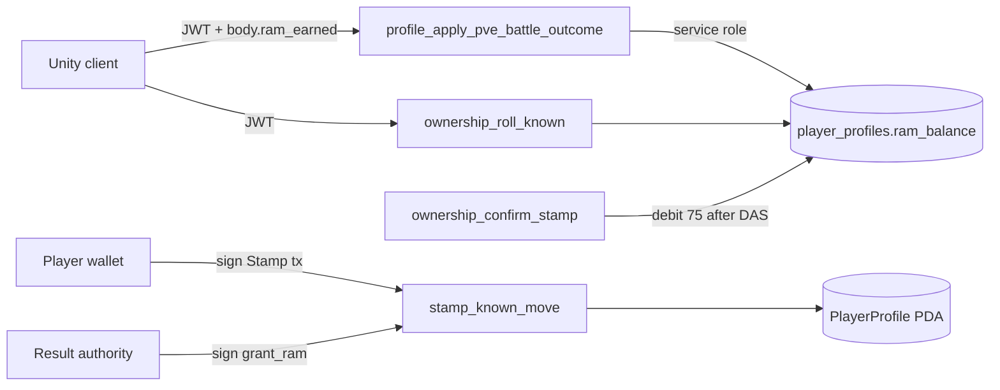

# 01 — RAM Ledger and Balances

**Audit:** Chainbound Ownership/Economy Security Audit  
**Date:** 2026-09-25  
**Mechanism:** Soft-currency RAM (profile ledger + on-chain PlayerProfile)

## Scope & assets

| Asset | Storage | Player-facing |
|---|---|---|
| `player_profiles.ram_balance` | Postgres (service-role Edge) | Primary live soft currency today |
| On-chain `PlayerProfile.ram_balance` | Solana PDA | Used by Stamp/Bind/`grant_ram`; Devnet ownership matrix |
| `player_lifetime_stats.total_ram_earned/spent` | Postgres | Telemetry / lifetime counters |
| Daily cap pin | `RAM_DAILY_CAP = 100` (Edge) / `config.ram_daily_cap` (program) | Applies to **on-chain** `grant_ram` / burn-for-RAM; **not** observed on profile battle credits |

## Faucets

| Name | Amount | Trust boundary | Entrypoint | Idempotency | Caps |
|---|---|---|---|---|---|
| PvE battle win RAM | Client `ram_earned` | Client → Edge JWT → service-role RPC | `profile_apply_pve_battle_outcome` → `profile_apply_pve_profile_lifetime_stats_tx` | Per-chainling battle key for metrics; **lifetime RAM apply has no separate idempotency** | `LEAST(INT_MAX, balance + earned - spent)` only |
| On-chain `grant_ram` | Caller amount (smoke uses 100) | Result authority signer + owner | `grant_ram` in `lib.rs`; Edge smoke prepare/confirm | Receipt PDA keyed by idempotency hash | `apply_capped_ram_grant` vs `ram_daily_cap` |
| Mastery fail payout (spec) | 12 RAM | Spec / client progression path | Spec tables; verify Unity → Edge wiring | Unknown if server enforces | Spec only |
| Salvage | Spec 10/20 | Not found live | — | — | — |
| Bootstrap SQL fund | Operator | Service role / SQL | Matrix plan M1 | N/A | Operator process |

## Sinks

| Name | Amount | Trust boundary | Entrypoint |
|---|---|---|---|
| Known roll | **5** pinned | Edge JWT + SQL `FOR UPDATE` | `ownership_roll_known` / `ownership_roll_known_atomic` |
| First Stamp confirm (profile mirror) | **75** | Edge JWT + DAS verify + SQL | `ownership_confirm_stamp` / `ownership_confirm_stamp_atomic` |
| On-chain Stamp | `ownership_config.stamp_ram_cost` (75) | Wallet + ticket | `stamp_known_move` |
| On-chain Bind | `bind_ram_cost` (250 pin) | Wallet | `bind_chainling` |
| Rebirth | 1000→3000 schedule | Edge JWT + SQL | `profile_rebirth_chainling` |
| PvE defeat penalty | Client `ram_penalty` | Client → Edge | Same lifetime stats RPC (`p_total_ram_spent`) |
| Upgrade move item (legacy) | `p_ram_cost` | Edge + SQL | migrations `profile_upgrade_move_item` / native economy |
| Market / salvage | Spec | Not live | — |

## Trust boundary diagram

## Exploit scenarios

1. **Critical — Infinite / inflated battle RAM:** Authenticated attacker POSTs `player_won:true`, `ram_earned:N` repeatedly (vary `forensic_hash`/`battle_seed` so chainling idempotency differs). Lifetime stats RPC adds N to balance with no daily cap.
2. **High — Dual-ledger arbitrage:** Farm profile RAM via battles while on-chain balance stays low (or smoke-grant on-chain only). Stamp requires **on-chain** RAM; profile debit on confirm can fail after mint if balances diverge → stuck/desync states.
3. **Medium — Defeat self-tax griefing:** Client can set large `ram_penalty` on loss; spent is clamped to balance (cannot go negative) but can wipe soft RAM intentionally or via malware rebuild.
4. **Low — Clock skew on daily cap:** On-chain day boundary uses `Clock::get()?.unix_timestamp` (cluster time). Not Unity local clock. Profile battle faucet has **no** daily cap today.

## Current controls

- Ownership roll/stamp costs hardcoded (`p_ram_cost <> 5` / `<> 75` raises).
- On-chain grants: result authority + receipt PDA + daily cap.
- Smoke grant: beta allowlist + membership in the server-only
  `CHAINBOUND_DEVNET_SMOKE_WALLETS` JSON allowlist.
- RLS: ownership/RAM grant tables revoke anon/authenticated.
- Ownership Unity flags OFF (matrix plan) — limits client Stamp; **does not** stop battle RAM.

## Gaps & severity

| Gap | Severity |
|---|---|
| Client-trusted `ram_earned` / `ram_penalty` | **Critical** |
| No profile-side daily earn cap | **High** |
| Dual ledger without reconciliation job | **High** |
| Lifetime RAM RPC not idempotent across retries of the outer loop | **Medium** |
| Spec market/salvage not implemented (reduces sink surface; also means fewer sinks) | Info |

## Recommended remediations (ordered)

1. Server-author PvE RAM table (standard 3 / elite 15 / boss 50) keyed by verified encounter/battle id; reject client amounts.
2. Add profile `daily_ram_earned` + UTC day reset mirroring on-chain cap (~100) for soft faucet.
3. Single idempotency receipt for battle lifetime apply (profile+battle id).
4. Reconciliation: after Stamp confirm, assert profile debit succeeded or quarantine; never mint without mirrored settle plan.
5. Keep result-authority secret out of Unity (already); rotate if ever logged.

## On-chain: worth it?

**Partial.** Migrating *every* battle credit on-chain is poor UX/fees. Worth keeping **`grant_ram` + daily cap** for bootstrap/premium and Stamp/Bind spends on-chain; **authoritative Edge payouts** for routine PvE.

## Evidence

- `Supabase/functions/_shared/ownership_spine.ts` — `KNOWN_ROLL_RAM_COST=5`, `FIRST_STAMP_RAM_COST=75`, `RAM_DAILY_CAP=100`
- `Supabase/functions/profile_apply_pve_battle_outcome/index.ts` — `p_total_ram_earned: nonNegativeInteger(body.ram_earned)`
- `Supabase/migrations/20260829000100_battle_defeat_ram_penalty.sql`
- `backend/.../lib.rs` — `grant_ram`, `apply_capped_ram_grant`, `spend_ram`
- `Docs/Specs/Economy/ECONOMY_01_EconomyAndProgression_v1.md` — battle RAM table
