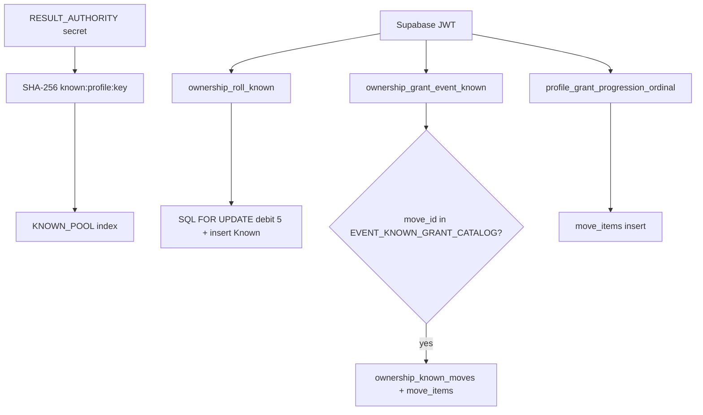

# 02 — Known Roll and Grants

**Audit:** Chainbound Ownership/Economy Security Audit  
**Date:** 2026-09-25  
**Mechanism:** Non-NFT Known move instances (candy roll + event/progression grants)

## Scope & assets

| Asset | Storage | Notes |
|---|---|---|
| `ownership_known_moves` | Postgres | Canonical candy/Stamp Known rows |
| `move_items` (tier `ordinal`) | Postgres | Party/inventory path; event grant dual-writes |
| On-chain Known in `MoveVault` | Solana | Materialized during Stamp prepare if missing |

Player terms: **Known** = non-NFT; never Metaplex.

## Faucets

| Name | Spend | Trust | Entrypoint | Idempotency |
|---|---|---|---|---|
| Candy **roll Known** | 5 RAM | JWT + authority digest pick from `KNOWN_POOL` | `ownership_roll_known` → `ownership_roll_known_atomic` | `(player_profile_id, idempotency_key)` unique |
| **Event Known grant** | 0 RAM | JWT + allowlist `EVENT_KNOWN_GRANT_CATALOG` | `ownership_grant_event_known` | Same unique key — **caller chooses key** |
| Progression ordinal | 0 RAM | JWT + client `move_id` | `profile_grant_progression_ordinal` | Client/default key from star/mastery/seed |
| Capture starter move | 0 | Capture path | `profile_capture_wild_tx` may insert move_item | Capture idempotency |
| Dev `GrantKnown` | 0 | Editor / debug stub | `DevCandyMachineInventory.GrantKnown` | Local memory only |

## Sinks

| Name | Effect |
|---|---|
| Stamp | Consumes Known (`consumed_at`) + on-chain vault remove |
| Spec salvage | Not live |

## Trust boundary diagram

## Exploit scenarios

1. **High — Unlimited event Known:** Call `ownership_grant_event_known` with `move_id: bean_sip` and fresh `idempotency_key` each time. No encounter/boss proof. Dual-writes stampable Known + inventory ordinal.
2. **High — Progression move pick:** Client supplies arbitrary `move_id` and star/mastery indices; server ownership check is chainling ownership + idempotency, not “did this star-up actually occur server-side.”
3. **Medium — Idempotency key grinding on roll:** Keys are client-chosen; outcome is `HMAC-like` digest over secret+profile+key so player can **reroll locally** until desired pool entry **before** paying — if they discard keys without calling. Once called, they pay 5. Mitigated by cost; still allows targeted selection vs server-forced entropy after payment.
4. **Info — Pool mismatch:** Edge `KNOWN_POOL` is a small baseline list; may diverge from Unity catalog / Moves.csv over time.

## Current controls

- Roll: atomic debit+insert; cost must be 5; RLS revoke client; JWT profile binding (`resolveAuthenticatedProfile`).
- Event: allowlist (`bean_sip` only as of review); service_role execute only.
- Stamp path consumes Known with `FOR UPDATE` and `consumed_at`.
- Spoofed `player_profile_id` rejected (matrix M3).

## Gaps & severity

| Gap | Severity |
|---|---|
| Event grant unbound to encounter victory | **High** |
| Progression grant client `move_id` | **High** |
| Client-chosen entropy seed (idempotency) for rolls | **Medium** |
| Dual tables (`ownership_known_moves` vs `move_items`) can drift | **Medium** |
| `vending_config.ramCostGetKnown: 0` vs pin 5 — confusing but roll path enforces 5 | Low |

## Recommended remediations (ordered)

1. Bind event grants to server-verified boss/encounter receipt (or one-time flag); ignore client idempotency as sole uniqueness — use `profile+encounter_id+reward_slot`.
2. Server-select progression move from species pool after authoritative star-up; client sends intent only.
3. Prefer server-generated roll nonce (return commitment) so clients cannot pre-grind digests.
4. Single Known source of truth; make `move_items` a projection.
5. Align `vending_config` GetKnown cost with pin 5.

## On-chain: worth it?

**No** for Known storage (spine says non-NFT). **Partial** for roll entropy (shared VRF ticket) if fair rolls matter commercially; cost/complexity high vs simply removing client grind + binding event grants.

## Evidence

- `Supabase/functions/ownership_roll_known/index.ts`
- `Supabase/functions/ownership_grant_event_known/index.ts`
- `Supabase/functions/_shared/ownership_spine.ts` — `KNOWN_POOL`, `EVENT_KNOWN_GRANT_CATALOG`, `deriveKnownResult`
- `Supabase/migrations/20260919064343_ownership_spine_phase1_authority.sql`
- `Supabase/migrations/20260920082521_ownership_event_known_grant.sql`
- `Supabase/functions/profile_grant_progression_ordinal/index.ts`
- `Assets/Scripts/Combat/Runtime/Services/EncounterVictoryKnownGrantService.cs`
