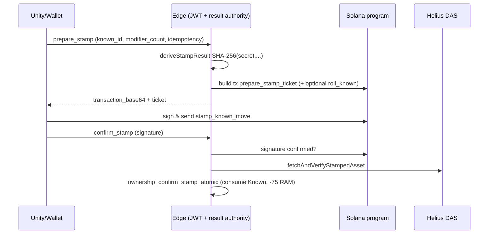

# 03 — Stamp Prepare / Confirm / Mint

**Audit:** Chainbound Ownership/Economy Security Audit  
**Date:** 2026-09-25  
**Mechanism:** Known → Stamped Metaplex Core (first Stamp, 75 RAM)

## Scope & assets

| Asset | Role |
|---|---|
| Known instance | Consumed (`consumed_at`, vault remove) |
| Stamp ticket PDA | Immutable modifier result + expiry |
| Stamped Core asset | Metaplex Core under Moves collection |
| RAM | On-chain debit `stamp_ram_cost`; profile mirror debit 75 on confirm |

Unity `enableDevnetOwnershipSpine` documented **OFF** for live spine; Edge + program paths exist on Devnet.

## Faucets

None directly (Stamp creates tradable Core from Known+RAM). Indirect: forged Known faucets (see `02`) feed Stamp.

## Sinks

| Name | Amount | Notes |
|---|---|---|
| First Stamp | 75 RAM + 1 Known + network fee | Pins enforced in Edge env (`unexpected_stamp_ram_cost` if ≠75) |
| Optional on-chain materialize roll | 5 RAM on-chain | If Known not yet in MoveVault, prepare prepends `roll_known_move` |

## Trust boundary diagram

## Exploit scenarios

1. **High — Dual debit / desync:** On-chain Stamp succeeds (Known burned on-chain, −75 on-chain). Confirm fails (DAS lag, insufficient **profile** RAM). Retry may eventually settle; window leaves profile Known still active → second prepare attempts / support burden. Inverse: confirm without valid mint blocked by DAS verify.
2. **Medium — Authority-chosen modifiers:** `prepare_stamp_ticket` accepts modifier_ids from result authority. Compromised `CHAINBOUND_RESULT_AUTHORITY_SECRET` → arbitrary rarity/mods. Not client-set (good), but secret is single point of failure.
3. **Medium — Client chooses modifier_count 1|2:** Affects digest domain; not free mythic, but biases economics.
4. **Medium — Entropy not VRF:** Same secret digest model as Known roll; predictable to authority holder; players cannot verify fairness vs MagicBlock path used for encounters.
5. **Low — Expired ticket:** Handled (`stamp_ticket_expired` 410); consumed flag prevents double mint.
6. **Info — Simulation required in Unity gateway:** `SubmitStampAsync` requires prior sim success — good UX/safety; bypassable by calling Edge+wallet outside Unity.

## Current controls

- Wallet must match `getActiveWallet` for profile (403 otherwise).
- Known must be unconsumed and owned.
- Operation upsert on `(profile, idempotency_key)`; confirmed replay returns idempotent success.
- On-chain: ticket not consumed, not expired, pool/generator match, collection/authority validation, CreateV2 CPI signed by `core_authority` PDA.
- Confirm: signature confirmed + DAS asset verify + `knownOnchainInstanceId` match + SQL atomic consume/debit.
- Cluster forced `devnet` in `loadOwnershipConfig`.
- Helius DAS URL server-only.

## Gaps & severity

| Gap | Severity |
|---|---|
| Profile vs chain RAM/Known desync after partial failure | **High** |
| SHA-256 authority digest ≠ VRF | **Medium** |
| No second-Stamp (see `04`) — reduces surface | Info |
| Unity flags OFF reduces player exposure | Mitigating |

## Recommended remediations (ordered)

1. Settle profile Known+RAM in a single post-mint worker that retries on DAS; mark operation `pending_settle` vs `confirmed`.
2. Require profile RAM ≥75 **at prepare** (lock/hold) to avoid mint-then-fail-confirm.
3. Migrate modifier draw to MagicBlock VRF (or commit-reveal) when fairness is product-critical.
4. Alerting on `prepared` ops older than TTL without confirm.
5. Keep Moves update authority as PDA; never client mint authority.

## On-chain: worth it?

**Yes (already).** First Stamp is correctly modeled as on-chain atomic consume+mint. Finish operational settle + entropy; do not reintroduce off-chain-only Stamped.

## Evidence

- `Supabase/functions/ownership_prepare_stamp/index.ts`
- `Supabase/functions/ownership_confirm_stamp/index.ts`
- `Supabase/functions/_shared/ownership_spine.ts` — `deriveStampResult`, `buildStampTransaction`, `fetchAndVerifyStampedAsset`
- `Supabase/migrations/20260920010000_ownership_bootstrap_ram_grant.sql` — `ownership_confirm_stamp_atomic`
- `backend/.../lib.rs` — `prepare_stamp_ticket`, `stamp_known_move`
- `Assets/Scripts/Combat/Runtime/Services/SupabaseOwnershipSpineGateway.cs`
