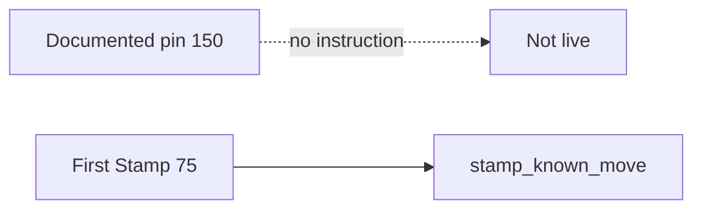

# 04 — Second Stamp (Deferred)

**Audit:** Chainbound Ownership/Economy Security Audit  
**Date:** 2026-09-25  
**Mechanism:** Add-mod / re-stamp on an already-Stamped move @ **150 RAM** pin

## Scope & assets

Documented Phase 1.1 **pin only**. No program instruction, Edge endpoint, SQL table, or Unity UI invents this flow.

Constant exists for documentation/config guards:

- `SECOND_STAMP_RAM_COST_PIN = 150` in `ownership_spine.ts`
- Ownership Spine / Devnet / Bootstrap docs: **BLOCKED / deferred**

## Faucets

None.

## Sinks

| Name | Status |
|---|---|
| Second Stamp 150 RAM | **Not implemented** — must not be overloaded into `stamp_ram_cost` or Bind |

## Trust boundary diagram

## Exploit scenarios

1. **Info — Spec confusion:** Operator might set `CHAINBOUND_OWNERSHIP_STAMP_RAM_COST=150` thinking it enables second Stamp. Loader currently **rejects** any stamp cost ≠75 (`unexpected_stamp_ram_cost`).
2. **Low — Future footgun:** If add-mod is added without consuming a distinct ticket/idempotency and without burning/rewriting Core atomically, double-mod or free mythic risk returns.

## Current controls

- Explicit non-implementation in program/docs.
- First-stamp cost env pinned to 75.
- Checklist: “150 is not overloaded into either on-chain cost field.”

## Gaps & severity

| Gap | Severity |
|---|---|
| No live surface | Info (positive) |
| Pin constant could confuse future implementers | Low |

## Recommended remediations (ordered)

1. Keep deferred until product needs add-mod; implement as **new** instruction (not overload `stamp_known_move`).
2. Require existing Stamped asset burn/rewrite + 150 RAM + VRF ticket; never recreate consumed Known.
3. Update pins/docs in the same PR as code.

## On-chain: worth it?

**Yes, when built** — must be on-chain Core mutation/burn+remint. Not an Edge-only JSON edit.

## Evidence

- `Docs/Specs/Economy/OWNERSHIP_SPINE_v1.md` — Second Stamp deferred
- `Docs/Specs/Economy/OWNERSHIP_SPINE_PHASE1_DEVNET.md` — matrix row BLOCKED
- `Docs/Specs/Economy/OWNERSHIP_SPINE_PHASE1_BOOTSTRAP_DESIGN.md`
- `Supabase/functions/_shared/ownership_spine.ts` — `SECOND_STAMP_RAM_COST_PIN`
- `lib.rs` — no second-stamp entrypoint (only `NotImplemented` style msgs elsewhere)
