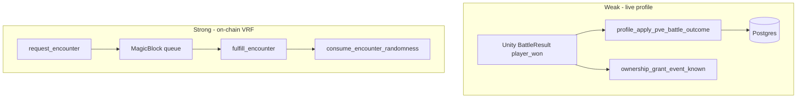

# 05 — Encounter Rewards and VRF

**Audit:** Chainbound Ownership/Economy Security Audit  
**Date:** 2026-09-25  
**Mechanism:** Wild/PvE encounters, combat rewards, MagicBlock VRF vs client outcomes

## Scope & assets

| Path | What it grants/spends | Entropy |
|---|---|---|
| `profile_apply_pve_battle_outcome` | RAM, XP/stars metrics, lifetime stats, HP sync | **Client-authored** deltas |
| `ownership_grant_event_known` / `EncounterVictoryKnownGrantService` | Known on victory | Allowlist + client idempotency |
| On-chain `request_encounter` / `fulfill_encounter` / `consume_encounter_randomness` | Randomness account for encounters | **MagicBlock VRF** |
| `encounter_events` live-ops table | Modifier payloads | Service-role only |
| Capture | Chainling + optional move | See `06` |

## Faucets

| Name | Asset | Trust |
|---|---|---|
| Battle completion RAM | RAM | Client `ram_earned` |
| Battle XP / star-ups | Progression | Client contribution JSON |
| Victory Known | Known | Client calls grant after local win |
| Encounter VRF fulfillment | Random bytes | MagicBlock callback + program |

## Sinks

| Name | Asset |
|---|---|
| Defeat RAM penalty | RAM (client `ram_penalty`, clamped) |
| Capture device items | Items (field/core consume paths) |

## Trust boundary diagram

## Exploit scenarios

1. **Critical — “I won” economy:** Replay crafted PvE outcomes with large `ram_earned`, fabricated star-ups, `progression_moves_granted`.
2. **High — Victory Known without fight:** Direct Edge call (see `02`); Unity service only gates locally.
3. **Medium — Forensic/idempotency bypass:** Idempotency uses `forensic_hash` + `battle_seed` from client — attacker varies them for repeated applies on same narrative fight.
4. **Info — VRF unused by Stamp:** Fairness gap between encounter VRF and stamp SHA-256 authority digest (documented intentional Phase 1).

## Current controls

- JWT profile binding on Edge.
- Per-chainling `profile_apply_pve_battle_outcome_tx` idempotency (quality depends on client key material).
- `encounter_events` RLS: no anon/authenticated access.
- On-chain VRF: `vrf_callback` scoped identity; status PENDING→FULFILLED→CONSUMED.
- Ownership flags OFF limits Stamp coupling, not battle RAM.

## Gaps & severity

| Gap | Severity |
|---|---|
| Unsigned client battle outcomes as economy truth | **Critical** |
| Victory Known unbound to VRF/encounter consume | **High** |
| Client-controlled idempotency inputs | **High** |
| Stamp entropy ≠ encounter VRF | **Medium** |

## Recommended remediations (ordered)

1. Authoritative encounter/battle service: server seeds from `consume_encounter_randomness` or dedicated battle id; client submits actions, server scores rewards.
2. Map victory Known to consumed encounter id + reward catalog row.
3. Stop accepting raw `ram_earned` / star fields; derive from server tables.
4. Optionally pipe stamp tickets through same VRF stack for consistency.

## On-chain: worth it?

**Partial.** VRF request/fulfill already on-chain — **use it** for anything scarce (IVs, entangled, Stamped mods). Routine RAM/XP can stay Edge if derived from verified consume proofs.

## Evidence

- `Supabase/functions/profile_apply_pve_battle_outcome/index.ts`
- `Supabase/migrations/20260829000100_battle_defeat_ram_penalty.sql`
- `Supabase/migrations/20260801200000_encounter_events.sql`
- `backend/.../lib.rs` — `request_encounter`, `fulfill_encounter`, `consume_encounter_randomness`
- `Assets/Scripts/Combat/Runtime/Services/EncounterVictoryKnownGrantService.cs`
- `Assets/Scripts/Solana/VRF/*`
