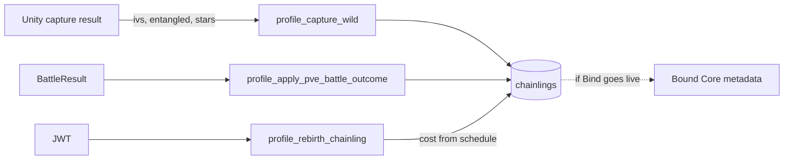

# 06 — Chainling IV and Progression

**Audit:** Chainbound Ownership/Economy Security Audit  
**Date:** 2026-09-25  
**Mechanism:** Capture, IVs/stats, stars/XP, mastery hooks, rebirth

## Scope & assets

| Asset | Storage | Notes |
|---|---|---|
| Chainling row | `chainlings` Postgres | IVs JSON, entangled, mutations, stars, HP |
| Rebirth IV bonuses | `rebirth_iv_bonuses` | Allocation picks; base IVs stay wild-rolled |
| On-chain chainling vault / Bound archive | Program | Capture add + Bind snapshot |
| Progression Known | `move_items` / ownership Known | Via separate grant endpoints |

Naming: **Bound** = Chainling archive book only (not a move tier).

## Faucets

| Name | Grants | Trust |
|---|---|---|
| `profile_capture_wild` | New chainling + optional ordinal move | **Client supplies IVs, entangled, stars, HP, capture modifiers** |
| PvE outcome | XP lifetime, stars, victories | Client contribution JSON |
| Progression ordinal grant | Known/move_item | Client `move_id` + indices |
| Starter commit | Starter chainling | Separate profile commit path (JWT) |

## Sinks

| Name | Cost | Trust |
|---|---|---|
| Rebirth | 1000/1500/2000/2500/3000 RAM | Edge computes cost from server `rebirth_count`; SQL debits |
| Bind (future live) | 250 RAM + cover + component + unbound chainling | On-chain |

## Trust boundary diagram

## Exploit scenarios

1. **Critical — God-roll IVs / entangled:** Authenticated client POSTs max IVs + `entangled:true` + chosen species with capture idempotency key. Server persists `p_ivs` / flags (`profile_native_capture` / `profile_capture_wild`).
2. **High — Instant high stars on capture:** Client `p_stars` accepted into insert path (verify clamp in SQL — treat as untrusted until proven capped).
3. **High — Progression inflation:** Combine fabricated battle star-ups with `profile_grant_progression_ordinal` for free Known.
4. **Medium — Capture rate manipulation:** Client sends `base_capture_rate`, status/device modifiers; server roll may use them (probability computed server-side but inputs client-controlled).
5. **Low — Rebirth:** Cost server-driven; less abuse except using stolen RAM from faucet bugs.

## Current controls

- Capture idempotency key required.
- Chainling ownership checks on rebirth/grants.
- Rebirth max from cost array length; stat index allowlist.
- Docs warn clients must not merge rebirth bonuses into base IVs for display authority.
- Bind recipe (when used) copies authoritative chainling fields — **amplifies** IV forgery if Bind ships before capture hardening.

## Gaps & severity

| Gap | Severity |
|---|---|
| IVs/entangled client-trusted | **Critical** |
| Stars/XP client-trusted | **High** |
| Capture modifier inputs client-trusted | **High** |
| No link from MagicBlock encounter randomness → IV roll on live profile capture | **High** |

## Recommended remediations (ordered)

1. Server-roll IVs from consumed encounter randomness (or server RNG sealed at encounter start); client never sends IV vectors.
2. Entangled/mutation as server rarity tables only.
3. Derive stars only from server XP ledger.
4. Block Bind until capture authority is fixed (else forever immortalize forged stats on-chain).
5. Add server caps/validation even as interim (IV 0–31, stars 0–5, etc.) — defense in depth, not root fix.

## On-chain: worth it?

**Partial / yes for Bind inputs.** IVs need **server or VRF authority before** archive mint. Storing every unbound chainling on-chain is optional; forging prevention is mandatory.

## Evidence

- `Supabase/functions/profile_capture_wild/index.ts` — passes `p_ivs`, `p_entangled`, …
- `Supabase/migrations/20260824010200_profile_native_capture.sql` — `v_ivs := COALESCE(p_ivs, …)`
- `Supabase/functions/profile_rebirth_chainling/index.ts`
- `Supabase/functions/_shared/vending_config.ts` — `rebirthRamCosts`
- `Docs/Specs/Economy/ECONOMY_01_EconomyAndProgression_v1.md`
- `backend/.../lib.rs` — `add_chainling_from_capture`, `bind_chainling`
