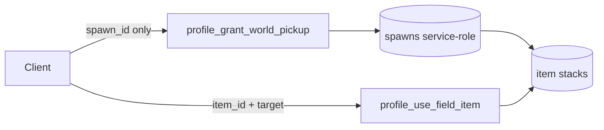

# 07 — Items Inventory

**Audit:** Chainbound Ownership/Economy Security Audit  
**Date:** 2026-09-25  
**Mechanism:** Off-chain item stacks, world pickups, field use, core-item consume prep

## Scope & assets

| Asset | Storage |
|---|---|
| `chainbound_item_catalog` | Server catalog |
| Player item stacks | Profile inventory tables (migrations `chainbound_player_item_inventory`) |
| World pickup spawns/claims | `chainbound_world_pickup_spawns` / `_claims` |
| On-chain cosmetics/items helpers | `_shared/onchain_items.ts`, `onchain_cosmetics.ts` |
| Core bag consume | prepare/finalize Edge pair |

Press Charge catalog rows may exist as retired data — not an active recipe (spine).

## Faucets

| Name | Trust | Entrypoint | Idempotency |
|---|---|---|---|
| World pickup grant | JWT; **server owns spawn→item map** | `profile_grant_world_pickup` → `profile_grant_world_pickup_tx` | Unique `(profile, spawn_id)` claim |
| Quest/narrative grants | Sequence/flag paths | `profile_apply_quest_state` / narrative (verify per-item) | Varies |
| Entitlement ledger insert | Weak (see `09`) | `entitlement_validate_and_grant` | Unique source_tx when present |

## Sinks

| Name | Trust | Entrypoint |
|---|---|---|
| Field item use | JWT + SQL | `profile_use_field_item` |
| Core item consume finalize | JWT + prepare receipt | `profile_prepare_core_item_consume` / `finalize` |
| Capture device consumption | Capture/battle flows | Coupled to capture |

## Trust boundary diagram

## Exploit scenarios

1. **Medium — Spawn id enumeration:** Client may claim any enabled `spawn_id` without proving world proximity. Mitigated by one-claim-per-spawn; still remote loot vacuum.
2. **Medium — Missing idempotency on field use:** If `idempotency_key` null, duplicate consumes/heals possible under concurrency — verify SQL behavior (mark Unknown if RPC allows null freely).
3. **Low — Catalog confusion:** Retired `press_charge` rows if still grantable via mistaken spawn seed.
4. **Info — Hybrid on-chain cosmetics:** Read paths must not trust Unity DAS alone (`ownership_das_proxy` exists for authenticated reads).

## Current controls

- Spawn rewards defined server-side; Unity sends `spawn_id` only (good pattern).
- Claims unique per profile+spawn; RLS service-role only on spawn/claim tables.
- Field use goes through Edge JWT + RPC.
- Item inventory payload builder centralizes response shape.

## Gaps & severity

| Gap | Severity |
|---|---|
| No spatial/quest gate on pickup claim | **Medium** |
| Null idempotency on some item RPCs | **Medium** (verify) |
| Entitlement path weak auth | **Medium** (see `09`) |
| World pickup model itself | Positive control |

## Recommended remediations (ordered)

1. Bind pickups to narrative flags / proximity challenge / one-time world flag already used as “scene presence.”
2. Require non-null idempotency keys on all consume/grant item RPCs.
3. Ensure retired Press Charge cannot be spawned (`enabled=false`, no seeds).
4. Keep DAS via authenticated proxy only.

## On-chain: worth it?

**No** for common field stacks. **Yes** for tradable cosmetics/covers (already Core-oriented). World pickup soft items fine as profile.

## Evidence

- `Supabase/functions/profile_grant_world_pickup/index.ts`
- `Supabase/migrations/20260901010000_world_pickup_grant.sql`
- `Supabase/functions/profile_use_field_item/index.ts`
- `Supabase/functions/profile_prepare_core_item_consume/index.ts` / `profile_finalize_core_item_consume`
- `Docs/Specs/Economy/PLAYER_ITEM_CATALOG_AND_INVENTORY_v1.md`
- `Supabase/functions/_shared/onchain_items.ts`
