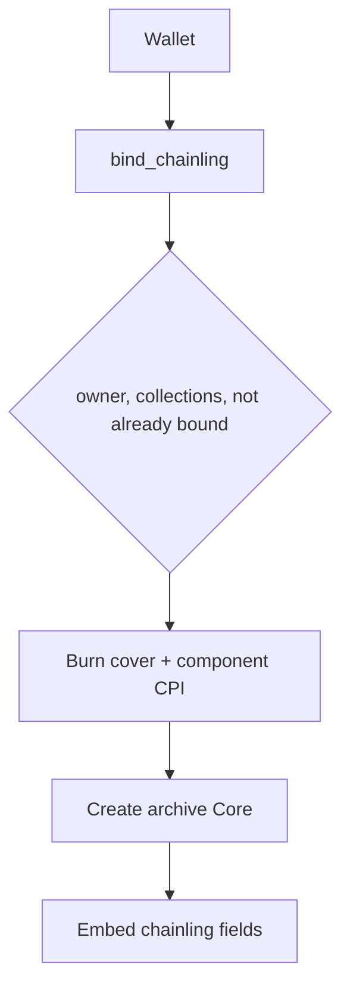

# 08 — Bind Archive

**Audit:** Chainbound Ownership/Economy Security Audit  
**Date:** 2026-09-25  
**Mechanism:** Bindery — unbound Chainling → Bound archive Core (**250 RAM** pin)

## Scope & assets

| Input | Output |
|---|---|
| Unbound Chainling + Core cover + (Stamped **or** cosmetic) + RAM + wallet | Bound Archive Core (`Chainbound Archives`) |

**Status:** Program instruction `bind_chainling` **present**. Unity live ownership spine flags **OFF**; treated as **config/program-ready, not live player path**. No dedicated `ownership_prepare_bind` Edge Function found in inventory (unlike Stamp).

Pins: `BIND_RAM_COST_PIN = 250`; Edge `loadOwnershipConfig` requires env bind cost == 250.

## Faucets

None (publishing sink). Bound book becomes tradable Core (secondary market faucet of scarcity, not mint from nothing).

## Sinks

| Name | Consumes |
|---|---|
| Bind | 250 RAM (on-chain) + cover burn + component burn + marks chainling bound |

## Trust boundary diagram

## Exploit scenarios

1. **High (when enabled) — Forged IV archival:** If profile chainling IVs were client-forged (`06`), Bind permanently mints them into Core metadata.
2. **Medium — Wrong collection / duplicate component:** Program checks collections, distinct accounts, component kind — solid if accounts wired correctly by client builder.
3. **Medium — No Edge settle mirror:** Unlike Stamp, absence of prepare/confirm Edge may push too much trust into client-built txs when first enabled.
4. **Low — RAM pin bypass via config:** `update_ownership_config` is authority-gated; compromised program authority could lower `bind_ram_cost`.

## Current controls

- On-chain recipe validations (owner, collections, burns, `is_bound`, RAM).
- Docs: no Press Charge; Bound ≠ move tier.
- Unity flags / matrix explicitly defer Archive Binding.
- Env pin check for 250 in ownership config loader (when Stamp config loads).

## Gaps & severity

| Gap | Severity |
|---|---|
| Live bind without capture authority fix | **High** (latent) |
| Missing Edge prepare/confirm pattern for Bind | **Medium** |
| Not live in player builds today | Mitigating |

## Recommended remediations (ordered)

1. Do not enable Bind UI/flags until capture IVs are server/VRF authoritative.
2. Add Edge prepare/confirm analogous to Stamp (build tx server-side, verify DAS archive, mirror profile state).
3. Snapshot only server-signed chainling attestation fields.
4. Keep burns atomic with mint (already in instruction — preserve).

## On-chain: worth it?

**Yes.** Bind must stay on-chain. Hybrid only for pre-bind dossier.

## Evidence

- `backend/.../lib.rs` — `bind_chainling` (~652+)
- `Supabase/functions/_shared/ownership_spine.ts` — `BIND_RAM_COST_PIN`
- `Docs/Specs/Economy/BINDERY_FOLIO_AND_PRESS_CHARGE_v1.md`
- `Docs/Specs/Economy/OWNERSHIP_SPINE_v1.md`
- `Docs/Specs/Economy/OWNERSHIP_SPINE_PHASE1_OPERATOR_CHECKLIST.md` — Binding not authorized
