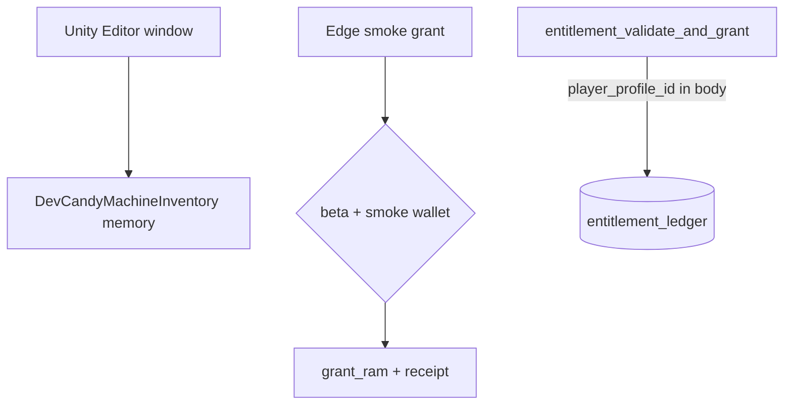

# 09 — Admin / Debug Grant Paths

**Audit:** Chainbound Ownership/Economy Security Audit  
**Date:** 2026-09-25  
**Mechanism:** Dev candy grants, Devnet smoke RAM, entitlement stub, SQL operator funds

## Scope & assets

Paths that can create RAM/Known/ledger rows **outside** normal sinks/faucets.

## Faucets (debug / operator)

| Name | Asset | Gate | Entrypoint |
|---|---|---|---|
| Editor Candy Machine Grants | Local stub RAM/Known | `#if UNITY_EDITOR` + Play Mode | `CandyMachineGrantsWindow` |
| `DevCandyMachineInventory.GrantRam/GrantKnown` | In-memory only | `Debug.isDebugBuild` surface | `DevCandyMachineInventory` |
| Devnet smoke `grant_ram` | On-chain RAM (100 / daily cap) | JWT + beta wallet + exact smoke wallet env | `ownership_prepare_devnet_smoke_grant` / confirm |
| SQL matrix fund | Profile RAM | Operator service role | Documented M1 |
| `entitlement_validate_and_grant` | `entitlement_ledger` row | `manual_grant`/`test` or `ALLOW_UNVALIDATED_ENTITLEMENT_GRANTS` | Edge function — **no JWT resolveAuthenticatedProfile** |

## Sinks

N/A (these are grant paths). Smoke uses on-chain daily cap as backpressure.

## Trust boundary diagram

## Exploit scenarios

1. **High — Entitlement stub abuse:** If deployed with `ALLOW_UNVALIDATED_ENTITLEMENT_GRANTS=true` or accepting `source_type=manual_grant|test` without authz, anyone who can hit the function inserts ledger rows for arbitrary `player_profile_id`. Confirm whether anything credits RAM from ledger automatically (Unknown — treat ledger write as staging for future autofulfill).
2. **Medium — Smoke wallet secret sprawl:** Smoke path is tightly gated but shares result authority signing; protect env and beta allowlist.
3. **Low — Dev stub in player `Debug.isDebugBuild`:** Local presentation only (claims no ProfileService mint). Still confusing if QA mistakes stub balances for real; ensure release builds strip UI (`IsDevSurfaceAllowed`).
4. **Info — Editor grants** cannot run in players (editor asm).

## Current controls

- Editor window compile-gated.
- Stub inventory documents non-authority.
- Smoke: profile wallet link + `isApprovedBetaWallet` + membership in the server-only
  `CHAINBOUND_DEVNET_SMOKE_WALLETS` JSON allowlist + amount == 100 + receipt uniqueness.
- Release security tests mention gating `SupabaseOwnershipSpineGateway` / enable flags (`SolanaMobileReleaseSecurityTests`).
- Matrix plan: flags OFF; no service-role in Unity.

## Gaps & severity

| Gap | Severity |
|---|---|
| Entitlement function unauthenticated profile id | **Medium/High** depending on deploy env |
| Unclear ledger→balance automation | Unknown — verify |
| Debug build stub surface | Low |

## Recommended remediations (ordered)

1. Require service auth / admin JWT on entitlement; remove `ALLOW_UNVALIDATED_*` from shared envs.
2. Never credit `ram_balance` from entitlement without provider receipt verification.
3. Keep smoke wallet allowlist single-operator; rotate result authority if smoke laptop compromised.
4. Assert shipping builds: `enableDevnetOwnershipSpine=0`, no GrantRam buttons in player scenes.
5. QA checklist: stub vs profile RAM labels.

## On-chain: worth it?

Smoke already on-chain with cap — good. Entitlements should stay off-chain with **provider validation**, not open Edge inserts.

## Evidence

- `Assets/Scripts/Editor/CandyMachineGrantsWindow.cs`
- `Assets/Scripts/Combat/Runtime/Services/DevCandyMachineInventory.cs` — `IsDevSurfaceAllowed => Debug.isDebugBuild`
- `Supabase/functions/ownership_prepare_devnet_smoke_grant/index.ts`
- `Supabase/functions/entitlement_validate_and_grant/index.ts`
- `Docs/Specs/Economy/OWNERSHIP_SPINE_PHASE1_DEVNET.md` (live-matrix plan file was removed; this report remains NO-GO)
- `Assets/Scripts/Combat/Tests/SolanaMobileReleaseSecurityTests.cs` (gated symbols)
