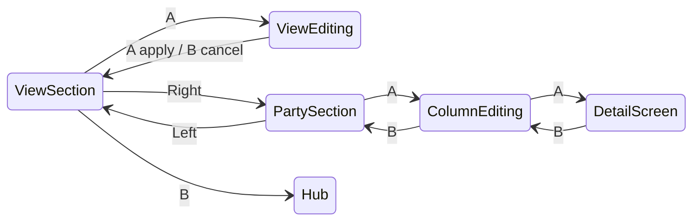

# CHAINLINGS_PARTY_TAB — Player Menu Active Party UI

**Status:** Draft v0.11 (Entry + Stats locked; Loadout summary locked — look card only)  
**Target prefab:** `Assets/Prefabs/UI/PlayerMenu/ChainlingsPartyView.prefab`  
**Visual reference:** `Docs/Specs/UI/UI_chainlingstab_draft.png`  
**Tab asset:** `Assets/Data/UI/PlayerMenuTab_chainlings.asset` (`tabId: chainlings`, display name **Chainlings**)

---

## 0. Purpose

Define the **Active Party** screen inside the player menu Chainlings tab. This screen shows the player’s **3 battle-ready Chainlings** (Lead, Partner, Bench) at a glance and lets them inspect progression, **combat attributes**, moves, species info, cosmetics, and service stats **without leaving the menu**.

**Out of scope for this tab (handled elsewhere):**

- Full roster / storage browsing → **PC terminals** (first: player-room Monitor)
- Party slot assignment / lineup mutations → **PC terminals**
- Deep move equip editing → retained in detail stack where appropriate; party tab is **inspect-first**

**Design north star:** Cassette Beasts party clarity + Pokémon summary density, adapted for Chainbound’s star progression, **Known / Stamped / Bound** move tiers, Archive dossier → bound encyclopedia identity, and cosmetic identity system.

**Archive deep view (locked):** [`CHAINLING_ARCHIVE_ENCYCLOPEDIA.md`](CHAINLING_ARCHIVE_ENCYCLOPEDIA.md) — column **Archive** action opens **Archive Dossier** (pre–Bind to Chain) or **Bound Encyclopedia** (Archived Chainling).

---

## 1. Design principles

| Principle | Application |
|-----------|-------------|
| **Minimal by default, detailed on demand** | Three columns always show identity + HP; info panels stay compact until the player drills in |
| **Controller-first (PSG1 / gamepad HUD)** | Every action reachable via D-pad + A/B; touch is optional parity |
| **One job per focus layer** | View mode changes *what* the blue panels show; column focus changes *who* you’re looking at |
| **No duplicate navigation rails** | Avoid six side buttons (draft) — use a single view segment strip (see §4) |
| **Data-driven** | All panel content binds to `PlayerRosterEntry`, `SpeciesDefinitionSO`, `CombatVisualProfileSO`, providers — no one-off species logic in UI code |
| **Safe area respect** | All interactive UI stays inside the magenta HUD safe zone from the draft; bottom corners remain clear for `MobileServices` controls |

**Cross-references:**

- `Docs/Specs/Combat/COMBAT_UI.txt` — progressive disclosure, type icon language
- `Docs/Specs/Combat/COMBAT_Species.txt` / `SpeciesMovePools.csv` — learnable moves
- `Docs/Specs/Combat/COMBAT_04_AcquisitionRarity_v1.0.txt` — move rarity colours
- `Assets/Scripts/Combat/Runtime/Services/PlayerMenuDataContracts.cs` — roster entry shape
- `Assets/Scripts/Combat/Runtime/ScriptableObjects/CombatVisualProfileSO.cs` — idle / attack sequences for menu visuals

---

## 2. Screen layout (from draft)

### 2.1 Safe area

The draft marks a **magenta rectangle** as the usable canvas inside the player menu, inset from:

- Bottom-left / bottom-right HUD touch zones (`Assets/Prefabs/Controls/MobileServices.prefab`)
- Top menu chrome (close button, dim overlay edges)

**Authoring rule:** Party content root (`ChainlingsPartyView`) stretches to `ScreenStackHost` inset, then applies an internal **SafeContent** rect matching the draft magenta bounds. No selectable may sit outside SafeContent.

### 2.2 Three-column party strip (center-weighted)

Three **equal square columns**, horizontally centered in SafeContent:

```
┌──────────────────────────────── SafeContent ────────────────────────────────┐
│  [ View strip — General | Attributes | Moves | Entry | Loadout | Stats ]   │
│                                                                             │
│     ┌──────────┐    ┌──────────┐    ┌──────────┐                          │
│     │  LEAD    │    │ PARTNER  │    │  BENCH   │   ← slot role (muted)    │
│     │ [Type][Name]│    │ [Type][Name]│    │ [Type][Name]│                  │
│     │          │    │          │    │          │                          │
│     │ CHAINLING│    │ CHAINLING│    │ CHAINLING│   ← animated visual      │
│     │  VISUAL  │    │  VISUAL  │    │  VISUAL  │                          │
│     │          │    │          │    │          │                          │
│     │ ████ HP  │    │ ████ HP  │    │ ████ HP  │                          │
│     │ ┌──────┐ │    │ ┌──────┐ │    │ ┌──────┐ │                          │
│     │ │ PANEL│ │    │ │ PANEL│ │    │ │ PANEL│ │   ← view-specific info   │
│     │ │ INFO │ │    │ │ INFO │ │    │ │ INFO │ │                          │
│     │ └──────┘ │    │ └──────┘ │    │ └──────┘ │                          │
│     └──────────┘    └──────────┘    └──────────┘                          │
│                                                                             │
│  Footer hint: ←→ Party   ←→ View   A Details   B Back                      │
└─────────────────────────────────────────────────────────────────────────────┘
```

**Column width:** Each visual stage is a **square** whose size is derived from SafeContent height (target ~40–45% of safe height for the yellow visual block). Columns share equal width with fixed gutter (12–16 px at 2670×1200 reference).

**Empty slot column:** Dashed frame, silhouette pedestal, `Empty` name, muted HP bar, info panel shows `Assign at a PC`.

### 2.3 Column anatomy (top → bottom)

| Zone (draft colour) | Element | Content |
|---------------------|---------|---------|
| **Blue — type** | Type icon | Primary type icon; secondary type icon if not `None` (reuse combat type icon set) |
| **Red — name** | Name label | `snapshot.displayName` if set, else `species.displayName` |
| **Yellow — visual** | Animated presenter | Idle loop from `CombatVisualProfileSO.idleSequence` at `idleFPS`; optional periodic flourish (see §8) |
| **Green — HP** | HP bar + numeric | `{current} / {max}` readable at a glance; bar fill colour by HP ratio |
| **Blue — panel info** | View panel | Content swaps with active view mode (§5); one panel per column |

**Slot role label** (`1` / `2` / `3`): small caption above type row or overlaid top-left of column — not a separate focus target. Slots `1` and `2` use the active role colour; slot `3` uses the muted bench colour.

---

## 3. Tab copy & entry state

**Hub tab description** (already directionally aligned):

> View your active party and inspect Chainlings. Change members at a PC.

**On screen entry:**

- Title line: `Active Party`
- Subline when partially filled: `Active Party · 2/3`
- Default view mode: **General**
- Default column focus: **Lead** (index 0), or first non-empty slot if Lead is empty

---

## 4. View mode system (UX recommendation)

### 4.1 Problem with draft side buttons

The draft places **three yellow buttons on the left** and **three on the right** of the party columns. With **six** view modes, this layout implies:

- Ambiguous mapping (which side button toggles what?)
- Extra vertical D-pad travel away from the primary party columns
- Accidental view changes while trying to move between columns

### 4.2 Recommended pattern: top segment strip

Replace side buttons with a **horizontal segment bar** centered above the three columns (same grammar as `ChainlingDetailScreen` Overview / Moves / Style / Progress segments).

> **Note:** With **six** views, the strip may crowd at mobile safe widths. See **§13** for the recommended **left-rail “Change View” list** (draft button zone) and other gamepad-friendly alternatives. §4.2 remains valid if labels are abbreviated or the strip scrolls horizontally.

| Segment | Short label | Icon (optional) |
|---------|-------------|-----------------|
| General | `General` | star / XP |
| Attributes | `Attributes` | pentagon radar + axis totals |
| Moves | `Moves` | fist / projectile |
| Entry | `Entry` (enum may remain `Detail` until rename) | book / catalog card |
| Loadout | `Loadout` | palette |
| Stats | `Stats` | chart / trophy |

**Behaviour:**

- Segments are `Button` + `MenuSelectableFocusVisual`
- Active segment uses accent underline + `PanelAlt` fill (match menu accent `(0.2, 0.85, 0.75)`)
- Changing view **does not** change column focus; all three info panels refresh in place
- Debounce rapid segment changes (~150 ms) before rebuilding panel content

### 4.3 Alternate input: shoulder cycle (optional enhancement)

If PSG1 bumpers are available in menu context later:

- **L shoulder:** previous view (wrap)
- **R shoulder:** next view (wrap)
- Segment strip remains the visual indicator and remains focusable for accessibility

### 4.4 Views vs drill-down

| Layer | What it is | Input |
|-------|------------|-------|
| **Summary** | Blue info panel under each column | Always visible for active view |
| **Drill-down** | Full-column overlay or pushed presenter | **A** on focused column when drill-down exists for that view |
| **Deep edit** | Move equip, cosmetic save, cycle | Route to existing detail sub-panels or a PC when mutation requires it |

---

## 5. View specifications

### 5.1 General (progression / XP)

**Summary panel (all three columns):**

| Field | Source |
|-------|--------|
| Star level | `snapshot.stars` / `CombatConstants.STAR_MAX` — **visual:** 5-slot star row (see **§16**) |
| Cycle | `ChainlingPlayerTerms.FormatCycleLabel(snapshot.rebirthCount)` via `PartyTabCycleProgressDisplay`: `rebirthCount` 0-4 → `Cycle I`-`Cycle V`; `rebirthCount` 5 → `Max Cycle` (final Cycle-up; typography reuses Cycle V). Starting band is Cycle I (not Cycle 0). |
| XP bar | Progress toward next star milestone via `StarProgressionUtility.GetXpToNextMilestone(entry.masteryXp, rebirth, rewardConfig)` |
| XP numeric | Segment progress label from `summary.xpLabel` (for example `205 / 450 XP`) |
| Type | Primary type via `ChainlingVariantDisplayUtility.ResolveTypeLabel`; entangled Chainlings prefix `Entangled` (e.g. `Entangled Fire`) |
| Variant | Cosmetic / visual skin via `ResolveVariantLabel` (Style + Loadout Variant slot); entangled mutation stays on Type, Variant reads `Default` unless a real skin id is equipped |
| Folio chance | `Next-star folio chance: {pct}%` when below ★5, or `Five-star mastery folio chance: {pct}%` at ★5 (XP-bar refill farm; not player Cycle-up). Per-move odds and `Owned ×N` stay independent in drill-down. See [`CHAINLING_PROGRESSION_GRANTS.md`](../Combat/CHAINLING_PROGRESSION_GRANTS.md). |

**Drill-down (A on column):** **Move Learn Breakdown** overlay for that Chainling

- Scrollable list of moves from species learnable pool not yet owned/equipped
- Columns: move name, type icon, rarity chip, learn % at next star
- Owned moves marked `Learned`
- Starter exclusives flagged
- Optional gate context is implied by the per-move % list (pool / ranking detail stays here, not in General)

**Empty slot:** panel shows `—`; A disabled with footer hint pointing to a PC.

---

### 5.2 Attributes (combat stats)

**Purpose:** Show each Chainling’s **battle attributes** in the info panel. **HP is excluded** — it already lives in the green HP bar above the panel.

**Summary panel (all three columns):**

Prefab-authored **pentagon radar** under `AttributesView` (`ChainlingPartyAttributesViewLayout` + `PartyTabAttributeRadarGraphic`). Each vertex has a type-tinted attribute icon + numeric total. Soft glow underlay Graphic sits behind the crisp radar. Progression footer: `*{stars}/{max} Cycle …`.

**Vertex layout** (default graphic rotation −90°, index 0 at bottom, then counter-clockwise) — melee on the right, ranged on the left; attacks top, defenses bottom; speed bottom-center:

| Vertex | Label | Source stat | Screen region |
|--------|-------|-------------|---------------|
| 0 | `SPD` | Speed | Bottom center |
| 1 | `MDEF` | Melee Defense | Bottom right |
| 2 | `MATK` | Melee Attack | Top right |
| 3 | `RATK` | Ranged Attack | Top left |
| 4 | `RDEF` | Ranged Defense | Bottom left |

Drill-down / compact text tables still list MATK → MDEF → RATK → RDEF → SPD.

**Radar fill (species-catalog universal range):**

Base IVs use the locked `CombatConstants.IV_MIN..IV_MAX` range (`-5..+5`).

Shared floor/ceil from `SpeciesDatabaseSO` (same for every party column; recomputed/cached from the catalog, not from the party):

```
For each species (skip base <= 0 / ghost stubs), for MATK…SPD:
  rim     = base + IV_MAX + REBIRTH_MAX + REBIRTH_MAX
            (auto +1×N + all picks into one combat axis +1×N; no star/Cycle multipliers)
  lowTot  = max(1, base + IV_MIN)
ceil  = max(rim) across catalog
floor = 0.25 × min(lowTot) across catalog
fill01 = clamp01( (total - floor) / (ceil - floor) )
```

One shared ceil across all axes (best for party compare / lean vs the game-wide peak). Axis **labels stay absolute totals**. Icon/label RectTransforms stay prefab-authored (`repositionAxesToRadarVertices` off by default). Stroke/icon colors derive from column type chrome. MaxHP stays off the Attributes radar.

**Authoring:** Axes/radar/glow are prefab children (no runtime Instantiate). Tune line widths, glow spread, ring count, and animation on the Graphic / layout components. Menu: **Tools → Chainbound → UI → Player Menu Dev → Ensure Party Tab Attributes Radar View**.

**Computation (must match combat / overview panel):**

Reuse `ChainlingAttributeDisplayUtility.BuildPartyRadarAxes` / `BuildPartyStatValues`:

1. Read species base: `baseMeleeAtk`, `baseMeleeDef`, `baseRangedAtk`, `baseRangedDef`, `baseSpeed`
2. Read base IV array on snapshot: `[MaxHP, MeleeAtk, MeleeDef, RangedAtk, RangedDef, Speed]` — **skip index 0 (HP)** for this view
3. Read Cycle pick counts: `snapshot.rebirthIvBonuses` (same order; do not merge into `ivs`)
4. Final per combat stat: `max(1, base + baseIV + cycleAutoFlat + cyclePickFlat)`

**Drill-down (A on column):** **Attribute Breakdown Sheet**

Scrollable stat-by-stat breakdown for the focused Chainling. One section per attribute (MATK, MDEF, RATK, RDEF, SPD):

| Row | Example |
|-----|---------|
| **Total** | `51` (bold, accent) |
| Base | `38` (from `SpeciesDefinitionSO`) |
| IV | `+4` (from `snapshot.ivs[index]`, base only) |
| Cycle auto | `+2` from `rebirthCount` (`+1` per Cycle on combat stats) |
| Cycle pick | `+1` from `rebirthIvBonuses` allocation (`+1` combat / `+5` MaxHP apply-side) |
| Formula hint | `Base + IV + Cycle auto + Cycle pick` (muted, one line) |

**UX notes:**

- Default drill-down selection: first stat row (`MATK`) or “all stats overview” header row
- ↑↓ moves between stat sections; each section expands inline (no second menu depth)
- HP breakdown available here only if player wants it — optional collapsed row `HP (see bar above)` linking to same formula for completeness

**Empty slot:** panel shows `—`; A disabled.

**Cross-reference:** `COMBAT_02B_StatsStagesIVs_v1.1.txt`, `ChainlingProgressionUtility.ComputeProgressedStat`

---

### 5.3 Moves

**Summary panel:**

- Header shows **`{equippedCount}/{maxSlots} moves equipped`**, where `maxSlots` comes from `MOVE_LOADOUT_RULES_AND_UI_SPEC.md`.
- List **equipped moves only** (compact): `MoveName` + type icon + stat label
- **No modifier badges** in summary (per request)
- Do not render empty slot placeholders; zero equipped shows one muted empty-state row.
- Display through a masked four-row viewport. When equipped move count exceeds 4 rows, rows 5-9 are cloned at runtime from the authored row template and auto-scroll inside the clipped viewport.
- Reset the moves list to the top whenever the view is rebound or previewed.

**Drill-down (A on column):** **Move Detail Sheet** for that Chainling

- One row per equipped move: name, type, category tag
- Expand each move to show `modifier1` / `modifier2` section labels (reuse move equip panel resolver)
- Read-only in party tab v1; equip actions link to detail Moves panel or a future PC loadout surface

**Data:** compact `snapshot.moveIds` + `MoveDatabaseSO`; inventory overlay via `IMoveInventoryProvider` when available.

---

### 5.4 Entry (species catalog card)

**Player-facing name:** **Entry** (rail / Change View list).  
**Internal mode:** `ChainlingPartyViewMode.Detail` until a deliberate enum rename.  
**Prefab root:** `DetailView` under each column’s `Views` (rename asset to `EntryView` optional in implementation).

**Job:** Species personality / identity card — not combat math (Attributes), not equipped loadout (Moves), not career totals (Stats).

**Out of scope for this view (deferred):** Party Sync / Field Bond / shared-party XP chemistry. Do not add meters or pair-bond copy here until a separate economy pass.

#### Summary panel (locked layout)

```text
Species: Validape
Preferred type: Meme
Preferred role: Melee Striker
Hook description (1–3 lines from species.description)
Signature
┌ MoveRow (same grammar as MovesView) ─────────────────┐
│ [type icon]  Flagship move name          STAT · rarity │
└────────────────────────────────────────────────────────┘
Encounters · Loom Lab / Zone A · Zone B …
```

| Block | Content | Source |
|-------|---------|--------|
| **Species** | Labeled catalog name (`Species: …`); label dimmed, value full white | `species.displayName` (nickname stays in column header / red zone) |
| **Preferred type** | Primary (+ secondary) as text — species default only, never Entangled prefix | `SpeciesDefinitionSO.primaryType` / `secondaryType` |
| **Preferred role** | One short archetype label | Derived classifier + optional `combatRoleOverride` on species (see below) |
| **Description** | Hook blurb, truncated | `species.description` (no need for a visible “Description:” label if space is tight) |
| **Signature** | Single **move row** matching Moves view | `species.flagshipMove` → bind via `ChainlingPartyMoveRowDisplay` + `PartyTabMoveRarityPaletteSO` + type icon |
| **Encounters** | Condensed origin line | Starter → `Starter · Loom Lab`; else 1–2 zone names or `N zones` |

**Signature move row (visual contract):**

- Reuse the **Moves view** row component pattern from `ChainlingsPartyView.prefab` → `MovesView` → `MoveRows` → `MoveRow_0N` (`ChainlingPartyMoveRowDisplay`).
- Show: type icon, move display name, category/stat label, **rarity tint** from `PartyTabMoveRarityPaletteSO` (same as Moves).
- Empty / missing flagship: muted empty row (`—` / “No signature authored”) — do not invent a random learnable move.
- One row only; do not list the full equip loadout here.

**Combat Role (player-facing set — v1):**

| Role | Intent |
|------|--------|
| Melee Striker | High melee offense relative to kit |
| Melee Guardian | High melee defense / bulk-forward melee |
| Ranged Striker | High ranged offense |
| Ranged Guardian | High ranged defense / bulk-forward ranged |
| All-Rounder | No single axis dominates |
| Speedy Striker | Speed-forward relative profile |
| Support Warrior | Heal / barrier / ally utility heavy pool |
| Utility Disruptor | Status / stage / control heavy pool |

Classifier rules (implementation):

1. Prefer authored `combatRoleOverride` on `SpeciesDefinitionSO` when set.
2. Else derive from **base stats** (relative within species bases / catalog norms) for Strike / Guard / Balanced / Speed.
3. Optionally bias to Support / Disrupt when progression / learnable pool tags are heal/barrier/status-heavy.
4. Do not invent free-text hybrids in UI; one preferred-role line only.

**Encounters summary copy:**

| Case | Summary |
|------|---------|
| `isStarter` | `Starter · Loom Lab` |
| Wild, zones resolved | Up to two zone display names, or `N zones` |
| Lookup unavailable | `Origins unlogged` |

#### Drill-down (A on column): **Encounter & Origin Sheet**

| Case | Content |
|------|---------|
| `species.isStarter == true` | Header `Starter Chainling` + full description / Loom Lab blurb |
| Wild species | Reverse lookup: all `EncounterZoneSO` entries containing `speciesId` |
| Per zone row | Zone display name, encounter weight %, time gate (Day/Night), capture rate |
| Always | Full untruncated species description available above or as header body |

**Data note:** Encounter reverse lookup is a **new read service** (`IEncounterCatalogProvider` or static index built from zone assets). See §7.3.

**Authoring / prefab:** Prefer a dedicated `ChainlingPartyEntryViewLayout` with authored labeled catalog lines (species name / preferred type / preferred role), description TMP, one `ChainlingPartyMoveRowDisplay`, and encounters line — not type/role chips and not a generic Lines stack. Column copy tooling should preserve inspector settings (same lesson as Attributes).

---


### 5.5 Loadout (cosmetics)

**Status:** Summary composition locked (v0.11).  
**Job:** Compact **look card** for what is visible on the party column — not the full Style-panel equip list.

#### Summary panel (info panel — locked)

Show identity cosmetics that matter **on this screen**. Do **not** dump every FX slot.

**Summary rows (per column), in order:**

| # | Label | Source | Notes |
|---|-------|--------|-------|
| 1 | Variant | `visualVariantId` | Always shown (`Default` when base) |
| 2 | Aura | `auraId` | `None` / resolved label |
| 3 | Party Column | `partyColumnVariantId` | Card chrome on this strip |
| 4 | Idle | `idleStyleId` + `idleFlourishId` | One line: loop · flourish when both set |
| 5 | Combat FX | count of non-default battle FX | Footer, e.g. `3 equipped` or `Stock` — full list in drill-down |

**Do not show on party Loadout summary:** HUD Card, Melee, Ranged, Hit Reaction, Swap In/Out, KO, Victory (drill-down / Style only).

**Typography / authoring (match Stats / Entry catalog lines):**

- Prefab-authored TMP under `LoadoutView` (no play-mode Instantiates)
- PixeloidSans; **font size 18**; **UpperCase** font style (same as authored Stats `Victories` lines)
- Label/value rich-text colors via layout (`labelColor` / `valueColor`)
- Bind animation: Entry line stagger (fade + Y settle, `0.045s` stagger)

**Copy:** Author on Column_1, then **Tools → Chainbound → UI → Player Menu Dev → Copy Column 1 Loadout View to Party Columns**.

```text
Variant         Neon Spine
Aura            Ember Ring
Party Column    Typeframe Teal
Idle            Cool sway · Flourish
Combat FX       3 equipped
```

#### Drill-down (A on column): Cosmetic Presenter Panel

- Full slot list (same slots as `ChainlingStylePanel` / prior 13-slot identity map)
- Live preview actions (read-only v1) as previously specified
- Editing stays in Style panel / PC terminal — party tab inspect-first

---

### 5.6 Stats (service record)

**Status:** Summary composition locked (v0.10).  
**Data source:** PvE service-record metrics in [`CHAINLING_PVE_SERVICE_RECORD.md`](../Combat/CHAINLING_PVE_SERVICE_RECORD.md). Competitive ladder / seasons groundwork (not shown as exact global ranks on this summary yet): [`COMPETITIVE_LADDER_AND_SEASONS_v1.md`](../Combat/COMPETITIVE_LADDER_AND_SEASONS_v1.md).

**Job:** Compact **career service record** for the focused Chainling — not Attributes math, not Archive badge hunting, not a live leaderboard.

#### Summary panel (info panel — locked)

Show **one aggregate career block** only. Do **not** split PvE / PvP on the party summary; mode split belongs in drill-down / Archive once `battleMode` (or separate PvP records) exists.

**Do not show on party Stats summary:**

- Milestone **badge strip** (badges → Archive dossier / Full Stat Sheet drill-down — see §7.4)
- Progression move grants, damage mitigated, healing, times captured (drill-down only)
- Exact global ranks `(#346)` — deferred until ladder materialization ships; optional later **Top %** seasoning per ladder spec

**Summary rows (per column), in order:**

| # | Label | Source | Notes |
|---|-------|--------|-------|
| 1 | Victories | `pve.total_victories` | Career PvE victories credited to this Chainling |
| 2 | Enemy KOs | `pve.enemy_kos` | |
| 3 | Damage dealt | `pve.damage_dealt` | Numeric row; also feeds the balance bar |
| 4 | Damage taken | `pve.damage_taken` | Numeric row; also feeds the balance bar |
| 5 | XP earned | `pve.xp_earned_lifetime` | Lifetime; separate from current `masteryXp` |
| 6 | Times KO'd | `timesKod` (legacy bridge) | Until a dedicated PvE KO'd metric exists |

**Visual — Dealt / Taken balance bar (required):**

Horizontal two-segment (or fill + remainder) bar under the damage rows (or between dealt/taken and XP):

- Left / fill weight ∝ `damage_dealt`
- Right / remainder weight ∝ `damage_taken`
- When both are 0, show an empty/neutral bar (no fake 50/50)
- Labels optional on the bar ends (`Dealt` / `Taken`) if space allows; the numeric rows remain canonical
- Honest 1:1 with stored metrics — no attribute-icon mapping or invented “factor” attribution

```text
Victories        128
Enemy KOs        412
Damage dealt     34,965
Damage taken     15,760
[========Dealt========|===Taken===]
XP earned        220,400
Times KO'd       17
```

Number formatting: thousands separators in player-facing copy when the binder supports it.

#### Drill-down (A on column): Full Stat Sheet (+ badges)

| Category | Metrics (target) |
|----------|------------------|
| Combat totals | Victories, losses (when tracked), win rate |
| Offense | Enemy KOs, damage dealt |
| Defense | Damage taken, damage mitigated, times KO'd |
| Support | Healing total, progression move grants |
| Capture | Times captured |
| Mode split | PvE vs PvP columns when backend tracks mode |
| Badges | Full grid — locked/unlocked + progress (not on summary) |
| Ladder (later) | Season / species percentile or rank — see ladder spec |

---

## 6. Input & navigation

Uses existing menu stack: `MenuInputContextController` on `PlayerMenuRoot` (`enableMobileHudNavigation: true`, A = submit, B = cancel).

### 6.1 Focus layers



### 6.2 Default focus graph

| From | Input | To |
|------|-------|-----|
| View section | A | Open view list |
| View section | → | Party section |
| View section | B | Hub (via `PlayerMenuController`) |
| View editing | ↑ / ↓ | Adjacent view mode |
| View editing | A | Apply view to all columns, return to View section |
| View editing | B | Cancel, return to View section |
| Party section | ← | View section |
| Party section | A | Column editing, defaulting to first active column |
| Column editing | ← / → | Adjacent Chainling column |
| Column editing | A | Open `ChainlingDetailScreen` for focused Chainling |
| Column editing | A (empty) | Status: `Assign at a PC` |
| Column editing | B | Party section |
| Detail screen | B | Restore Column editing on the opened column |

### 6.3 Footer hints (contextual)

| Context | Hint text |
|---------|-----------|
| View section | `→ Party   A Change View   B Back` |
| View editing | `↑↓ View   A Select   B Cancel` |
| Party section | `← View Rail   A Select Column   B Back` |
| Column editing | `←→ Party   A Details   B Back` |
| Empty column editing | `←→ Party   B Back   Assign at PC` |

### 6.4 Touch parity

- Tap column → focus column + refresh footer (same as D-pad focus)
- Tap segment → switch view
- Tap drill-down scroll rows → mirror D-pad selection
- Touch targets ≥ **48 pt**; column hit area includes visual + info panel

---

## 7. Data contracts

### 7.1 Available today (bind now)

| Data | Type / location |
|------|-----------------|
| Party slots | `PlayerRosterEntry.partySlot` 0–2, `CombatConstants.ROSTER_SIZE` |
| Identity | `ChainlingSnapshot.displayName`, `speciesId`, `stars`, `rebirthCount`, `visualIdentity` |
| Mastery XP | `PlayerRosterEntry.masteryXp` |
| XP milestones | `StarProgressionUtility`, `BattleRewardConfigSO` |
| Equipped moves | `snapshot.moveIds` (+ modifier id lists) |
| Combat attributes | Species base + `snapshot.ivs[1..5]` + Cycle auto/pick flats (`ComputeProgressedStat`) |
| Species lore | `SpeciesDefinitionSO.description`, types, `isStarter`, `flagshipMove` |
| Entry signature row | Same bind path as Moves: `ChainlingPartyMoveRowSummary` + `PartyTabMoveRarityPaletteSO` |
| Learnable pool | `SpeciesDefinitionSO.learnableMoves`, `learnLevels`, `exclusiveMoves` |
| Visual animation | `CombatVisualProfileSO` sequences + FPS fields |
| Aggregate battle stats | `ChainlingBattleStats` on `PlayerRosterEntry` |
| Cosmetics resolution | `ChainlingStylePanel` slot model + identity DB |
| PvE service record | `PlayerRosterEntry.pveServiceRecord` (`ChainlingPveServiceRecord`) |
| **Party tab read model** | `ChainlingPartyColumnViewModelBuilder` + per-view display utilities under `Assets/Scripts/UI/MenuNavigation/Chainlings/PartyTab/` — **UI binding surface for all six column modes** (summary + drill-down DTOs) |

### 7.2 Needs utility / spec follow-up

| Feature | Gap | Proposed resolver |
|---------|-----|-------------------|
| **Learn % on star-up** | No single UI helper today | `MoveLearnPreviewUtility.GetLearnOdds(species, stars, moveId, rewardConfig)` — derive from species pool + star tier rules in `COMBAT_06` / reward tables |
| **Current HP in menu** | Resolved — see [`CHAINLING_HP_STATE.md`](../Combat/CHAINLING_HP_STATE.md) | Persisted `current_hp` on roster; menu shows `{current} / {max}` via `ChainlingPartyColumnSummary.vitals` |
| **PvP vs PvE stats** | `ChainlingBattleStats` is undifferentiated | Extend DTO + Supabase schema: separate PvP service record or `battleMode` tagged events; party summary stays aggregate until then |
| **Damage dealt/taken/mitigated** | Tracked on PvE service record | Party summary shows dealt/taken + balance bar; mitigated/heal in drill-down |
| **Badges / milestones** | Evaluator + catalog exist; strip removed from Stats summary | Keep evaluator; surface badges in Archive / Full Stat Sheet only (§7.4) |
| **Competitive ladder ranks** | No materialized ranks | Groundwork in [`COMPETITIVE_LADDER_AND_SEASONS_v1.md`](../Combat/COMPETITIVE_LADDER_AND_SEASONS_v1.md); no exact `#N` on summary until soft launch |
| **Encounter zone reverse lookup** | Zones forward-map species | Build `EncounterCatalogIndex` from all `EncounterZoneSO` assets at boot |
| **Combat Role** | Resolved — `SpeciesCombatRole` + optional override | Entry summary binds preferred role |
| **Party Sync / Field Bond** | Not designed for v1 Entry | Deferred — do not block Entry UI |

### 7.3 Encounter reverse lookup (Entry drill-down)

For each `EncounterZoneSO`:

1. Iterate `encounterEntries` (or equivalent species list on zone asset)
2. If `entry.speciesId == target`, emit `{ zoneId, zoneDisplayName, weight, weightPercent, timeGate, baseCaptureRate }`
3. Sort by weight descending

Starter species bypass table → show static starter copy.

### 7.4 Badge system (Archive / drill-down — not party Stats summary)

**Ownership:** Milestone badges are a **dossier / Full Stat Sheet** concern. Party Stats summary does **not** show a badge strip (v0.10).

**Badge definition (ScriptableObject):**

- `badgeId`, `displayName`, `icon`, `description`
- `metricKey` (e.g. `pve.enemy_kos`, `pve.total_victories`)
- `threshold`, optional `battleModeFilter` (PvE/PvP/Any)

**Examples:**

| Badge | Condition |
|-------|-----------|
| First Blood | `pve.enemy_kos >= 1` |
| Veteran | `pve.total_victories >= 50` |
| Untouchable | win rate ≥ 80% with min 20 battles *(needs losses tracked)* |
| Capture Artist | `timesCaptured >= 10` |

Drill-down / Archive shows full grid with locked/unlocked state and progress fraction. Optional later: highlight top unlocked badges on the Archive landing page only.

---

## 8. Animation & polish

### 8.1 Column visual presenter

Replace static portrait-only preview with **`ChainlingMenuVisualPresenter`** per column:

- Resolves clips through `ChainlingVisualSequenceResolver` from `visualVariantId` + equipped cosmetics.
- Plays swap-in at the same `ScreenEnterStagger` beat as column chrome, focus frame, info panel, labels, and HP.
- Plays idle from the equipped `idleStyleId` when present; otherwise the variant profile `idleSequence`.
- **Flourish:** every 2 completed idle loops, play equipped `idleFlourishId` one-shot, then return to idle.
- On identity change: debounced crossfade (~160–200 ms) matching existing menu motion timing.

### 8.2 View / panel transitions

- Info panel content swap: `CanvasGroup.DOFade` 0 → 1 (~120 ms), no layout slide (avoid nausea on mobile)
- Drill-down overlay: fade + `DOScale(0.96 → 1)` on open (~180 ms)

### 8.3 Performance

- Pool three presenters (one per column), not per-frame allocate
- Pause off-screen column animations when drill-down covers column (optional battery save)

---

## 9. Relationship to other UI

| Surface | Role |
|---------|------|
| **ChainlingsPartyView** (this spec) | Active party inspect, view modes, drill-downs |
| **ChainlingDetailView** | Deep edit: move equip mutations, cosmetic save, cycle confirm |
| **PC terminal** | Full roster, assign Lead/Partner/Bench |
| **Player menu hub** | Tab preview copy only; hides when content opens |

**Migration note:** Phase 1 replaces the legacy **4-panel hub-style layout** with the **three-column draft layout** (`SafeContent` + view rail + column shells). Regenerate prefabs via **Tools → Chainbound → UI → Player Menu Dev → Create Chainlings Menu View Prefabs** if upgrading an existing project.

---

## 10. Implementation phases

### Phase 0 — Read model layer (complete)

- [x] `ChainlingAttributeDisplayUtility` + `ChainlingOverviewPanel` refactor
- [x] Per-view display utilities (General, Attributes, Moves, Detail, Loadout, Stats)
- [x] `ChainlingPartyColumnViewModelBuilder` + DTOs (`ChainlingPartyColumnSummary`, `ChainlingPartyColumnDrillDown`)
- [x] `ChainlingBadgeCatalogSO` + `Assets/Data/Combat/Badges/ChainlingBadgeCatalog.asset`
- [x] Unit tests (`ChainlingAttributeDisplayUtilityTests`, `ChainlingPartyReadModelTests`)
- [x] Harness/debug helpers (`ChainlingsMenuTestHarness.TryCreatePartyReadModelInputs`, `ChainlingPartyReadModelDebug`)

**Code locations:**

| Component | Path |
|-----------|------|
| Builder + DTOs | `Assets/Scripts/UI/MenuNavigation/Chainlings/PartyTab/` |
| Shared stat math | `Assets/Scripts/Combat/Runtime/Services/ChainlingStats/Display/ChainlingAttributeDisplayUtility.cs` |
| Badge catalog | `Assets/Scripts/Combat/Runtime/ScriptableObjects/ChainlingBadgeCatalogSO.cs` |

**Stubs (replace in Phase 4/5):** Detail encounter drill-down (`EncounterCatalogIndex` pending). General learn % is now backed by `MoveLearnPreviewUtility`.

### Phase 1 — Layout & navigation shell

- [x] SafeContent rect + three column prefab structure (`ChainlingPartyColumnShell`, `ChainlingsPartyScreen`)
- [x] View rail Option A — collapsed `Change View` + vertical 6-mode list (`ChainlingPartyViewRail`)
- [x] Column zones (type, name, visual stage, HP bar, info panel) + read-model bind
- [x] Empty slot dashed frame + placeholder pedestal loop + PC copy
- [x] Footer hints wired to focus context (`ChainlingPartyFooterHints`)
- [x] DOTween motion catalog T1, T2/T3, T5–T8, T9/T10, T14 (`PartyTabMotionProfileSO`, `ChainlingPartyMotionController`)
- [x] HP bar bind from `summary.vitals` with delta-only tweens

### Phase 2 — Visual presenters

- [x] `ChainlingMenuVisualPresenter` idle loop from resolved identity + variant profile
- [x] Swap-in starts on the same stagger delay as T1 column reveal
- [x] Idle flourish every 2 idle loops
- [x] Debounced identity transition fade (DOTween)
- [ ] Wire `IPlayerPartyProvider` / roster fetch (background full roster for future detail)

### Phase 3 — View panel binders

Thin MonoBehaviours that call `ChainlingPartyColumnViewModelBuilder` only — no formatting logic in UI:

- [ ] `PartyViewGeneralPanel` — **star rating row (§16)**, XP bar, learn chance line (replaces text `Stars 3/5` line)
- [x] `PartyViewAttributesPanel` / Attributes radar — MATK/MDEF/RATK/RDEF/SPD summary (`ChainlingPartyAttributesViewLayout`)
- [ ] `PartyViewMovesPanel` — equipped move list
- [x] `PartyViewEntryPanel` / Entry layout — types, role, blurb, signature MoveRow, encounters (§5.4) (`ChainlingPartyEntryViewLayout`, rail label Entry)
- [ ] `PartyViewLoadoutPanel` / `ChainlingPartyLoadoutViewLayout` — look card (Variant / Aura / Party Column / Idle / Combat FX)
- [ ] `PartyViewStatsPanel` / `ChainlingPartyStatsViewLayout` — career rows + dealt/taken bar (no badge strip)

### Phase 4 — Drill-down overlays

- [ ] Move learn breakdown
- [ ] Attribute breakdown sheet (base + IV + star/cycle scale per stat)
- [ ] Move modifier detail sheet
- [ ] Encounter / starter origin sheet
- [ ] Cosmetic presenter (preview animations)
- [ ] Full stat sheet + badge grid

### Phase 5 — Data backend

**Done:**

- [x] PvE service record + Supabase persistence ([`CHAINLING_PVE_SERVICE_RECORD.md`](../Combat/CHAINLING_PVE_SERVICE_RECORD.md))
- [x] Badge definition assets (3 starter badges)
- [x] Badge evaluator (code) + `ChainlingBadgeCatalogSO`

**Remaining:**

- [x] Learn % utility (`MoveLearnPreviewUtility`) — backed by progression reward tables + species weighted pools
- [ ] Encounter catalog index (`EncounterCatalogIndex`) — Detail drill-down
- [ ] PvP stat split — future backend
- [ ] Badge unlock persistence table — optional v2

---

## 11. Open questions / revision log

| ID | Question | Status |
|----|----------|--------|
| Q1 | Show **current HP** in menu or max-only until post-battle sync exists? | **Resolved:** current/max from persisted HP — [`CHAINLING_HP_STATE.md`](../Combat/CHAINLING_HP_STATE.md) |
| Q2 | Should party tab allow **cosmetic preview animations** only, or also **equip save**? | **Proposed:** preview-only; save in detail/PC |
| Q3 | Learn % formula — star-based table vs flat pool roll? | Resolved: gate percent x normalized weighted pool chance |
| Q4 | Rename segment **Detail** → player-facing **Entry**? | **Resolved:** **Entry** on rail; enum/prefab may lag as `Detail` / `DetailView` |
| Q5 | Keep shoulder-bumper view cycle on PSG1? | Optional Phase 2 |
| Q6 | Attributes drill-down: show HP breakdown row (collapsed) or omit entirely? | **Proposed:** omit HP; bar is canonical |
| Q7 | View rail: Option A left list vs Option B top strip for Phase 1? | **Resolved:** **Option A** — left `Change View` + vertical 6-mode list (§13.2) |
| Q8 | Column focus scale: subtle (1.03) vs menu default (1.06 from `UiMotionProfileSO`)? | **Proposed:** 1.03 on visual stage only; 1.06 on buttons |
| Q9 | Idle flourish frequency in menu: 8–12 s ambient vs focus-only? | **Proposed:** focused column only |
| Q10 | Fainted column: static red bar vs play `koSequence` hold frame? | **Resolved:** **Red/muted HP bar + label only** (T8); no KO sprite / desaturate (Phase 1) |
| Q11 | Stats summary: badges + full metric dump vs compact career + bar? | **Resolved:** Compact career rows + dealt/taken bar; badges out of summary (v0.10) |
| Q12 | Exact global ranks next to party Stats? | **Deferred:** Ladder groundwork first; soft-launch seasons when population supports it — see ladder spec |

### Revision history

| Version | Date | Notes |
|---------|------|-------|
| v0.1 | 2026-06-11 | Initial spec from `UI_chainlingstab_draft.png` + party tab design session |
| v0.2 | 2026-06-11 | Added Attributes view; §13 view-toggle UX exploration |
| v0.3 | 2026-06-11 | Phase 0 read model layer complete; §14 post-read-model carry-on list |
| v0.3.1 | 2026-06-11 | §14 marked **PAUSED** pending Chainling progression system (§14.1 blockers) |
| v0.4 | 2026-06-11 | HP slice complete; §15 Phase 1 polish & DOTween design brief |
| v0.5 | 2026-06-11 | Phase 1 layout shell: SafeContent, Option A view rail, three column shells, motion profile, placeholder pedestal/shimmer art |
| v0.7 | 2026-06-11 | §16 star rating visual proposal (fixed 5-slot row + shimmer); Phase 3 General panel notes updated |
| v0.8 | 2026-06-24 | Section navigation model: View section default, Party section gate, Column editing, and Back peel stack |
| v0.9 | 2026-07-20 | §5.4 **Entry** locked: types, combat role, description, signature MoveRow (Moves grammar), encounters; Party Sync deferred |
| v0.10 | 2026-07-21 | §5.6 **Stats** locked: career rows + dealt/taken balance bar; badges → Archive/drill-down; ladder ranks deferred to competitive seasons groundwork |
| v0.11 | 2026-07-21 | §5.5 **Loadout** locked: look card (Variant / Aura / Party Column / Idle / Combat FX count); full slots → drill-down |

---

## 12. Acceptance checklist (play mode)

1. Open Chainlings tab → three columns visible inside safe area; HUD corners unobstructed
2. D-pad: default View section; → Party section; A enters view list or column editing; view list ↑↓ + A applies to all columns; A on focused column opens detail (Phase 1 — no drill-down overlays); B peels Column editing → Party section → View section → hub
3. All six views refresh all three info panels without losing column focus (T5 crossfade)
4. Filled columns play swap-in on screen enter, then resolved idle animation from variant profile or equipped idle loop
5. Empty column shows dashed frame, placeholder pedestal loop, and PC message; A does not open drill-down
6. Touch: tap column and view rail achieves same state as controller
7. No full roster grid or lineup edit controls on this screen
8. Attributes view shows MATK/MDEF/RATK/RDEF/SPD only (no HP duplicate)
9. Read model produces non-empty summary for each view mode from harness data (`ChainlingPartyReadModelDebug` / `ChainlingsMenuTestHarness.TryCreatePartyReadModelInputs`)
10. **HP delta tween:** after battle refresh, HP fill animates on change only (T6/T7); unchanged HP does not re-tween
11. **Fainted:** HP bar tweens to muted red fill + numeric label; party tab does not play KO sprites
12. **View rail:** Option A collapsed `Change View` + vertical list; footer hints match §13.6 table
13. **Placeholder art:** empty slot pedestal `UIImageFrameAnimator` visible; view rail selection shimmer on active mode row

---

## 13. View toggle UX — options & recommendation

Six views is too many for a single readable horizontal strip at mobile safe widths without scrolling or truncation. The draft’s **left-side rectangular buttons** are a reasonable instinct (dedicated view control zone), but a **dropdown** is a poor fit for gamepad-first navigation. Below are viable patterns ranked for Chainbound’s PSG1 / Game Boy–style input.

### 13.1 Why dropdowns are a weak fit here

| Issue | Impact |
|-------|--------|
| Dropdowns assume **mouse hover** or precise touch on a small chevron | Awkward on PSG1; fights `MobileServices` corner HUD |
| **Hidden options** until opened | Player cannot see what views exist without an extra A press |
| Focus trap complexity | Open list → navigate items → confirm → close; easy to desync EventSystem focus |
| Not a Game Boy pattern | GB/GBA/DS party screens use **tabs, L/R paging, or a dedicated mode button** — not OS-style dropdowns |

**Verdict:** Avoid dropdown for primary view switching. Acceptable only as a **touch-only shortcut** mirroring the same ordered view list (never the sole path).

---

### 13.2 Option A — Left “Change View” + vertical view list (recommended hybrid)

Uses your **left rectangular button zone** from the draft without a dropdown.

```
┌ SafeContent ─────────────────────────────────────────┐
│ [Change View]     [ Lead col ] [ Partner ] [ Bench ] │
│  General ◀                                           │
│  Attributes                                          │
│  Moves          ← vertical list appears when        │
│  Detail            “Change View” is focused/open    │
│  Loadout                                             │
│  Stats                                               │
└──────────────────────────────────────────────────────┘
```

**Closed state (default):**

- Left rail shows one button: **`Change View`** + current mode label underneath (`Attributes`, etc.)
- The **View section** is the default focus on tab open. A section rectangle frames the rail area.
- Press **→** to move the section rectangle to the Party columns.

**Open state (A on Change View):**

- Left rail expands to a **vertical list of 6 views** (highlight current)
- ↑↓ selects view; **A confirms** and collapses rail back to closed label
- **B** cancels without changing view

**Party section state:**

- A section rectangle frames all three Chainling columns.
- **A** enters Column editing, defaulting to Lead / first active Chainling.
- Column editing uses ←→ between columns; **A** opens `ChainlingDetailScreen`; **B** returns to Party section.

**Why this works:**

- Maps cleanly to D-pad ↑↓ (Game Boy menu list mental model)
- Left rail matches draft real estate without six ambiguous side buttons
- Current view always visible on the collapsed button — no hidden state
- Touch: tap `Change View` → tap a row (same list, no dropdown)

**Tradeoff:** One extra A press vs always-visible tabs. Acceptable for 6 modes.

---

### 13.2 Option B — Horizontal segment strip with scroll / paging (spec §4.2 baseline)

Single row above columns; ←→ cycles segments; may **scroll horizontally** if labels overflow.

| Pros | Cons |
|------|------|
| All modes visible (or 3–4 visible + peek) | Crowded at 2670×1200 with 6 labels |
| Matches existing detail screen segments | Requires horizontal scroll focus or truncated labels (`Attr`, `Gen`, …) |
| Fastest view switch (one ←→) | Accidental view changes if strip shares ↑ from columns |

**Mitigation:** Use **icons + short labels**; wrap segment focus behind **L/R bumpers** when strip not focused.

---

### 13.3 Option C — L/R shoulder cycle only (minimal chrome)

No strip, no left rail. Footer shows `View: Attributes` and **L/R bumpers** cycle modes.

| Pros | Cons |
|------|------|
| Cleanest layout; maximum column space | No discoverability — players must read footer or tutorial |
| Fast for experts | 6 views = many presses to reach distant mode |
| Very “GBA action menu” feel | Needs wrap indicator (`Attributes ▶`) |

**Best as supplement** to Option A or B, not sole control.

---

### 13.4 Option D — Two-level mode groups (reduce cognitive load)

Group six views into **three super-modes**, then sub-toggle:

| Super-mode | Sub-views |
|------------|-----------|
| **Progress** | General, Attributes |
| **Battle** | Moves, Stats |
| **Identity** | Entry, Loadout |

Left button cycles super-mode (←→ or ↑↓); second button or A cycles sub-view within group.

| Pros | Cons |
|------|------|
| Fewer top-level choices | Extra navigation depth |
| Thematic grouping | Harder to jump General → Loadout quickly |

**Verdict:** Consider if playtests show view fatigue; not v1 default.

---

### 13.5 Option E — “Change View” opens full-screen picker overlay

A on left button → modal list covering center columns; pick view → dismiss.

| Pros | Cons |
|------|------|
| Large touch targets | Hides party visuals while choosing — breaks context |
| Simple to implement | Feels heavier than inline left rail |

**Verdict:** Fallback for touch-only low-width layouts; avoid as primary on PSG1.

---

### 13.6 Recommended approach (v1)

**Primary:** **Option A** — left **`Change View`** button + **vertical list** (not dropdown)

**Secondary:** **Option C** — L/R shoulder cycle when bumpers available in menu context

**Optional touch parity:** Tap `Change View` opens the same vertical list (not a floating dropdown)

**Default focus on entry:** Party column (Lead), **not** the view control — players inspect team first, change view deliberately.

**Collapsed left rail copy:**

```
┌─────────────┐
│ Change View │
│ Attributes  │  ← current mode
└─────────────┘
```

**Navigation summary (recommended v1):**

| Context | ← / → | ↑ / ↓ | A | B |
|---------|-------|-------|---|---|
| Column focused | Prev / next Chainling | Up → view rail | Drill-down | Hub |
| View rail closed, focused | — | Open list | Open list | Back to columns |
| View rail open | — | Prev / next view | Apply view, close | Cancel, close |
| Shoulder (optional) | Prev / next view | — | — | — |

**Footer hints:**

| Context | Hint |
|---------|------|
| Columns | `←→ Party   A Details   Y Change View   B Back` |
| View list open | `↑↓ View   A Select   B Cancel` |
| With shoulders | `L/R View   ←→ Party   A Details   B Back` |

*(Map `Y Change View` to Select button or a dedicated HUD affordance if available; otherwise ↑ to left rail.)*

---

### 13.7 Revision impact on §4

§4.2’s **top segment strip** remains a valid alternative if horizontal space is solved with icons. For v0.2, **defer final choice** to implementation spike:

1. Prototype **Option A** (left rail list) in `ChainlingsPartyView` — aligns with draft buttons
2. Playtest discoverability vs **Option B** (top strip with abbreviated labels)
3. Add shoulder cycle regardless once menu input maps bumpers

Update §4.2 header with: *“Alternative: see §13.6 for left-rail recommendation when six views exceed strip width.”*

---

## 14. Remaining work after read model

> **Status (2026-06-11): Phase 1 layout shell complete.** Phase 0 + HP state slice complete. **Phase 2:** `ChainlingMenuVisualPresenter` idle loops + focus flourishes.

Explicit post-Phase-0 sequence:

1. **Lock UX + polish decisions** — view rail (§13 Option A vs B), §15 DOTween + pixel-art scope
2. **Phase 1 — Layout shell** — SafeContent, three columns, view rail, HP bar bind (`summary.vitals`), empty slots, focus graph
3. **Phase 2 — Visual presenters** — `ChainlingMenuVisualPresenter` per column + pixel idle loops
4. **Phase 3 — UI panel binders** — thin MonoBehaviours that call `ChainlingPartyColumnViewModelBuilder` only
5. **Phase 4 — Drill-down overlays** — wire drill-down DTOs; replace General/Detail stubs when utilities land
6. **Phase 5 remainder** — learn % + encounter catalog
7. **PC terminal** — out of party tab scope

### 14.1 Blockers (progression system — see ECONOMY_01)

Party tab UI phases depend on authoritative progression data. Track against [`Docs/Specs/Economy/ECONOMY_01_EconomyAndProgression_v1.md`](../Economy/ECONOMY_01_EconomyAndProgression_v1.md):

| Gap | Blocks party tab |
|-----|------------------|
| Star-up ordinal roll + inventory grant | Implemented via `StarProgressionGrantService` + `profile_grant_progression_ordinal` |
| Mastery cycle rewards at ★5 | Implemented in grant detection and preview odds |
| `MoveLearnPreviewUtility` | Resolved for General summary/drill-down odds |
| Server-side star derivation from `mastery_xp` | Client reward flow now derives previous/new stars from mastery XP; Supabase outcome persists `new_stars` |
| Cycle-based move slot cap | Implemented via `MOVE_LOADOUT_RULES_AND_UI_SPEC.md` and `MoveLoadoutSlotRules`; source field remains `rebirthCount` until the backend contract is renamed |

`ChainlingPartyGeneralDisplayUtility` now uses real learn odds. Resume remaining §14 UI sequence when layout/presenter work is re-prioritized.

---

## 15. Phase 1 polish & animation design brief

**Purpose:** Capture UI dynamics, DOTween motion catalog, and pixel-art opportunities **before** locking the Phase 1 prefab plan. This section is the input for implementation planning — not yet committed layout.

**North-star feel:** Game Boy / GBA party screen — **calm idle life** on the Chainling stage, **snappy focus** on navigation chrome, **no sliding panels** (fade/scale only). Motion should communicate *who you are inspecting* and *what mode you are in*, never distract from stat readability.

### 15.1 UI dynamics we are aiming for

| Dynamic | Player perception | Implementation hook |
|---------|-------------------|---------------------|
| **Inspect-first calm** | Party columns feel alive but not noisy | Idle pixel loops on filled columns; flourishes only on focused column |
| **Focus clarity** | One column is “active” at a time | Accent frame + visual stage scale pop; unfocused columns at 100% scale, slightly dimmed panel alpha (~0.85) optional |
| **View-invariant vitals** | HP always trustworthy | Green bar + `{current}/{max}` never hidden by view mode; fainted = red tint, no heal animation until consumables exist |
| **Mode swap without whiplash** | Changing view updates text, not layout | Same panel rect; crossfade content 120 ms; column focus unchanged |
| **Deliberate view change** | Six modes need intentional navigation | Left-rail list (§13 Option A) or abbreviated top strip; not accidental ↑ from column |
| **Drill-down as sheet** | A opens depth, B returns instantly | Overlay dims columns ~40%; sheet scales in; background idle pauses optional |
| **Empty slot honesty** | Bench gap reads as PC assignment | Dashed frame, muted pedestal, no fake HP animation |
| **Post-battle feedback** | Returning from combat shows damage | HP fill tweens on first bind after cache patch; optional single-frame “damage flash” on bar background |

**Anti-patterns (avoid in Phase 1):**

- Parallax sliding columns or panel carousels
- Continuous shake / glitch on healthy Chainlings
- Full-screen view picker that hides all three columns (Option E)
- Duplicate HP motion in Attributes view

### 15.2 DOTween motion catalog

All tweens use **`SetUpdate(true)`**. Kill tweens on `OnDisable`. Prefer a shared **`UiMotionProfileSO`** asset for timings (proposed: `Assets/Data/UI/PartyTabMotionProfile.asset` in Phase 1 plan).

| ID | Trigger | Target | Tween | Duration | Ease | Notes |
|----|---------|--------|-------|----------|------|-------|
| **T1** | Screen open / first populate | Three columns | `DOFade` 0→1 + `DOScale` 0.98→1 | 180 ms | OutCubic | Stagger 60 ms Lead → Partner → Bench |
| **T2** | Column focus gain | Visual stage `RectTransform` | `DOScale` 1→1.03→1 | 200 ms | OutQuad | Yoyo or sequence; matches §8.1 |
| **T3** | Column focus loss | Visual stage | `DOScale` →1 | 120 ms | OutQuad | Snap back if mid-pop |
| **T4** | Column identity change | Visual `CanvasGroup` | `DOFade` 0→1 | 160 ms | OutSine | Debounce 200 ms — reuse `ChainlingPartyPreviewPresenter` |
| **T5** | View mode change | Info panel `CanvasGroup` | `DOFade` 0→1 | 120 ms | Linear | Rebuild text at alpha 0 then fade in |
| **T6** | HP value change | HP fill `Image` | `DOFillAmount` | 350 ms | OutQuad | Skip if delta < 2% |
| **T7** | HP label punch | HP `TMP_Text` rect | `DOScale` 1→1.08→1 | 150 ms | OutBack | On damage/heal delta only |
| **T8** | Fainted state | HP fill color | `DOColor` to muted red | 200 ms | OutSine | Hold; optional alpha pulse loop (T12) |
| **T9** | View rail row focus | Row root | `UiSelectableMotion` scale + pulse | 120 ms in / out | OutCubic | Shared menu profile |
| **T10** | View rail open | Left rail panel | `DOAnchorPosX` or `DOFade` | 150 ms | OutCubic | List rows stagger 40 ms |
| **T11** | Drill-down open | Overlay root | `DOFade` 0→1 + `DOScale` 0.96→1 | 180 ms | OutCubic | Dim scrim behind |
| **T12** | Fainted idle (optional) | HP fill alpha | `DOFade` 0.6↔1 loop | 900 ms | InOutSine | LoopType.Yoyo; low priority |
| **T13** | Drill-down close | Overlay | Reverse T11 | 140 ms | InCubic | Restore column focus tweens |
| **T14** | Submit / A on column | Column button | Press scale 0.95→focus | 80 ms | OutBack | Via `UiSelectableMotion` |

**Composed sequences:**

```text
ScreenEnter     = T1 (staggered columns)
FocusColumn     = T2 + optional unfocused panel dim (CanvasGroup 0.85)
ChangeView      = T5 on all three panels
OpenDrillDown   = T11 + pause column idle flipbooks
CloseDrillDown  = T13 + resume idle
BattleReturn    = T6 + T7 on affected columns
```

**Reference implementations today:**

- `ChainlingPartyPreviewPresenter` — T4 scale/fade timings
- `UiSelectableMotion` — T9/T14 focus/press/pulse/shimmer
- `SettingsPanelController` / `MainMenuSequenceController2` — panel fade patterns with `SetUpdate(true)`

### 15.3 Pixel art animation — where it adds value

Prefer **reusing combat flipbooks** (`CombatVisualProfileSO`) before authoring menu-only art. Request new pixel work only where reuse cannot deliver the fantasy.

| Priority | Zone | Asset / sequence | Source today | New art needed? |
|----------|------|------------------|--------------|-----------------|
| **P0 — Phase 2** | Yellow visual stage | **Idle loop** | `idleSequence` + `idleFPS` | Only if species missing idle frames |
| **P0 — Phase 2** | Yellow visual stage | **Focus flourish** (melee/ranged one-shot) | `meleeAttackSequence` / `rangedAttackSequence` | Optional per-species polish |
| **P1 — Phase 2** | Fainted column | **KO hold frame** or last `swapOutSequence` frame | `koSequence` / `swapOutSequence` | Optional 1-frame fainted pose if effect is too busy |
| **P1 — Phase 1** | Empty slot pedestal | **Silhouette breathe** (2–4 frames) | None | **Yes** — generic pedestal idle |
| **P1 — Phase 1** | View rail | **Selection shimmer** overlay | `UiSelectableMotion` + `UIImageFrameAnimator` | **Yes** — 4–6 frame accent shimmer |
| **P2 — Phase 1** | HP bar | **Low-HP warning** icon blink | None | Optional 2-frame heart/circuit at ≤25% |
| **P2 — Phase 3** | General panel | **Star row shimmer** (filled slots) | 4–6 frame glint strip per star or row overlay | **Yes** — see §16; art ref: 5-star golden strip |
| **P2 — Phase 4** | Stats badges | **Unlock sparkle** | None | **Yes** — 6–8 frame shared VFX |
| **P3 — Phase 4** | Loadout drill-down | **Cosmetic preview** one-shots | Cosmetic + combat profile seqs | Extend existing flipbooks |
| **P3 — Phase 4** | Detail drill-down | Zone icon idle | None | Optional tiny biome loop |

**Recommended art requests (highest ROI):**

1. **Empty slot pedestal** — 32×32 or 48×48, 2–4 frame subtle pulse, neutral gray silhouette pedestal.
2. **Menu selection shimmer** — 4–6 frames, horizontal strip, accent `(0.2, 0.85, 0.75)` — view rail + column focus overlay.
3. **Badge unlock sparkle** — 8 frames max, reusable for Stats drill-down (Phase 4).

Species idle/attack flourishes ship via **`CombatVisualProfileSO`** (combat pipeline), not party-tab-only duplicates.

### 15.4 `ChainlingMenuVisualPresenter` behaviour (Phase 2 target)

| State | Pixel behaviour | DOTween |
|-------|-----------------|---------|
| **Idle** | Loop `idleSequence` @ `idleFPS` | None on sprite |
| **Focused** | Same loop + optional flourish timer | T2 on stage mount |
| **Flourish** | One-shot attack seq → return idle | Sequence callback only |
| **Fainted** | Hold KO frame OR desaturated idle | T8 on HP bar; optional T12 |
| **Hidden** (drill-down) | Pause flipbook | — |
| **Empty** | Pedestal art loop | T1 fade only |

Flourish rules (proposed — Q9): random **8–12 s** while focused; 50/50 melee/ranged if both exist; **one column at a time**.

### 15.5 Phase split — motion vs art

| Phase | Layout / DOTween | Pixel art |
|-------|------------------|-----------|
| **Phase 1** | T1, T2/T3, T5–T8, T9/T10, T14; HP bind from `summary.vitals` | Placeholder empty pedestal loop + menu shimmer (runtime-generated; swap in `Assets/Data/UI/PartyTab/` when art lands) |
| **Phase 2** | T2–T4, flourish timer | Species idle + attack reuse from combat profiles |
| **Phase 3** | XP bar tweens | Star rating row + optional shimmer (§16) |
| **Phase 4** | Drill-down T11/T13 on all overlays | Badge sparkle, loadout preview sequences |

### 15.6 Decisions locked (Phase 1 — 2026-06-11)

- [x] **View rail:** **Option A** (left list) — Q7
- [x] **Motion profile asset:** Dedicated `Assets/Data/UI/PartyTabMotionProfile.asset` (clone timings from `UiMotionProfile.asset` for buttons)
- [x] **Unfocused column dim:** **85%** info panel alpha (focused = 100%)
- [x] **HP tween:** animate **on delta only** (T6/T7)
- [x] **Fainted presentation:** **red bar + label only** — Q10 (T8; no T12 pulse in Phase 1)
- [ ] **Flourish scope:** focused-only vs all columns ambient — Q9 (Phase 2)
- [x] **Pixel art batch 1:** Placeholder pedestal (3-frame gray pulse) + shimmer (4-frame accent strip) via `PartyTabPlaceholderArtUtility`; swap path: assign sprites on `UIImageFrameAnimator` in column shell / view rail prefabs
- [x] **Acceptance:** §12 rows 10–13 added for HP delta, fainted bar, view rail, placeholder art

---

## 16. Star rating visual — design proposal (review before implement)

**Status:** Proposed (2026-06-11) — visual polish ahead of full Phase 3 `PartyViewGeneralPanel` split  
**Replaces:** text line `Stars · 3/5` from `ChainlingPartyGeneralDisplayUtility` in General view  
**Art reference:** 5-star golden pixel strip (filled state); empty slots use a muted/outline variant at the same cell size

### 16.1 Problem

Today General view renders star level as a text row:

```
Stars    3/5
```

That reads clearly but does not match the pixel-party tone, and left-aligned numeric rows feel sparse when paired with icon-heavy combat UI. We want a **fixed-width, center-anchored star strip** that always occupies the same horizontal footprint whether the Chainling is ★1 or ★5, with **no awkward trailing gap** when star count is low.

### 16.2 Recommended layout — fixed 5-slot row (center-anchored block)

**Do not** spawn only `N` star images left-aligned (that leaves empty space on the right and breaks visual balance).

**Do** always render **`CombatConstants.STAR_MAX` (5) cells** in a single row:

| Slot index | 0 | 1 | 2 | 3 | 4 |
|------------|---|---|---|---|---|
| ★3 Chainling | filled | filled | filled | **empty** | **empty** |
| ★5 Chainling | filled | filled | filled | filled | filled |

**RectTransform setup (per column info panel, General view only):**

```
InfoPanel
└── StarRatingRow          ← anchor stretch top band; pivot (0.5, 0.5)
    └── StarRowLayout      ← HorizontalLayoutGroup
        ├── StarCell_0     ← LayoutElement preferredW/H = starSize
        ├── StarCell_1
        ├── StarCell_2
        ├── StarCell_3
        └── StarCell_4
```

**HorizontalLayoutGroup settings:**

| Property | Value | Why |
|----------|-------|-----|
| Child Alignment | **Middle Center** | Row content centered inside `StarRatingRow` |
| Child Force Expand | Width **off**, Height **off** | Stars keep authored size |
| Spacing | `6–8` px at 1080p ref | Matches reference strip density |
| Padding | `0` | Outer centering handled by parent anchors |

**Parent centering:** Set `StarRatingRow` anchors to horizontal stretch (or fixed width = `5×starSize + 4×spacing`) with **anchor pivot X = 0.5** so the strip sits in the panel center regardless of filled count. The row width is **constant**; only filled vs empty sprites change.

This gives the “spreads from center” feel without dynamic reposition math: the block is always symmetric in the panel.

### 16.3 Shimmer + HorizontalLayoutGroup — compatibility

**Yes, they work together.** The view rail already combines layout + shimmer:

- `HorizontalLayoutGroup` positions **cells**
- Each cell is a **fixed-size** `RectTransform`
- `PartyTabFrameAnimator` swaps **sprites on an `Image`** inside the cell — it does not resize the layout element

**Rule:** keep every star frame the **same pixel dimensions** (e.g. 32×32 or 40×40). Then layout never reflows during animation.

### 16.4 Shimmer — baked composite frames (chosen approach)

Export **full-cell composite frames** from Aseprite (filled star + shimmer baked into each frame). Each filled slot runs its own `PartyTabFrameAnimator` loop; empty slots use a single static outline sprite.

```
StarCell_i
└── Star (Image)
    └── PartyTabFrameAnimator   ← loop baked frames; stagger via Play(i * staggerSeconds)
```

| Slot state | Visual |
|------------|--------|
| **Filled** | `filledShimmerFrames[]` loop (8–10 FPS); slot `i` starts at `i × staggerSeconds` |
| **Empty** | Static `emptyStar` sprite; animator stopped |

**Why baked frames:** art is already authored per-frame in Aseprite; no overlay alignment risk. `HorizontalLayoutGroup` only sizes fixed cells — sprite swaps never reflow layout.

**When shimmer plays (defaults):**

| Condition | Shimmer |
|-----------|---------|
| General view + filled slot | Idle loop |
| Empty slot | **Off** (static outline) |
| Other view modes | Star row hidden |

**Avoid:** animating star count by adding/removing layout children — causes reflow and breaks center alignment.

### 16.5 Art assets

| Asset | Path (proposed) | Notes |
|-------|-----------------|-------|
| Filled star shimmer | `Assets/Data/UI/PartyTab/Stars/star_filled_shimmer_*.png` | 4–8 baked composite frames; same cell size |
| Empty star | `Assets/Data/UI/PartyTab/Stars/star_empty.png` | Dark outline / dim gold; **same canvas size** as shimmer frames |
| Config | `Assets/Data/UI/PartyTabStarRatingArt.asset` | Sprites, spacing, FPS, stagger |

Import: **Filter Mode = Point**, **Compression = None** (or high-quality UI), **Mesh Type = Full Rect**, consistent **Pixels Per Unit** across all star frames.

Reference strip (design target for filled ★5): five evenly spaced golden stars with outline + highlight — treat as **five identical filled cells**, not one sliced texture (sliced makes empty/filled states harder).

### 16.6 Code hook (when implemented)

| Piece | Responsibility |
|-------|----------------|
| `PartyTabStarRatingDisplay` | Owns 5 cells in `HorizontalLayoutGroup`; `SetRating(filledCount, visible, playShimmer)` |
| `PartyTabCycleProgressDisplay` | Owns `CycleLabel` plus five Roman pips; binds `summary.cycleLabel` / `summary.cycleTier` in General view |
| `ChainlingPartyInfoPanelBinder` | Serialized star/cycle displays on prefab; show/hide when `mode == General`; bind `summary.starCount` and cycle fields |
| `ChainlingPartyGeneralDisplayUtility` | **Remove** text `Stars` / `Rebirth` lines; set `summary.starCount`, form, XP, and learn odds |
| `PartyTabFrameAnimator` | Reuse existing menu flipbook helper (same as pedestal / view rail) |

**Prefab authoring:** Star rating lives under `InfoPanel/StarRating` on `ChainlingsPartyView.prefab` (and column shell prefab). Tune `StarRating` rect, `StarRowLayout` spacing, and each `StarCell_*` `LayoutElement` in the Inspector. Run **Tools → Chainbound → UI → Player Menu Dev → Ensure Party Tab Star Rating Layout** once to bake the hierarchy, or use **Ensure Star Rating Layout** on `ChainlingPartyInfoPanelBinder`.

**Current per-view info authoring:** `InfoPanel` owns a `ChainlingPartyInfoPanelBinder` controller. Its `Views` child contains one `ChainlingPartyInfoViewLayout` per mode: `GeneralView`, `AttributesView`, `MovesView`, `DetailView`, `LoadoutView`, and `StatsView`. At runtime the binder activates only the selected view root, binds the shared summary DTO into that view, and leaves the legacy `Lines`, `StarRating`, `CycleProgress`, `XpBarBackground`, and `Badges` children as a fallback surface if authored layouts are disabled or missing.

Run **Tools -> Chainbound -> UI -> Player Menu Dev -> Ensure Party Tab Info Panel Layouts** or press **Ensure Info Panel Layouts** on `ChainlingPartyInfoPanelBinder` to create/repair the authored roots. Each view layout exposes controller-level settings for line colors, label/value separator, optional star rating, optional XP bar, optional badge strip, and max badge icons. Author fixed TMP line slots under each view's `Lines` root when a mode needs a custom arrangement; extra runtime rows are pooled from `LineTemplate` only when the data has more lines than the authored slots.

Recommended first-pass authoring:

| View root | Primary authored pieces |
|-----------|-------------------------|
| `GeneralView` | Star row, cycle progress row, XP bar, compact text rows (`Type`, `Variant`, and the imminent `Next-star folio chance` / `Five-star mastery folio chance`) |
| `AttributesView` | Prefab-authored pentagon radar (`ChainlingPartyAttributesViewLayout`) + axis icons/labels + progression footer |
| `MovesView` | 4 authored move row templates in a masked viewport; overflow rows 5-9 are runtime clones |
| `DetailView` (Entry) | Types + role chips, description, signature `MoveRowDisplay`, encounters line (§5.4) |
| `LoadoutView` | Look-card rows (§5.5) — Variant / Aura / Party Column / Idle / Combat FX footer; no Instantiates |
| `StatsView` | Career rows (§5.6) + dealt/taken balance bar; no badge strip |

For `MovesView`, `Column_1/Views/MovesView` is the canonical authored source for the party prefab. Tune the full view there, then run **Tools -> Chainbound -> UI -> Player Menu Dev -> Copy Slot 1 Moves View to Party Columns** to copy the whole authored `MovesView` into columns 2 and 3. Runtime overflow rows clone the first authored row, so rows 5-9 inherit the same presentation without existing as prefab children.

**Column shell sync:** Author visuals on `Column_1` in `ChainlingsPartyView.prefab`, then run **Tools → Chainbound → UI → Player Menu Dev → Copy Slot 1 Column Visuals to Column Shell Prefab** (or the matching button on `ChainlingsPartyScreen`) to push the same layout/sprites into `ChainlingPartyColumnShell.prefab` without redoing work. Use **Copy Slot 1 Column Visuals to Slots 2 and 3** to align the other party columns. Shell sync strips `MenuSelectableFocusVisual` from the reusable template.

**Party column card visuals:** Type identity and cosmetic chrome are intentionally separate. `ChainlingPartyTypeChromePaletteSO` drives the non-cosmetic card fill and pedestal tint from the Chainling's primary type. Per-chainling `partyColumnVariantId` on `ChainlingVisualIdentity` drives only the collectible/cosmetic column frame via `ChainlingPartyColumnVariantDefinitionSO` (same identity DB / Style panel / Supabase pipeline as HUD Card).

| Layer | Serialized ref | When visible |
|-------|----------------|--------------|
| **Hit target** | root `background` Image | Transparent Button target / raycast surface |
| **TypeBackground** | `typeBackgroundImage` | Filled slot uses primary type color; empty slot uses neutral palette color |
| **TypeIconMask / PrimaryTypeIcon** | `typeIconMask`, `typeIconPrimaryImage` | Primary type icon scrolls behind the Chainling visual; secondary type icon is disabled/migration-only |
| **Pedestal** | `emptyPedestalImage` | Tinted to the same primary type color as the card background |
| **ArchiveIndicator** | `archiveIndicatorImage` + fallback TMP glyph | Top-left Dossier/Anchored marker; `PartyTabArchiveIndicatorArtSO` supplies paperclip/bookmark sprites |
| **EntangledBadge** | `entangledBadgeLabel` | Visible only when `ChainlingProgressionIdentityUtility.IsEntangled(snapshot)` |
| **CardChrome** | `cardChromeImage` (+ optional `PartyTabFrameAnimator`) | Filled slot with equipped variant frame/chrome |
| **ColumnDimOverlay** | `columnDimOverlay` | Navigation-state dimming only |

Equip via **ChainlingStylePanel → Party Column** (Appearance group). After shell sync, run **Ensure Party Column Shell Cosmetic Layers** once to add/rebind `TypeBackground`, `CardChrome`, and pedestal refs. Author variant assets under `Assets/Data/Combat/ChainlingSpecies/Visual/Cosmetics/ChainlingPartyColumnVariant_*.asset` and register them on `ChainlingVisualIdentityDatabase.asset`. Tune per-type background/pedestal colors in `Assets/Data/UI/PartyTab/ChainlingPartyTypeChromePalette.asset`. See [`COSMETIC_CORE_NFT_ADAPTABILITY_SPEC.md`](../Solana/COSMETIC_CORE_NFT_ADAPTABILITY_SPEC.md) for ownership flow.

**Data:** `filled = ChainlingProgressionUtility.NormalizeStars(snapshot.stars)`; `max = CombatConstants.STAR_MAX`.

### 16.7 Options considered (not recommended)

| Option | Issue |
|--------|-------|
| Single 5-star atlas image cropped by fill amount | Cannot show empty slots cleanly; bad for ★1–★4 |
| Spawn only `N` stars + `HorizontalLayoutGroup` left align | Trailing empty space; panel feels unbalanced |
| Text + ★ unicode | Inconsistent with pixel HUD; font scaling |
| DOTween scale pulse per star | Acceptable as **accent** later; does not replace base art |

### 16.8 Acceptance (General view)

1. General panel shows **5 star cells** centered as a block; ★3 displays 3 filled + 2 empty with **no horizontal shift** vs ★5.
2. Star row hidden in non-General view modes.
3. Filled stars can play shimmer loop without layout jitter (cell size constant).
4. Empty stars never shimmer.
5. Text rows `Stars 3/5` and `Rebirth/Rb` are removed; Cycle, XP, Type, Variant, and folio chance are distinct authored controls/rows.

### 16.9 Open decisions (review)

| ID | Question | Proposal |
|----|----------|----------|
| S1 | Row placement in General panel | Star row at top, Cycle row below it, XP bar/label below Cycle, then Type / Variant / folio chance |
| S2 | Shimmer scope | Filled slots only; idle loop when General + column visible |
| S3 | Focus boost | +15% shimmer alpha when column focused (optional) |
| S4 | Near milestone | Brief one-shot glint on all filled stars when `xpBarFill01 > 0.85` (Phase 3+ polish) |
| S5 | Placeholder until art lands | Gray filled/empty solids via `PartyTabPlaceholderArtUtility` extension (same as pedestal) |

---

## 17. Archive deep view (locked 2026-07-09)

**Authoritative spec:** [`CHAINLING_ARCHIVE_ENCYCLOPEDIA.md`](CHAINLING_ARCHIVE_ENCYCLOPEDIA.md)

### 17.1 Entry

- From focused party column: **Archive** action (A / dedicated control) opens the Chainling’s archive viewer.
- Column summary (HP, stars, cycle badge) **remains visible**; Archive is drill-down, not a replacement for the column shell.

### 17.2 Unbound — Archive Dossier

- Loose **articles** (stats), **excerpts** (service record), **library cards** for moves.
- Move cards use **Known / Stamped / Bound** styling per [`MOVE_TIER_PLAYER_FACING_v1.md`](../Combat/MOVE_TIER_PLAYER_FACING_v1.md).
- When eligible (`rebirthCount >= 1`, shown to players as Cycle II+, plus equipped **Bound move**): show **Bind to Chain** CTA -> Archive Binding ceremony.

### 17.3 Archived — Bound Encyclopedia

- **3D book** on pedestal (phase 4+); 2D book mock acceptable in earlier phases.
- Closed: **binding cover** + **binding mutation** on spine.
- Open: paginated moves, stats, badges, signature Bound move spread.
- Gamepad: L/R flip pages; B close.

### 17.4 Implementation phase

| Phase | Party tab deliverable |
|-------|------------------------|
| 1 | Archive button + gate checklist placeholder |
| 2 | 2D Archive Dossier layout |
| 3 | Bind to Chain ceremony hook |
| 4 | 3D Bound Encyclopedia viewer |

### 17.5 Acceptance

1. Archive entry reachable from each filled column without losing column focus model.
2. Dossier vs Anchored presenter selected by `ChainlingPlayerTerms.ResolveArchiveState(snapshot)` (`nftMintAddress` or `archivedAtUnix`).
3. Move cards in dossier never use internal tier names (Ordinal/Inscription/Rune) in player copy.
4. Bind to Chain never shown without gate copy when ineligible.
