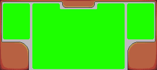
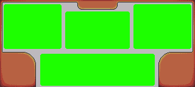

# Handheld HUD Safe Areas and Menu Visual Language

Status: canonical UI authoring contract for the landscape Seeker/mobile build.

This document defines the usable panel geometry inside the permanent controller overlay and records the menu presentation patterns already established by the Player Menu and Candy Machine. It applies to full-screen gameplay panels, modal dossiers, collection views, post-capture presentation, and similar authored UI.

## Source references

- Controller overlay: [`controller_hud.png`](../../../Assets/Sprites/Controls/controller_hud.png)
- Unified-center sample: [`safearea_sample1.png`](../../../Assets/Sprites/Controls/safearea_sample1.png)
- Multi-panel sample: [`safearea_sample2.png`](../../../Assets/Sprites/Controls/safearea_sample2.png)
- Player Menu reference: [`PlayerMenuRoot.prefab`](../../../Assets/Prefabs/UI/PlayerMenu/PlayerMenuRoot.prefab)
- Candy Machine reference: [`CandyMachinePanel.prefab`](../../../Assets/Prefabs/UI/CandyMachine/CandyMachinePanel.prefab)
- Chainling dossier reference: [`ChainlingDetailView.prefab`](../../../Assets/Prefabs/UI/PlayerMenu/ChainlingDetailView.prefab)


The source art is 320 x 144, a 20:9 landscape frame. The safe-area samples use the same coordinate space. Use the normalized anchors below so the layout remains stable if the Canvas reference resolution differs. At 1920 x 864, one source pixel equals six Canvas pixels.

## Two safe-area layers

`Screen.safeArea` and the controller HUD solve different problems and both are required.

1. **Device safe area** protects against Android system bars, display cutouts, and physical screen insets.
2. **Controller HUD content profile** protects against the game's persistent frame, D-pad, face buttons, and decorative shell.

The recommended hierarchy is:

```text
Canvas
└── DeviceSafeArea                         Screen.safeArea
    ├── MenuPresentationRoot               dimmer/background/scanlines
    │   └── ControllerHudContentProfile    named content slots below
    └── ControllerHudOverlay               controller_hud.png, raycastTarget=false
```

Do not replace the device safe area with one large rectangular inset. The controller art has irregular occlusion, especially in both lower corners. Important text, focus chrome, buttons, scrollbars, and pointer targets must remain inside a named slot. Decorative color, shadows, glow, and transition effects may bleed behind the frame when they do not carry information or receive input.

## Profile A: Unified dossier

Use this for a single dominant object: Chainling dossier, library card detail, item inspection, profile summary, or a carousel whose current item deserves most of the screen.



| Slot | Art-space bounds, top-left origin | Normalized Unity anchors, bottom-left origin | 1920 x 864 equivalent |
|---|---:|---:|---:|
| `AccessoryLeft` | x 6..60, y 7..80 | min (0.019, 0.438), max (0.191, 0.951) | x 36..365, y 378..821 |
| `PrimaryCenter` | x 66..253, y 7..141 | min (0.206, 0.014), max (0.794, 0.951) | x 396..1523, y 12..821 |
| `AccessoryRight` | x 259..313, y 7..80 | min (0.809, 0.438), max (0.981, 0.951) | x 1554..1883, y 378..821 |

The numeric source bounds are inclusive; normalized anchors use the exclusive far edge. Treat these as outer panel bounds. Give text and focus art a further 3 source-pixel inset, or 18 pixels at 1920 x 864, unless the sprite's own transparent padding already supplies it.

Usage rules:

- The center panel owns the information hierarchy and the only long-form copy.
- Side panels are intentionally narrow. Use them for previous/next arrows, compact identity facts, page position, type/rarity marks, or a small comparison—not a second document.
- A carousel may leave the side slots visually empty and place only large arrow affordances there.
- Keep the primary action and tab rail inside `PrimaryCenter`; never place them over the D-pad or face-button art.
- For `ChainlingDetailView`, the book page belongs in `PrimaryCenter`. The side slots may carry carousel arrows or compact status, but capture presentation can leave them unused.

## Profile B: Three-up with dialogue

Use this when the player compares or navigates multiple simultaneous columns and still needs persistent instruction/status copy. The Candy Machine is the primary reference.



| Slot | Art-space bounds, top-left origin | Normalized Unity anchors, bottom-left origin | 1920 x 864 equivalent |
|---|---:|---:|---:|
| `TopLeft` | x 6..100, y 7..80 | min (0.019, 0.438), max (0.316, 0.951) | x 36..605, y 378..821 |
| `TopCenter` | x 107..212, y 19..80 | min (0.334, 0.438), max (0.666, 0.868) | x 642..1277, y 378..749 |
| `TopRight` | x 219..313, y 7..80 | min (0.684, 0.438), max (0.981, 0.951) | x 1314..1883, y 378..821 |
| `DialogueLowerCenter` | x 66..253, y 89..141 | min (0.206, 0.014), max (0.794, 0.382) | x 396..1523, y 12..329 |

Usage rules:

- `TopLeft` is browse/list/context; `TopCenter` is mode, resource, or high-level selection; `TopRight` is preview/review/action.
- `DialogueLowerCenter` explains the currently focused control, reports state, and presents blocking errors or progress. Prefer one concise title, two or three lines of body copy, and one prompt line.
- Do not duplicate detailed body text in all three upper panels. The lower panel is the shared explanation surface.
- Collapse or hide irrelevant upper columns during blocking work. A finalization state may show only the mode/status column plus `DialogueLowerCenter`.
- Do not extend the lower panel toward either bottom corner. Those regions are fully occupied by controller art even when the underlying Canvas is visible.

## Space-efficiency rules

- Spend the center area on the current decision or collectible, not permanent navigation chrome.
- Use shallow headers: kicker, title, and one metadata line. Move explanatory prose into the dialogue/detail panel.
- Prefer tabs that replace one content body over multiple simultaneously visible bodies.
- Use compact rows for stats and moves. Avoid cards-inside-cards unless the inner frame communicates selection or grouping.
- Long lists scroll vertically inside their slot. Keep the scrollbar and focused row inside the slot inset.
- Keep touch targets at least 60 x 60 Canvas pixels at the 1920-wide target. Visual art may be smaller if the transparent hit RectTransform remains large and does not overlap a neighboring action.
- Touch and D-pad must operate the same controls. Every panel defines explicit navigation, a default selection, and a deterministic Back destination.

## Panel and background language

### Layer order

Use this back-to-front order:

1. Modal dimmer or world fade, if needed.
2. `BaseTint`.
3. `ScanlineOverlay`.
4. Nine-slice panel backdrops and separators.
5. Content, labels, and icons.
6. Selection shimmer, focus outline, and short-lived reveal flash.
7. `controller_hud.png` overlay.

Decorative images, scanlines, shimmers, flashes, and the controller overlay must have `raycastTarget = false`. A modal's deliberate input blocker belongs on its root dimmer or base tint, not on every visual layer.

### Scanlines

The established hierarchy is `PlayerMenuBackground/BaseTint/ScanlineOverlay`, controlled by [`PlayerMenuBackgroundController.cs`](../../../Assets/Scripts/UI/MenuNavigation/PlayerMenuBackgroundController.cs). The Candy Machine uses the same `BaseTint` and `ScanlineOverlay` vocabulary.

- Keep `respectAuthoredPresentation` enabled on authored prefabs. Runtime code must not replace the artist's sprite, color, texture, or UV layout unless a caller explicitly opts into an override.
- Scanlines sit behind text and interaction chrome. Their contrast must not reduce small pixel-font legibility.
- Mask scanlines to a panel silhouette when they belong to a nested popup.
- Scroll scanline UVs using unscaled time so paused menus remain alive.
- Reuse `Assets/Sprites/Combat/BattleDevice/SCANLINE_FRAME_PMROOT.png` for Player Menu-family surfaces unless a feature has an intentionally different authored texture.

### Panel backdrops

Prefer existing sliced families instead of new one-off rectangles:

- `Assets/Sprites/UI/PlayerMenu/9sliceborder_*.png`
- `Assets/Sprites/UI/PlayerMenu/bar_sliced*.png`
- `Assets/Sprites/UI/PlayerMenu/infopanel.png`
- `Assets/Sprites/UI/MainMenu/Buttons/menu_panel_sliced*.png`
- `Assets/Sprites/UI/MainMenu/Buttons/dialog_box.png` for the established dialogue treatment

Use `Image.Type.Sliced` for sprites authored with borders. Preserve crisp pixel edges and the authored outline thickness; resize the center fill rather than scaling corner pixels. Orange is active/selected/emphatic, gray is neutral/disabled, and dark maroon/brown is the normal reading surface.

## Buttons, focus, and navigation

The reusable button behavior is [`UiSelectableMotion.cs`](../../../Assets/Scripts/UI/UI_VisualFX/UiSelectableMotion.cs) with a `UiMotionProfileSO` rather than feature-specific focus scripts.

- Base state: gray or neutral button sprite.
- Selected state: orange sprite or full-button shimmer overlay.
- When shimmer owns the selected visual, keep the base image on its deselected sprite. Drawing a selected base and full-button shimmer together causes doubled borders and muddy text.
- Keep the shimmer behind the label, non-raycastable, and active only while selected.
- Submit and pointer click must share the same confirm feedback. Pointer enter may move EventSystem focus so touch/mouse and D-pad state agree.
- Disabled controls use the authored gray sprite and readable gray label, remove shimmer/pulse, and remain non-interactable. Explain the reason in the shared detail body.

The standard profile currently uses focus scale 1.06 over 0.12 s, a subtle 1.03 pulse, press scale 0.95 over 0.08 s, and a stagger of 0.06 s. The common Player Menu shimmer runs at 15 fps with a 1.25 s pause; Main Menu uses 8 fps. Treat the ScriptableObject as authoritative rather than copying these values into new scripts.

Gamepad contract:

- D-pad/left stick: navigate.
- A/South: submit.
- B/East: cancel/back.
- Default selection is set after entrance completes, not while controls are moving.
- Navigation is explicit for nontrivial grids, tab rails, side arrows, and transitions between header/content/footer groups.

## Motion vocabulary

All menu tweens use unscaled time, are killed on hide/destroy, and lock interaction only for the portion that would make selection ambiguous.

| Pattern | Existing reference | Use |
|---|---|---|
| Top drop + soft landing | `ChainlingDetailScreen.PlayEntrance` | Dossiers and book-page summaries: 0.42 s `OutCubic` to a small overshoot, 0.12 s `OutBack` settle, with a short fade-in. |
| Card drop, tilt, and scale settle | `LibraryCardResultPresenter.PlayEntrance` | High-value collectible reveals only: 0.64 s `OutCubic`, slight random tilt, 1.02 scale settle, outline flash. |
| Column pop/stagger | `CandyMachineScreen.PlayColumnReveal` | Multi-panel mode changes: center/mode commits first, then side columns scale from zero with `OutBack` and a short fade. |
| Focus + pulse + press squash | `UiSelectableMotion` | Every reusable button. Keep motion subtle enough that neighboring hit regions do not appear to move. |
| Pending pulse/flash | `UiPendingIndicator` | Async operations: persistent spinner while pending, one short success/failure flash when state changes. |
| Carousel shift | Chainling and inventory rails | Neighbor items move/scale/fade together with `OutSine`; do not teleport focus between slots. |

Do not play a high-impact entrance for every tab change. Reserve the book/card drop for a newly captured or newly acquired subject. Ordinary detail tabs should switch quickly with a panel cue and minimal fade/slide.

## SFX vocabulary

Route UI audio through `PlayerMenuSfxResolver`/the existing SFX player instead of adding local `AudioSource` components.

- `MenuOpen` / `MenuClose`: full-screen menu lifecycle.
- `PanelSwitch`: book page arrival, mode commit, or tab/page change.
- `ChainlingSelect`: Chainling reveal/selection accent; may use the species spawn sound where supported.
- `Confirm`: accepted action or capture-reveal continuation.
- `Cancel`: Back/close.
- `Invalid`: blocked or unavailable action.
- `CarouselMove`: one item-to-item movement, with navigation-cue suppression to avoid double playback.

For the post-capture dossier, play `PanelSwitch` as the page begins moving and `ChainlingSelect` at the landing. Do not stack another generic confirm cue on the same frame. The Continue action uses `Confirm`; Back from a normal Player Menu dossier uses `Cancel`.

## Authoring checklist

- Test with `controller_hud.png` visible above the panel.
- Test the actual Android `Screen.safeArea`; do not validate only at desktop 16:9.
- Choose Profile A or B before placing content. Do not create a third geometry casually.
- Keep every meaningful element inside a named slot and its internal inset.
- Confirm touch hit rectangles and D-pad focus are both visible and unobstructed.
- Verify A submits, B returns to the previous screen, and reopening restores a valid default selection.
- Confirm authored sprites/colors survive Play Mode; enable `respectAuthoredPresentation` where applicable.
- Verify scanline/shimmer/decorative layers do not block raycasts.
- Verify tweens run at `timeScale == 0`, release input locks, and reset after close/reopen.
- Validate at least one long name, maximum stat value, empty state, pending state, and error state.

