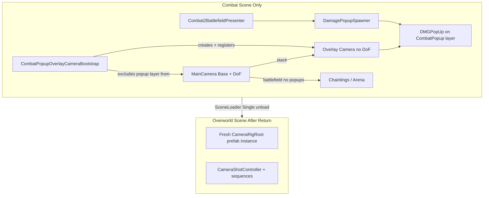

> **Parked for review.** Yet to implement. No combat popup overlay camera in the client scripts. Review list: [../README.md](../README.md).

# Combat Popup Overlay Camera — Planning Brief

> **Purpose:** Reference document for Codex / implementation planning.  
> **Scope:** Fix world-space combat damage popups being blurred by Global Volume Depth of Field (DoF) **without** affecting the shared overworld camera rig.  
> **Status:** Planning only — no implementation yet.

---

## 1. Goal Summary

Combat damage popups (`DMGPopUp`) are spawned in **world space** at chainling slot anchors during battle. They use `TextMeshPro` + `SpriteRenderer` and billboard toward the combat camera.

The combat scene’s main camera (`CameraRigRoot` → `MainCamera`) renders with **URP post-processing enabled**, including Gaussian Depth of Field from `Assets/Global Volume Profile.asset` (`gaussianStart: 65`, `gaussianEnd: 95`). Popups sit near the battlefield (~10–20 units from camera) and fall **outside the in-focus band**, so they appear soft/blurred.

**We want:**

1. Sharp, readable combat popups during battle.
2. Keep battlefield DoF on the main combat camera (aesthetic unchanged).
3. Introduce a **URP Overlay camera** that renders popups on a dedicated layer **without post-processing**.
4. Scope the overlay to **combat scenes only** — create at combat start, tear down when leaving combat / returning to overworld.
5. **Do not permanently modify** `Assets/Prefabs/Camera/CameraRigRoot.prefab` or any shared overworld/narrative camera setup.

---

## 2. Problem Analysis (Current Pipeline)

### 2.1 Popup spawn path

| Step | Location | Notes |
|------|----------|-------|
| Battle events trigger popups | `Assets/Scripts/Combat/Runtime/Presentation/Combat2BattlefieldPresenter.cs` | `SpawnPopup`, `SpawnPopupAtAnchor`, category popups in partials |
| Anchor resolution | `Assets/Scripts/Combat/Runtime/Presentation/Combat2ChainlingView.cs` | `ResolvePopupWorldPosition()` uses `popupAnchor` / `impactAnchor` / `barrierAnchor` |
| Spawning + pooling | `Assets/Scripts/Combat/Runtime/Presentation/DamagePopupSpawner.cs` | `Configure(combatCamera)` sets `renderCamera`; pool under `popupRoot`, active popups reparented to scene root |
| Visual playback | `Assets/Scripts/Combat/Runtime/Presentation/DamagePopup.cs` | `LateUpdate()` billboards to `_renderCamera` (from spawner’s `combatCamera`) |
| Prefab | `Assets/Prefabs/Combat/DMGPopUp.prefab` | Layer **19 = Chainling**; `billboardToCamera: 1` |
| Scene wiring (test harness) | `Assets/Scenes/Combat2_TestHarness.unity` | `DamagePopupSpawner.renderCamera` → combat `MainCamera` (`790244949`); presenter wires spawner in `ResolveUxFallbacks()` |

Presenter camera wiring (combat-only, scene-local):

```csharp
// Combat2BattlefieldPresenter.ResolveUxFallbacks()
damagePopupSpawner.Configure(combatCamera);
```

Presenter discovers camera on enable:

```csharp
// Combat2BattlefieldPresenter.OnEnable()
if (combatCamera == null)
    combatCamera = Camera.main;
// combatCameraController → TopDownCameraController3D (ICombatCameraController)
```

### 2.2 DoF source

| Asset | Role |
|-------|------|
| `Assets/Global Volume Profile.asset` | Active Gaussian DoF: start **65**, end **95** |
| `Assets/Prefabs/Volume/Global Volume.prefab` | References above profile (`guid: fee8bffbbdc5d4147bc47cab6cf27dbf`) |
| Combat scene | `Combat2_TestHarness.unity` contains a scene `Global Volume` object |

Main camera post-processing is **on** in `CameraRigRoot.prefab`:

- `UniversalAdditionalCameraData.m_RenderPostProcessing: 1`
- `m_Cameras: []` (empty overlay stack today)
- `m_CameraType: 0` (Base)

### 2.3 Why layer/material exemption is insufficient

URP applies Volume post-processing **per camera render**, not per-object material. Popups on the same base camera as the battlefield will be DoF-processed regardless of layer or shader, unless they are:

- Rendered by a **separate camera** with post-processing disabled, or
- Moved to Screen Space UI on a canvas that bypasses world DoF (not desired — popups are world-anchored to slots).

---

## 3. Proposed Solution — Combat-Only URP Overlay Camera

Use Unity URP **Camera Stacking**:

1. **Base camera** (existing `MainCamera` on `CameraRigRoot`) — unchanged role: battlefield, chainlings, DoF, narrative/combat camera control.
2. **Overlay camera** (runtime-created) — renders **only** the popup layer, **post-processing off**, stacked on the base camera.

Popups must be **excluded from the base camera culling mask** while combat is active so they are not drawn twice (once blurred, once sharp).



---

## 4. Required Additions and Changes

### 4.1 New Unity layer (Project Settings)

**Add:** `CombatPopup` (or similar) in `ProjectSettings/TagManager.asset`.

**Why:** Popups currently use layer **Chainling** (index 19). Chainlings must stay on the main camera. Popups need an isolated layer the overlay camera alone renders.

**Change popup layer assignment:**

| Target | Change |
|--------|--------|
| `Assets/Prefabs/Combat/DMGPopUp.prefab` | Set root + children to `CombatPopup` layer |
| `DamagePopupSpawner.CreatePopup()` | Optionally force layer at instantiate time as safety net |
| `DamagePopup` root on play | Ensure runtime-created fallback popups get `CombatPopup` layer |

**Do not** move chainling meshes to this layer.

---

### 4.2 New runtime bootstrap component (combat-scoped)

**Add:** e.g. `Assets/Scripts/Combat/Runtime/Presentation/CombatPopupOverlayCameraBootstrap.cs`  
*(Alternative placement: `Assets/Scripts/Camera/` if treated as camera utility — prefer Combat/Presentation since it is combat-only.)*

**Responsibilities:**

| Phase | Action |
|-------|--------|
| **Awake / OnEnable** | Resolve base camera (`Camera.main` or serialized ref from presenter) |
| | Snapshot base camera `cullingMask` for restore |
| | Create child GameObject under `MainCamera` (or sibling under pitch pivot): `CombatPopupOverlayCamera` |
| | Add `Camera` + `UniversalAdditionalCameraData` |
| | Configure overlay: `RenderType.Overlay`, post-processing **off**, culling mask = `CombatPopup` only, same FOV/near/far/orthographic as base |
| | Register overlay in base `UniversalAdditionalCameraData.cameraStack` |
| | Remove `CombatPopup` layer bit from base camera culling mask |
| **LateUpdate** (if not parented to MainCamera) | Copy base transform so overlay matches combat camera motion |
| **OnDisable / OnDestroy** | Remove overlay from stack, restore culling mask, destroy overlay GameObject |

**Hard rules for overlay camera:**

- **No** `AudioListener`
- **No** `MainCamera` tag (keep tag on base only)
- **No** changes to base camera depth, clear flags, or render type
- **No** insertion into `CameraYawPivot` / `CameraPitchPivot` hierarchy in a way that alters rig logic — child of `MainCamera` transform is acceptable (inherits motion automatically)

**Suggested attachment point:** Combat scene object already always present — e.g. same GameObject as `DamagePopupSpawner`, or wired from `Combat2BattlefieldPresenter` after `ResolveUxFallbacks()`.

---

### 4.3 DamagePopupSpawner / DamagePopup (minor)

**File:** `Assets/Scripts/Combat/Runtime/Presentation/DamagePopupSpawner.cs`

| Item | Detail |
|------|--------|
| `Configure(Camera camera)` | Continue passing **base/main combat camera** for billboarding — same view direction as today |
| Optional | Accept overlay bootstrap reference; or bootstrap self-registers before first spawn |
| `CreatePopup()` | Set instantiated popup layer to `CombatPopup` |

**File:** `Assets/Scripts/Combat/Runtime/Presentation/DamagePopup.cs`

| Item | Detail |
|------|--------|
| `LateUpdate()` billboarding | **No change required** if `renderCamera` remains base camera (recommended) |
| Layer | Prefab + spawner should assign `CombatPopup`; no shader changes needed |

Billboarding uses the same camera transform whether popups render on overlay or base:

```csharp
// DamagePopup.LateUpdate()
var cam = _renderCamera != null ? _renderCamera : Camera.main;
transform.rotation = Quaternion.LookRotation(-toCamera.normalized, cam.transform.up);
```

---

### 4.4 Combat2BattlefieldPresenter (integration hook)

**File:** `Assets/Scripts/Combat/Runtime/Presentation/Combat2BattlefieldPresenter.cs`

| Item | Detail |
|------|--------|
| Optional serialized ref | `CombatPopupOverlayCameraBootstrap` |
| `ResolveUxFallbacks()` | Ensure bootstrap exists/enabled before or when configuring spawner |
| `OnDisable()` | Bootstrap teardown via its own `OnDestroy` is sufficient if on same scene object graph |

Presenter already restores combat camera focus on disable (`RestoreDefaultCameraTarget`, `DestroyRuntimeCameraFocusTarget`) — overlay bootstrap must **not** interfere with `TopDownCameraController3D` / `ICombatCameraController` target or shake APIs.

---

### 4.5 Scene / prefab wiring (combat only)

| Asset | Change |
|-------|--------|
| `Assets/Scenes/Combat2_TestHarness.unity` | Add bootstrap component (or ensure auto-create from presenter). **Do not** add overlay camera to scene YAML permanently if bootstrap creates it at runtime. |
| Future production combat scene(s) | Same bootstrap pattern |
| `Assets/Prefabs/Camera/CameraRigRoot.prefab` | **NO permanent overlay camera child** |
| Overworld scenes (`Loomville`, `player_room`, `main_menu`, etc.) | **NO changes** |

---

### 4.6 Files that must NOT be changed (for this feature)

| Asset / System | Reason |
|----------------|--------|
| `Assets/Prefabs/Camera/CameraRigRoot.prefab` | Shared across 6+ scenes; narrative + explore camera |
| `Assets/Scripts/Camera/TopDownCameraController3D.cs` | Rig hierarchy, profiles, yaw/pitch, shake — combat calls via `ICombatCameraController` |
| `Assets/Scripts/Camera/Shots/CameraShotController.cs` | DontDestroyOnLoad; re-binds per scene — must not receive combat overlay state |
| `Assets/Global Volume Profile.asset` | DoF stays; overlay bypasses it instead of removing DoF globally |
| `Assets/Prefabs/GameServices/GameServices.prefab` | Persistent services — bootstrap must **not** live here |

---

### 4.7 Optional editor tooling

**Add (optional):** Menu item under `Tools/Signal Jam/Combat/` to validate combat scene has bootstrap + layer + prefab layer assignment (mirrors patterns in `CombatSfxPrefabAuthoring.cs`, `CombatBattleCanvasSplitEditor.cs`).

---

## 5. Overworld Camera Safety — Hard Constraints

These constraints are **non-negotiable** for implementation and review.

### 5.1 Scene isolation (primary safety net)

`SceneLoader` loads with **`LoadSceneMode.Single`**:

```csharp
// Assets/Scripts/Core/Services/SceneLoader.cs
AsyncOperation loadOp = SceneManager.LoadSceneAsync(sceneName, LoadSceneMode.Single);
```

**Implication:** Entering combat **unloads** the overworld scene and its `CameraRigRoot` instance. Returning to overworld **destroys** the entire combat scene, including any runtime overlay camera and runtime culling-mask overrides. Overworld gets a **fresh** prefab instance with default stack (`m_Cameras: []`) and original culling mask.

Encounter flow reference:

- Into combat: `Assets/Scripts/Core/EncounterTransitionBridge.cs` → `SceneLoader.LoadSceneAsync(battleSceneName, ...)`
- Out of combat: `Assets/Scripts/Core/PostBattleSceneReturnHandler.cs` → `EncounterOverworldSceneLoader.LoadReturnScene` / `SceneLoader.LoadScene`

### 5.2 No permanent shared prefab edits

| Forbidden | Why |
|-----------|-----|
| Adding overlay camera to `CameraRigRoot.prefab` | Would appear in main menu, player room, Loomville, Bootstrap, etc. |
| Changing `MainCamera` tag, depth, or Base → Overlay on prefab | Breaks `Camera.main`, narrative shots, explore mode |
| Adding second `AudioListener` anywhere persistent | Breaks spatial audio across scenes |

### 5.3 Runtime mutations must be reversible

If the bootstrap modifies the **combat scene’s** base camera at runtime:

| Mutation | Must restore on teardown |
|----------|--------------------------|
| `UniversalAdditionalCameraData.cameraStack` | Remove overlay entry |
| `Camera.cullingMask` | Restore snapped pre-combat mask |
| Child overlay GameObject | `Destroy` |

Implement `OnDestroy` cleanup even though Single-scene unload usually handles it — protects **Play Mode** when jumping directly into `Combat2_TestHarness` or stopping play from combat.

### 5.4 Do not attach bootstrap to DontDestroyOnLoad

| Object | Persistence |
|--------|-------------|
| `GameServicesContainer` / `GameServices.prefab` | DontDestroyOnLoad |
| `CameraShotController` | On GameServices; re-finds `TopDownCameraController3D` on `SceneManager.sceneLoaded` |
| `CameraRigRoot` | **Scene-local** (not DontDestroyOnLoad) |

Bootstrap must live on a **combat scene object** so it is destroyed with the combat scene. Never parent overlay camera under GameServices.

### 5.5 Narrative / combat camera control unchanged

During combat, overworld narrative camera is inactive (scene unloaded). Combat uses:

- `TopDownCameraController3D` on `MainCamera` (`ICombatCameraController`)
- `Combat2BattlefieldPresenter` → `SetCameraTarget`, `ShakeCamera`, runtime focus target

Overlay camera must:

- **Not** replace or reassign `combatCamera` / `combatCameraController` on the presenter
- **Not** modify rig pivots (`CameraRigRoot` → `CameraYawPivot` → `CameraPitchPivot` → `MainCamera`)
- **Not** change camera profiles or `CameraShotController` saved state

After overworld return, `CameraShotController.OnSceneLoaded` already clears stale shot state and re-acquires the new scene’s `TopDownCameraController3D` — no combat overlay residue expected if constraints above are met.

### 5.6 Layer mask discipline

Only **`CombatPopup`** layer is added to overlay and removed from base. Do not alter other layer bits — avoids accidentally hiding UI, chainlings, or VFX on either camera.

---

## 6. Implementation Checklist (for Codex plan)

### Phase A — Project setup
- [ ] Add `CombatPopup` layer in Tag Manager
- [ ] Update `DMGPopUp.prefab` layer (all child renderers)

### Phase B — Runtime bootstrap
- [ ] Create `CombatPopupOverlayCameraBootstrap.cs`
- [ ] Snapshot/restore culling mask
- [ ] Create overlay camera with URP Overlay settings
- [ ] Register/unregister camera stack
- [ ] `OnDestroy` cleanup

### Phase C — Combat integration
- [ ] Wire bootstrap in `Combat2_TestHarness.unity` (or auto-spawn from presenter)
- [ ] Ensure `DamagePopupSpawner` sets popup layer on instantiate
- [ ] Verify `Configure(combatCamera)` still uses base camera

### Phase D — QA
- [ ] Popups sharp during battle with DoF still visible on battlefield
- [ ] No double-draw (ghost/blur duplicate)
- [ ] Combat camera follow, shake, intro, and focus modes unchanged
- [ ] Return to overworld: no overlay in hierarchy, `Camera.main` normal, narrative shots work
- [ ] Direct play from combat scene + stop Play Mode: no errors, no leaked stack entries
- [ ] Main menu / player room / Loomville: no overlay camera present (prefab unchanged)

---

## 7. Acceptance Criteria

1. **Visual:** Damage/heal/crit/status popups are crisp and readable in combat with Global DoF active on the battlefield.
2. **Scope:** Overlay exists only while a combat scene is loaded; absent in all non-combat scenes.
3. **Prefab integrity:** `CameraRigRoot.prefab` diff is empty (or only unrelated changes).
4. **Camera behavior:** `TopDownCameraController3D` + presenter combat focus/shake behave identically before/after.
5. **Overworld return:** No console errors; `CameraShotController` and narrative sequences control camera normally.
6. **Performance:** Single extra overlay draw of lightweight TMP/sprites only; no second full-scene render.

---

## 8. Alternatives (Out of Scope Unless Revisited)

| Approach | Tradeoff |
|----------|----------|
| Disable DoF in combat via combat-only Volume profile | Simpler, but loses battlefield depth blur entirely |
| Screen Space Camera canvas for popups | Breaks world-anchor slot positioning model |
| Material/shader "unlit overlay" on same camera | **Does not bypass** URP Volume DoF |
| Move popups to Chainling layer + exclude from DoF | **Not supported** by current URP volume pipeline |

---

## 9. Key Codebase References

| Path | Relevance |
|------|-----------|
| `Assets/Prefabs/Camera/CameraRigRoot.prefab` | Shared rig; Base camera, post-processing on, empty stack |
| `Assets/Scripts/Camera/TopDownCameraController3D.cs` | Rig hierarchy; `ICombatCameraController`; must remain untouched |
| `Assets/Scripts/Camera/Shots/CameraShotController.cs` | DontDestroyOnLoad; scene re-bind on load |
| `Assets/Scripts/Combat/Runtime/Presentation/Combat2BattlefieldPresenter.cs` | Combat camera + popup orchestration |
| `Assets/Scripts/Combat/Runtime/Presentation/DamagePopupSpawner.cs` | Pooling; `Configure(combatCamera)` |
| `Assets/Scripts/Combat/Runtime/Presentation/DamagePopup.cs` | Billboarding to render camera |
| `Assets/Scripts/Combat/Runtime/Presentation/Combat2ChainlingView.cs` | `ResolvePopupWorldPosition()` |
| `Assets/Prefabs/Combat/DMGPopUp.prefab` | Popup prefab (currently layer Chainling) |
| `Assets/Global Volume Profile.asset` | DoF gaussian 65–95 |
| `Assets/Prefabs/Volume/Global Volume.prefab` | Volume profile reference |
| `Assets/Scenes/Combat2_TestHarness.unity` | Combat test scene wiring |
| `Assets/Scripts/Core/Services/SceneLoader.cs` | Single-scene load (isolation guarantee) |
| `Assets/Scripts/Core/EncounterTransitionBridge.cs` | Overworld → combat transition |
| `Assets/Scripts/Core/PostBattleSceneReturnHandler.cs` | Combat → overworld return |
| `ProjectSettings/TagManager.asset` | Layer definitions (Chainling = 19) |

---

## 10. Suggested Codex Plan Structure

When turning this into an executable plan, split work as:

1. **Layer + prefab** — data-only, no runtime risk to camera
2. **Bootstrap component** — isolated, unit-testable teardown
3. **Combat scene wiring** — test harness first
4. **QA matrix** — combat direct play, encounter round-trip, overworld spot-check

Explicit **review gate:** confirm `CameraRigRoot.prefab` and overworld scenes have zero diff before merge.
