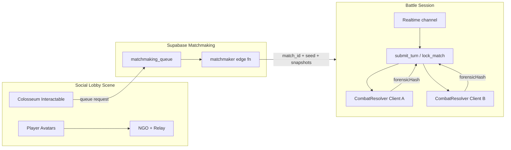

> **Parked for review.** Yet to implement. No lobby or matchmaking types in the Unity scripts. The NGO package is only a manifest dependency. Review list: [../README.md](../README.md).

# PvP Phase 1 — Social Lobby & Casual Matchmaking

**Status:** Spec / implementation guide (pre-build)  
**Audience:** Implementing agents, Unity engineers, backend engineers  
**Depends on:** Existing combat determinism (`CombatResolver`, `ConfigStamp`, `forensicHash`), wallet session (`AccountSessionService`), NGO package already in `Packages/manifest.json`  
**Does not include:** On-chain escrow, ranked rating, tournament brackets (Phases 2–3)  
**Related:** [`PVP_02_Ranked_Escrow_And_Ladder.md`](PVP_02_Ranked_Escrow_And_Ladder.md), [`PVP_03_Tournaments_And_Themed_Brackets.md`](PVP_03_Tournaments_And_Themed_Brackets.md), [`LEVER_BOARDS_v1.md`](../../Specs/Combat/LEVER_BOARDS_v1.md), [`COMPETITIVE_LADDER_AND_SEASONS_v1.md`](../Specs/Combat/COMPETITIVE_LADDER_AND_SEASONS_v1.md), [`AssemblyModules.md`](../../Architecture/AssemblyModules.md), [`WALLET_CONNECTION_SETUP.md`](../../Guides/WALLET_CONNECTION_SETUP.md)

---

## 0. Purpose

Ship the smallest end-to-end online PvP loop that:

1. Puts players in a **shared social lobby** (avatar movement, presence).
2. Lets anyone feel the social layer **without a wallet**.
3. Gates the **colosseum / arena entrance** for wallet-linked players when entering wager-capable queues later — Phase 1 still allows casual queue without wallet if product wants a funnel.
4. Matchmakes **casual 1v1** battles.
5. Relays turn actions through Supabase and resolves combat via **dual local simulation** of the existing deterministic `CombatResolver`.
6. Collects **forensic hash mismatch telemetry** so Phase 2 escrow can trust the pipeline.

This phase is the beta PvP surface. No SOL, no NFT deposits, no rating movement.

---

## 1. Architecture principle — split presence from battle

| Concern | Stack | Why |
|---------|-------|-----|
| Lobby presence (transform, emotes, chat later) | **Unity Netcode for GameObjects (NGO) 1.8.x** + **UGS Relay + Lobby** (or Unity 6 Multiplayer Sessions API) | Soft state; client-authoritative transforms OK; package already present |
| Matchmaking | **Supabase** (`matchmaking_queue` + edge matcher) | Same backend as profiles/outcomes; no dedicated game server |
| Battle turns | **Supabase Realtime channel per match** + edge functions for submit/validate | Turn-based; needs server witness, not physics sync |
| Combat outcome | Both clients run `CombatResolver` with server-issued seed + pinned `configHash` | Already deterministic; stamps `ConfigStamp` / `forensicHash` |

**Hard rule:** Do **not** run combat state sync over NGO. Do **not** trust either client as battle host for legality or outcomes.



---

## 2. What already exists (reuse, do not rewrite)

| Asset | Path / note |
|-------|-------------|
| NGO package | `com.unity.netcode.gameobjects` **1.8.1** in `Packages/manifest.json` — **unused in scripts today** |
| Player locomotion | `Assets/Scripts/Movement/PlayerMovement3D.cs` |
| Player visuals | `MeshRendererPlayerVisual`, `PlayerAnimationController3D_*` |
| Scene loading | `Assets/Scripts/Core/Services/SceneLoader.cs` (spawn IDs, fade, input freeze) |
| Interactables | `Assets/Scripts/Interactable/**` — colosseum door should be an interactable |
| Wallet gate primitives | `AccountSessionService.isWalletConnected`, `HasFreshWalletProof`; MWA via `MobileWalletAdapterBridge` |
| PvP combat hooks | `CombatBattleController.SetWagerOrchestrator`, `BattleType.PvP`, `PvPMoveSelectController` |
| Determinism | `CombatRng`, `CombatResolver` seed, `ConfigStamp`, `CombatReplayData`, `BattleResult.forensicHash` |
| Rulesets | `CombatRulesetSO` + `Ruleset_PvP_Ranked.asset` (use a casual ruleset clone or flag) |
| Persistence pattern | Edge functions via `SupabaseClient.PostJsonAsync` only (no direct `/rest/v1` from game) |

---

## 3. Explicit deliverables

### 3.1 Unity — Lobby scene & netcode

**Create / configure:**

1. **Scene:** e.g. `Assets/Scenes/PvP/SocialLobby.unity` (use existing scene folder conventions; do not invent scripts folders outside project rules).
2. **Network bootstrap MonoBehaviour** (Assembly-CSharp unless an existing multiplayer folder appears — prefer `Assets/Scripts/UI/` or `Assets/Scripts/Core/Services/` for lobby services; combat-facing match handoff stays behind interfaces in Combat.Runtime).
3. **Player lobby prefab** with:
   - NGO `NetworkObject` + `NetworkTransform` (or lightweight custom transform sync).
   - Visual driven by cosmetic IDs already known to the profile (catalog IDs only — never trust peer-sent ownership).
   - Local input: reuse `PlayerMovement3D` patterns; remote peers: disable local input, apply networked pose.
4. **Lobby shard capacity:** 12–16 players per Relay session. When full, allocate a new Lobby/Relay instance (plaza shards).
5. **Colosseum interactable:** On interact → open queue UI (casual / later ranked). Check wallet only when entering ranked or when product requires wallet for casual (configurable flag on `MatchmakingConfigSO`).

**Packages to add (Editor):**

- `com.unity.services.multiplayer` / Lobby + Relay packages matching Unity version (verify against current UGS docs at implement time).
- Initialize UGS with anonymous or project-auth; do **not** confuse UGS player ID with Supabase profile ID — store a mapping table if both exist.

### 3.2 Unity — Matchmaking client

Interface-first (systems-first):

```csharp
// Conceptual contract — place under Combat/Runtime/Services or Core/Services
public interface IMatchmakingService
{
    Task EnqueueAsync(MatchQueueRequest request, CancellationToken ct);
    Task CancelAsync(CancellationToken ct);
    event Action<MatchFoundPayload> OnMatchFound;
}
```

`MatchQueueRequest` must include:

- `profileId`, `queueType` (`casual` | `ranked` later)
- `rulesetId` + local `configHash` (server rejects mismatch)
- `clientAppVersion` + resolver build stamp
- Locked party snapshot **or** snapshot hash if server re-fetches from profile lineup
- Optional: preferred wager tier (ignored in Phase 1)

### 3.3 Supabase — Matchmaking

**Tables (illustrative):**

```sql
-- matchmaking_queue
profile_id uuid PK/FK
queue_type text -- 'casual'
ruleset_id text
config_hash text
app_version text
party_snapshot jsonb  -- or reference to locked lineup row
enqueued_at timestamptz
expires_at timestamptz
status text -- waiting | matched | cancelled | expired

-- pvp_matches
match_id uuid PK
queue_type text
ruleset_id text
config_hash text
seed bigint / bytea
player_a uuid
player_b uuid
party_a jsonb
party_b jsonb
state text -- created | in_progress | completed | disputed | cancelled
created_at timestamptz
```

**Edge functions:**

| Function | Role |
|----------|------|
| `pvp_enqueue` | Validate JWT, profile, ruleset hash vs server `get_pvp_config` / ruleset registry, insert queue row |
| `pvp_cancel_queue` | Remove waiting row |
| `pvp_matchmaker` | Cron or triggered: pair same `queue_type` + compatible `ruleset_id`/`config_hash`/`app_version`; create `pvp_matches`; delete queue rows; notify via Realtime or poll |
| `pvp_lock_match` | Finalize locked parties (re-validate ownership/lineup from DB — never trust client party for eligibility later in ranked) |
| `pvp_submit_turn` | Validate turn vs locked loadout + AP budget + timer; append turn log; broadcast |
| `pvp_submit_result` | Accept `forensicHash` + optional replay digest; if both match → complete; else → disputed |

**Realtime:** one channel per `match_id` (e.g. `pvp_match:{match_id}`). Clients subscribe after match found. Prefer edge-function writes over client-direct channel sends so the server remains authoritative.

### 3.4 Battle dual-simulation flow

1. Server creates match with cryptographically strong **seed**, pinned `rulesetId` / `configHash`, and both **party snapshots** (server-authored from profile/lineup after lock).
2. Clients load combat scene via existing `SceneLoader` / narrative encounter patterns — prefer a **PvP battle bootstrap** that injects providers from the match payload (not `ManualEncounterProvider` in production).
3. Each turn:
   - Local player chooses move through existing combat UI.
   - Client POSTs action to `pvp_submit_turn`.
   - Server validates cheap legality (move in locked `moveIds`, target legal, AP affordable, within turn timer from `CombatResolverConfigSO.turnActionTimeLimitSeconds`).
   - Server stores ordered turn record and pushes to opponent.
   - Both clients feed the same action into local `CombatResolver`.
4. End:
   - Each client computes `forensicHash` (existing path).
   - Both submit via `pvp_submit_result`.
   - Match → `completed` if hashes equal; else `disputed` and log both hashes + full turn log for offline re-sim.

**Phase 1 settlement:** no escrow. Winner gets casual cosmetics/XP only if product wants — route through `PostBattleRewardsConfigSO` with a PvP casual difficulty row; do not invent a parallel rewards system.

### 3.5 Lever board — MatchmakingConfigSO

New board per Rule 11 (lever boards). Own these values **only here**:

| Field | Intent |
|-------|--------|
| `casualEnabled` / `rankedEnabled` | Feature flags |
| `requireWalletForCasual` | Default **false** for funnel |
| `requireWalletForRanked` | Default **true** (Phase 2) |
| `lobbyMaxPlayers` | 12–16 |
| `queueTimeoutSeconds` | Expire waiting players |
| `ratingBandStart` / `widenPerSecond` / `bandCap` | Used lightly in Phase 1 if soft skill hints exist; required in Phase 2 |
| `rematchCooldownSeconds` | Anti-spam |
| `turnForfeitMissedTurns` | N missed turns → forfeit (server) |
| `maxAppVersionSkew` | Reject mismatched clients |
| `defaultCasualRulesetId` | Points at `CombatRulesetSO` |

Implement: `ComputeConfigHash()`, `OnValidate()`, `CreateRuntimeDefault()`, register on `BalanceConfigRuntime` / `BalanceConfigService`. Update [`LEVER_BOARDS_v1.md`](../../Specs/Combat/LEVER_BOARDS_v1.md) when shipping.

Server mirror: `Supabase/functions/_shared/matchmaking_config.ts` + `get_pvp_config` (can start as matchmaking-only; Phase 2 extends with wager fields). Client must refuse to queue if local hash ≠ server hash when server reachable (same pattern as `get_vending_config`).

---

## 4. Wallet / social gating policy (Phase 1)

| Space | Wallet required? |
|-------|------------------|
| Enter social lobby | **No** — anonymous Supabase session sufficient |
| Emotes / roam / spectate plaza | **No** |
| Casual queue | Configurable; recommend **No** for beta funnel |
| Ranked / escrow (Phase 2) | **Yes** — `isWalletConnected && HasFreshWalletProof` |
| Colosseum interior (visual) | Optional soft gate with UI prompt to connect wallet |

Use existing MWA stack for connect prompts (`SolanaWalletService`, `MobileWalletAdapterBridge`). Do not reintroduce Solana.Unity-SDK.

**Seeker / MWA notes (from Solana Mobile docs — re-verify via MCP at implement time):**

- MWA is the protocol for transaction/message signing on mobile; Seed Vault is Seeker hardware custody.
- Cache MWA authorization across sessions per product policy (see Solana Mobile “Caching MWA Authorization”).
- Detect Seeker users only when a feature needs device-specific UX — do not hard-gate Phase 1 lobby on Seeker.

---

## 5. Assembly & folder placement (agents)

Follow the project-structure rule (not in this public snapshot) and [`AssemblyModules.md`](../../Architecture/AssemblyModules.md):

| Code | Suggested home | Assembly |
|------|----------------|----------|
| Matchmaking interfaces / DTOs used by combat | `Assets/Scripts/Combat/Runtime/Services/**` | Chainbound.Combat.Runtime |
| NGO lobby bootstrap, avatar sync | Prefer `Assets/Scripts/Core/Services/**` or `UI/**` | Assembly-CSharp (unless new asmdef explicitly requested) |
| Solana wallet prompts | `Assets/Scripts/Solana/**` | Chainbound.Combat.Runtime (asmref) |
| Lever board SO | `Assets/Scripts/Combat/Runtime/ScriptableObjects/` | Combat.Runtime |
| Config assets | `Assets/Data/Combat/Config/**` | n/a |
| Docs | `Docs/Guides/**` or `Docs/Specs/**` | n/a |

**Never** have Combat.Runtime reference MenuNavigation. Menu UI may call combat services.

Do **not** add new `.asmdef` unless the user asks — prefer existing modules.

---

## 6. Guardrails & failure modes

| Risk | Guardrail |
|------|-----------|
| Cheating via host authority | No client-hosted battle authority; server turn log is SoT |
| Loadout swap mid-queue | Lock party at match create from server profile; ignore client re-sends |
| Config tampering | Pin `configHash`; reject enqueue on mismatch |
| Determinism drift | Gate on `app_version` + resolver hash; log mismatches; quarantine disputed matches |
| NGO lobby griefing | Soft: kick/report hooks later; no economic stake in lobby |
| Relay cost blowup | Cap lobby size; idle disconnect; region select |
| Realtime spoof | Clients cannot write match state directly; only edge functions mutate |
| Wallet spoof for social | Social does not grant ownership; cosmetic display uses verified catalog IDs from server when available |
| Scene load races | Freeze input via existing locks; cancel queue on lobby teardown |
| Replay quarantine | Dispute worker reuses resolver offline; do not ship untrusted client replay as authority |

---

## 7. Implementation checklist (agent)

1. Read this guide + `LEVER_BOARDS_v1.md` + `AssemblyModules.md` + systems-first skill.
2. Confirm NGO version vs Unity version; add Lobby/Relay packages.
3. Implement `MatchmakingConfigSO` + runtime registration + server `_shared` mirror + `get_pvp_config`.
4. Add Supabase migrations + edge functions listed in §3.3.
5. Build lobby scene + networked avatar prefab (reuse movement/visuals).
6. Colosseum interactable → queue UI.
7. PvP battle bootstrap: inject locked parties + seed into `CombatBattleController` / resolver without requiring `WagerMatchOrchestrator` yet (or inject orchestrator only when escrow exists).
8. Wire `pvp_submit_turn` ↔ combat UI action commit path.
9. Dual `forensicHash` submit + telemetry dashboard/log table.
10. Edit-mode tests: config hash determinism; turn validation unit tests; matchmaker pairing logic tests (Deno/TS).
11. Manual Seeker/Android smoke: lobby join, casual match, disconnect mid-turn → forfeit path.

**Solana MCP (Phase 1):** No new Anchor instructions required. If any wallet connect/sign UX changes, call Solana MCP (`list_sections` → `solana-mobile-docs` / `Solana_Documentation_Search`) before changing MWA flows. Do not invent MWA APIs from memory.

---

## 8. Dev / Editor configuration notes

| Step | Detail |
|------|--------|
| UGS | Create Unity project linked to UGS; enable Lobby + Relay; set environment (dev/staging) |
| ScriptableObjects | Create `MatchmakingConfig_Default.asset` under `Assets/Data/Combat/Config/`; assign on `BalanceConfigService` |
| Ruleset | Create or reuse `Ruleset_PvP_Casual.asset` (may share resolver config with ranked but different id) |
| Scene | Add SocialLobby to build settings; ensure Bootstrap/`SceneLoader` can load it by id |
| Feature flags | Start with `casualEnabled=true`, `rankedEnabled=false` |
| Supabase | Deploy functions; set secrets; enable Realtime for match channels |
| Editor testing | Two Editor instances or Editor + Android device; use UGS Relay for NAT |
| Logging | Tag logs `[PvPLobby]`, `[PvPMatch]`, `[PvPTurn]`; never log private keys or full wallet secrets |
| Harnesses | Follow `PLAYER_MENU_TEST_HARNESSES.md` patterns for disposable lobby mocks; do not leave harnesses in production scenes |

---

## 9. Acceptance criteria

- [ ] Non-wallet player can enter lobby and move.
- [ ] Two devices can share a lobby shard via Relay.
- [ ] Casual queue produces a match with identical seeds/snapshots on both clients.
- [ ] Full battle completes with matching `forensicHash` in happy path.
- [ ] Forced action desync produces `disputed` + stored turn log.
- [ ] Missed turns beyond config threshold forfeit cleanly.
- [ ] Local vs server `MatchmakingConfig` hash mismatch blocks queue when server reachable.
- [ ] No escrow / SOL / NFT transfers occur in this phase.

---

## 10. Out of scope (explicit)

- Anchor escrow / `IEscrowWagerService` real implementation → Phase 2  
- Rating / seasons UI → Phase 2 (schema groundwork may land early per ladder spec)  
- Tournaments / brackets → Phase 3  
- Player trading → future  
- cNFT Inscription wagering → Phase 2+ deferral  
- Chat, parties >1v1, spectating battles → later enhancements  
