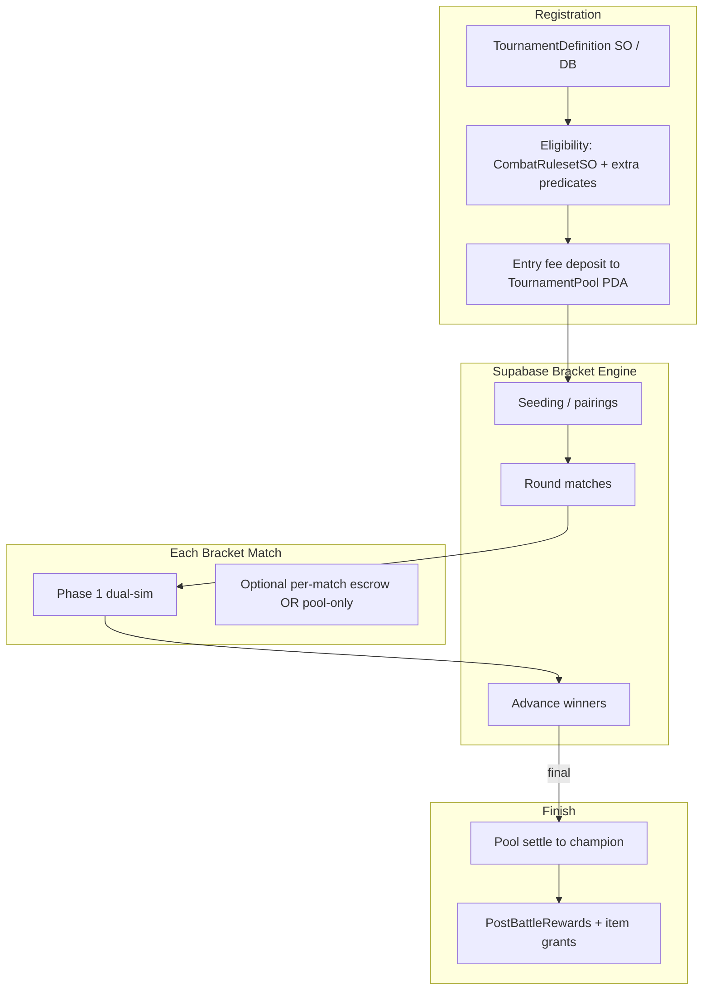

> **Parked for review.** Yet to implement. No tournament or bracket code. Review list: [../README.md](../README.md).

# PvP Phase 3 — Tournaments & Themed Brackets

**Status:** Spec / implementation guide (pre-build)  
**Audience:** Implementing agents, Unity engineers, backend/Anchor engineers, designers  
**Depends on:** Phase 1 dual-sim + matchmaking; Phase 2 escrow + referee settle (pool escrow extends match escrow)  
**Related:** [`PVP_01_Social_Lobby_And_Casual_Matchmaking.md`](PVP_01_Social_Lobby_And_Casual_Matchmaking.md), [`PVP_02_Ranked_Escrow_And_Ladder.md`](PVP_02_Ranked_Escrow_And_Ladder.md), [`CombatRulesetSO`](../../../Assets/Scripts/Combat/Runtime/ScriptableObjects/CombatRulesetSO.cs), [`LEVER_BOARDS_v1.md`](../../Specs/Combat/LEVER_BOARDS_v1.md), [`COMPETITIVE_LADDER_AND_SEASONS_v1.md`](../Specs/Combat/COMPETITIVE_LADDER_AND_SEASONS_v1.md)

---

## 0. Purpose

Ship **tournament-style PvP**:

1. Players deposit into a **shared tournament pool** (SOL entry + optional NFT stakes per event rules).
2. Server runs **brackets** (single-elim first) until a final winner.
3. Winner receives **pool − protocol fee** plus **server-assigned rewards** (items, XP, cosmetics) via existing post-battle / inventory pipelines.
4. Each tournament is **themed** by filtering eligible Chainlings/loadouts — primarily through `CombatRulesetSO` (already supports allowed types, required/banned moves, stat mutators).
5. All matches reuse Phase 1 turn relay + Phase 2 settle patterns; no second combat engine.

---

## 1. Architecture overview



**Principle:** Bracket state is **off-chain** (Supabase). Money is **on-chain** (pool PDA). Combat remains **deterministic dual-sim**. Themes are **data** (`CombatRulesetSO` + tournament definition), not hard-coded `if (isGasForkTournament)` branches in combat core (systems-first Rule 8).

---

## 2. What to reuse

| System | Reuse |
|--------|-------|
| `CombatRulesetSO` | `allowedTypes`, `requiredMoveIds`, `bannedMoveIds`, `statMutators`, `IsChainlingEligible`, `configHash` |
| Phase 1 match pipeline | `pvp_matches`, turn relay, forensic hashes |
| Phase 2 escrow patterns | PDA custody, fee bps, referee settle, timeouts |
| `PostBattleRewardsConfigSO` | Server-assigned XP/RAM tables for tournament completion |
| Lobby colosseum | Tournament board / NPC / interactable listing events |
| Ladder spec | Optional: tournament wins as separate trophy track, not conflated with seasonal rating unless explicitly tagged |

---

## 3. Tournament definition (data)

### 3.1 ScriptableObject + server row

**Unity authoring asset** (designers) mirrored to **Supabase `tournaments` table** (authoritative at runtime):

| Field | Purpose |
|-------|---------|
| `tournamentId` | Stable id |
| `displayName` / theme copy | UI only |
| `rulesetId` | → `CombatRulesetSO` |
| `bracketSize` | 8 / 16 / 32 |
| `entrySolLamports` | Pool contribution |
| `entryNftRequired` | bool + asset class rules |
| `registrationOpensAt` / `closesAt` | Schedule |
| `minPlayers` / `maxPlayers` | Start gates |
| `poolFeeBps` | May match or override wager board via `TournamentConfigSO` |
| `rewardTableId` | Server grants (cosmetics, items, XP) |
| `eligibilityExtras` | See §4 |
| `status` | draft / announced / registering / in_progress / settled / cancelled |

**Do not** embed story-specific eligibility in `CombatResolver`. Put it in ruleset + tournament extras evaluated at registration and again at each match lock.

### 3.2 Lever board — TournamentConfigSO

| Field | Owner intent |
|-------|--------------|
| `defaultBracketSizes` | Allowed sizes |
| `defaultPoolFeeBps` | Revenue |
| `registrationBufferSeconds` | Ops |
| `matchStartGraceSeconds` | No-show → forfeit |
| `noShowForfeitPolicy` | Advance opponent / refund rules |
| `maxConcurrentTournamentsPerPlayer` | Abuse |
| `serverRewardMultiplier` | Global knob referencing rewards board — do not duplicate XP numbers |

Anti-duplication: XP amounts stay on `PostBattleRewardsConfigSO`; entry fees/fee bps on tournament/wager boards; combat formulas on resolver/ruleset.

Server mirror in `get_pvp_config` or `get_tournament_config` (prefer extending pvp config with a tournaments section to avoid config sprawl — document ownership clearly).

---

## 4. Theming & eligibility

### 4.1 Covered today by CombatRulesetSO

Examples:

- **Gas & Fork only** → `allowedTypes = { Gas, Fork }`
- **Banned moves** → `bannedMoveIds`
- **Required signature moves** → `requiredMoveIds`
- **Stat mutators** → event buffs/caps

### 4.2 Extensions to plan (eligibility predicates)

Add reusable predicates on tournament definition (evaluated server-side against profile Chainling rows), **not** one-off combat branches:

| Theme example | Predicate |
|---------------|-----------|
| Starters only | `speciesId ∈ starter set` (data list on tournament / catalog) |
| Non-entangled | `isEntangled == false` |
| Cycle III only | `rebirthCount == 3` (or `>=` / range) |
| Max stars | `stars <= N` |
| No Mythic Runes | loadout rarity cap (ranked validator style) |

Implement as a small **eligibility rule DSL or enumerated rule list** on the tournament row (systems-first, composable). Unity mirrors for pre-flight UX; **server re-checks** at registration and match lock.

### 4.3 Pinning fairness

At tournament start:

1. Freeze `rulesetId` + `configHash` + `app_version` gate for all bracket matches.
2. Snapshot each entrant’s registered party (cannot swap mid-tournament unless event rules allow between-round changes — default **locked at registration**).

---

## 5. Bracket engine (Supabase)

### 5.1 Tables

```text
tournaments
tournament_entries (tournament_id, profile_id, party_snapshot, deposit_sig, seed_score)
tournament_brackets (tournament_id, round, match_slot, player_a, player_b, pvp_match_id, winner)
tournament_rewards_ledger (grants issued)
```

### 5.2 Edge functions

| Function | Role |
|----------|------|
| `tournament_list` / `tournament_get` | Public schedule |
| `tournament_register` | Eligibility + create entry intent |
| `tournament_confirm_entry` | Verify on-chain pool deposit |
| `tournament_start` | Admin/cron: seal entries, seed bracket, create round-1 matches |
| `tournament_advance` | On match complete → write winner → spawn next round match |
| `tournament_settle_pool` | Final: call pool settle with champion |
| `tournament_cancel_refund` | Ops: refund all if under-subscribed / emergency |

### 5.3 Seeding

- v1: random shuffle among paid entrants.
- v2: optional rating-based seeding (Phase 2 ladder).
- Byes for non-power-of-two only if product allows; prefer exact fill or waitlist.

### 5.4 No-shows & disconnects

- Match start grace from `TournamentConfigSO`.
- Missing player → forfeit; advance opponent; **entry remains in pool** (winner-take-all pressure — document clearly in UX).
- Mid-match disconnect → Phase 1/2 forfeit timers.

---

## 6. On-chain tournament pool

### 6.1 Relationship to Phase 2 match escrow

| Approach | When |
|----------|------|
| **A. Pool-only** | Entry SOL (+ optional NFT) at registration; individual bracket matches are non-wager dual-sim; champion gets pool | **Recommended v1** — simpler, fewer settle txs |
| **B. Pool + per-match escrow** | Additional side bets per match | Later / special events |
| **C. NFT entry locked entire event** | Assets stay in pool PDA until end | High friction; only for special cups |

**Recommendation:** Approach A for first tournaments.

### 6.2 `TournamentPool` PDA

Seeds: `["tournament_pool", tournament_id]`

State:

- `authority` / `result_authority`
- `treasury`, `fee_bps`
- `total_lamports`
- `entrant_count` / merkle or vec of entrants (prefer off-chain entrant list + on-chain deposit receipts to save rent)
- `state`: Registering | Locked | Settled | Refunded
- `champion` optional

Instructions:

| Ix | Behavior |
|----|----------|
| `initialize_tournament_pool` | Create with terms hash (ruleset hash, fee, entry amount) |
| `deposit_entry` | Transfer SOL (+ Core if required); emit receipt |
| `lock_registration` | result_authority or time; no more deposits |
| `settle_champion` | Pay champion total − fee; fee to treasury; one-shot |
| `refund_all` | If cancelled / under-min players after deadline — permissionless or authority |

### 6.3 Solana MCP requirements (agents)

Same gate as Phase 2:

1. MCP `list_sections` → escrow + Core + sealevel-attacks + mobile docs.
2. Every Rust change → `program_autofixer` loop until clean.
3. Prefer extending the **dedicated escrow program** with tournament pool accounts rather than a third program, unless blast radius demands isolation.
4. Re-verify Metaplex Core transfer CPI if NFT entries enabled.

### 6.4 Guardrails

| Risk | Guardrail |
|------|-----------|
| Under-subscribed event | Auto-cancel + `refund_all` after close if `entrants < minPlayers` |
| Double settle champion | Terminal state + one-shot |
| Bracket/oracle mismatch | Settle only when bracket marks `completed` + final match forensic OK |
| Eligibility bypass | Server checks at register + lock; on-chain cannot know species — off-chain enforce, on-chain holds money |
| Rage quit mid-bracket | Forfeit advances; pool still settles to eventual champion |
| Fee misconfig | OnValidate + server hash; pause |
| Grief registration spam | Cap per wallet; entry fee itself is deterrent |

**Important honesty:** Species/theme eligibility is **not enforceable purely on-chain** without oracles. On-chain guarantees money custody; off-chain guarantees fair bracket. Document this in player-facing ToS/FAQ.

---

## 7. Rewards beyond the pool

After `settle_champion`:

1. Edge function grants **server rewards** from tournament `rewardTableId` (items, cosmetics, XP).
2. Use existing inventory/edge patterns (never trust Unity for minting paid assets).
3. Optional: small rewards for top-4 / participation — configure on tournament definition, pay from **hot wallet / treasury budget**, not by draining the player pool (unless event explicitly says so).

Do not overload `PostBattleRewardsConfigSO` with tournament-specific story grants — reference a tournament reward table asset/id.

---

## 8. Unity client surfaces

| Surface | Behavior |
|---------|----------|
| Lobby tournament board | List registering/active events |
| Registration UI | Show theme rules, entry cost, eligibility failures per Chainling |
| Party picker | Filter by `IsChainlingEligible` + extras |
| Bracket view | Read-only tree from Supabase |
| Match ready | Reuse Phase 1 battle bootstrap with tournament ruleset pinned |
| Results | Champion ceremony + reward claim status |

Assembly: UI in MenuNavigation or Assembly-CSharp; eligibility helpers may live in Combat.Runtime; Solana deposit in `Solana/**`.

---

## 9. Implementation checklist (agent)

1. Confirm Phase 1+2 acceptance criteria green (or feature-flag tournament on staging only).
2. Author `TournamentConfigSO` + update lever board docs.
3. Extend `CombatRulesetSO` eligibility only if predicates cannot live on tournament row — prefer tournament-side rules first.
4. Supabase schema + bracket advance state machine with idempotent transitions.
5. Anchor `TournamentPool` (MCP + autofixer).
6. Wire registration → deposit → confirm → start.
7. Each bracket match creates standard `pvp_matches` with `tournament_id` + `bracket_slot` metadata.
8. Final settle + reward ledger.
9. Tests: eligibility matrix; bracket advance; cancel refund; double settle fail; no-show forfeit.
10. Designer docs: how to author a themed ruleset asset + tournament row.

---

## 10. Dev / Editor configuration

| Item | Notes |
|------|-------|
| Ruleset assets | e.g. `Ruleset_Tournament_GasFork.asset`, `Ruleset_Tournament_Starters.asset` under `Assets/Data/Combat/Config/` |
| Tournament definitions | Prefer `Assets/Data/Combat/Tournaments/**` for SO mirrors; server remains SoT when live |
| Validate Balance Boards | Extend validator for `TournamentConfigSO` |
| Staging | Run 8-player smoke with bot accounts or internal builds |
| Feature flag | `tournamentsEnabled` on config; default off |
| Lobby | Colosseum interactable opens tournament UI when flag on |

---

## 11. Acceptance criteria

- [ ] Designer can ship a new theme with a ruleset asset + tournament row (no combat code change).
- [ ] Ineligible parties blocked at registration with clear reasons.
- [ ] Full 8-player single-elim completes; champion receives pool − fee.
- [ ] Cancelled undersized event refunds all entrants.
- [ ] No-show forfeits advance bracket without stuck state.
- [ ] All matches stamp same tournament `configHash` / ruleset id.
- [ ] Server rewards appear in inventory/XP pipelines once.
- [ ] Ranked ladder rating **not** moved unless tournament explicitly marked ranked-eligible.

---

## 12. Future (explicitly later)

- Double-elim / Swiss / round-robin  
- Spectator mode in lobby  
- On-chain bracket (unnecessary for v1)  
- Inscription/cNFT entry fees  
- Cross-tournament spectator betting  
- Player trading (generalize escrow to bilateral swap without referee)  

---

## 13. Cross-phase dependency map

| Capability | Phase 1 | Phase 2 | Phase 3 |
|------------|---------|---------|---------|
| Social lobby NGO | Required | Reuse | Reuse (board UI) |
| Casual matchmaking | Required | — | — |
| Dual-sim + forensic hash | Required | Required | Required |
| Wallet gate | Optional | Required | Required for paid entry |
| Match escrow | — | Required | Optional (pool preferred) |
| Tournament pool | — | — | Required |
| Themed rulesets | Helpful | Ranked ruleset | Required themes |
| Lever boards | Matchmaking | + Wager | + Tournament |

Agents must not start Phase 3 Anchor pool work without Phase 2 security patterns and MCP autofixer discipline already established.
