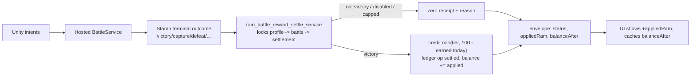
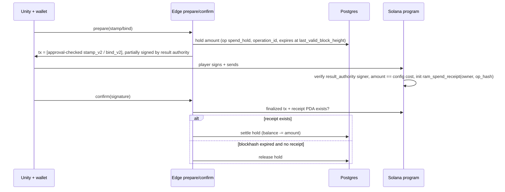
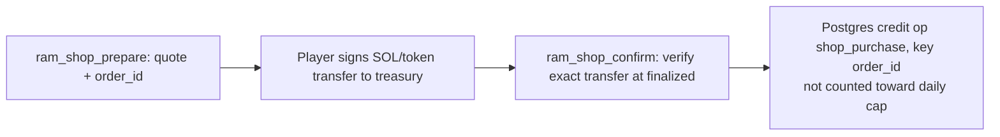

> **Implementation plan and local build record (v2).** Postgres-canonical RAM plus immediate battle rewards. Phase 1 is implemented locally but not deployed; Phases 2-4 remain gated. Review list: [../README.md](../README.md).

# RAM_00 - RAM v2: Postgres-canonical RAM + immediate battle rewards

**Status:** Architecture decision approved by Cronus. Phase 1 code is implemented locally as of 2026-10-09; no migration, Edge function, BattleService, or program change from this plan has been deployed. Phase 2 on-chain spend work still requires its explicit operator approval gate.  
**Checked against:** `ram/r01` working tree (including uncommitted work), Devnet `jhzqcbrzkausrrtcavuu` (SELECT only), Devnet/Mainnet public RPC (read only)  
**Previous version:** the chain-canonical plan (792 lines, with the Codex/user edits) is backed up at `C:\Users\mando\agent-tools\sbsync\scratch\RAM_00_before_v2_20261008_1908.md`. Its hosting, terminal-outcome, manifest, and test detail is carried forward below where it still applies.  
**Related:** [`PVP_00_Battle_Spine_First.md`](PVP_00_Battle_Spine_First.md), `Docs/Specs/Economy/OWNERSHIP_SPINE_PHASE1_BOOTSTRAP_DESIGN.md`, `Docs/Specs/Security/EconomyAudits/01_RAM_ledger_and_balances.md`

## 0. Decision record

| | Before (today) | After (v2) |
|---|---|---|
| Canonical balance | On-chain `PlayerProfile.ram_balance` (u32 in a PDA); Postgres mirrors it | `player_profiles.ram_balance` in Postgres, nothing else |
| Earning (battle, quest, shop) | Must land on-chain first (`grant_ram` / `credit_purchased_ram`), then mirror | Postgres credit only: instant, no wallet, no rent |
| Daily earn cap | On-chain `GameConfig.ram_daily_cap` = 100 | Postgres, 100 per UTC day, purchases excluded |
| On-chain RAM spends (Stamp, Bind) | Program reads and debits the on-chain balance | Server holds RAM in Postgres and co-signs; program checks the server signature and writes a one-time spend receipt |
| Consistency | Audit freezes the account on any profile/chain mismatch | Mirror, freeze-on-mismatch, and on-chain cap are retired. New audit: balance = ledger sum, and spend receipts = settled spends |

**Why the change:**
- Under chain-canonical, every win costs about 0.00126 SOL of permanent receipt rent plus a transaction fee, and waits for finality.
- Wallet-less players can't earn at all.
- Any off-chain credit freezes the account.
- The chain adds value only where a player-owned asset is minted (Stamp/Bind) or SOL changes hands, so v2 keeps the chain for exactly those.

RAM stays non-transferable and is not a token.

## 1. How RAM works today

| Action | Balance changes in | Signer | On-chain record / rent |
|---|---|---|---|
| `grant_ram` (lib.rs 169), smoke grant / retired top-up | Chain, then Postgres | Result authority only | Grant receipt, 121 B, 0.00126 SOL, never closed |
| `credit_purchased_ram` (258), RAM shop | Chain, then Postgres (`ram_shop_settle_purchase`) | Result authority | Purchase receipt, 117 B |
| `create_ram_reservation` (199) / `cancel_ram_reservation` (238) | Neither; earmarks RAM | Result authority | Reservation; only cancel closes it |
| `debit_reserved_ram` (286), Rebirth | Chain, then Postgres (`ram_ledger_settle_spend`) | Result authority | Debit receipt |
| `roll_known_move` (376), 5 RAM | Chain, then Postgres | Result authority (player not a signer) | Known-roll receipt plus a vault entry |
| `stamp_known_move` (712), `stamp_ram_cost` | Chain, then Postgres | Player plus server reservation | Stamp ticket plus Core asset |
| `bind_chainling` (841), `bind_ram_cost` | Chain, then Postgres | Player | Bind receipt (player pays) |
| `reconcile_ram_delta` (325) | Chain only (operator fix) | Result authority | Reconciliation receipt |
| `spend_ram` (154), `burn_known_move_for_ram` (425) | Chain | Result authority | None; no callers |
| PvE battle | Nothing (RAM forced to 0) | - | - |

**Devnet now:**
- **On-chain:**
  - 2 PlayerProfile PDAs.
  - `9zMw…`: chain 20 = Postgres 20, account `active`.
  - `H68e…`: chain 100 vs Postgres 90, account `frozen_reconciliation`, case open.
  - 6 grant receipts (100 each, Sep 21-30, 0.00759 SOL rent), 6 Known-roll receipts, 6 stamp tickets.
  - 0 purchase, debit, reconciliation, reservation, or bind accounts.
  - GameConfig: cap 100, RAM per burn 10, flags 0. The flags are stored but never checked.
- **Postgres:**
  - 71 profiles; 5 hold RAM, 126 total (90 + 20 + 10 + 3 + 3).
  - The three small balances have no ledger account and no chain profile.
  - `ram_ledger_operations` has 0 rows.
  - Shop checkout is enabled (`devnet-seeker-20261004`), with 0 purchases.
- **Mainnet:** program `7oBf57qG…` is not deployed (public RPC returns no account). Mainnet launches directly on v2.

## 2. RAM v2 model

**Principles**
1. `player_profiles.ram_balance` is the only balance. RAM is a non-transferable game number, not a token.
2. The chain is used only for (a) the SOL/token payment when buying RAM and (b) on-chain actions that consume RAM: Stamp and Bind.
3. On-chain spends are server-attested. Postgres holds the RAM first. The server co-signs that exact transaction, and the program checks the result-authority signature and creates a one-time spend receipt keyed by the operation id.
4. Idempotency everywhere: battle rewards key on `battle_id`; shop credits on `order_id`; spends on `operation_id`.
5. Every RAM write goes through a service-only function: SECURITY DEFINER, `SET search_path = ''`, REVOKE from PUBLIC/anon/authenticated, explicit GRANT to service_role. Clients never write RAM.

| Action | v2 flow |
|---|---|
| Battle win | BattleService terminal outcome -> one SQL settlement (credit, capped) -> response carries the receipt and `balanceAfter` |
| Quest reward | Quest-state RPC calls the same credit routine with a `quest_id` key (optional hook) |
| Buy RAM | Player signs SOL/token transfer -> Edge verifies at finalized -> Postgres credit. No `credit_purchased_ram` |
| Stamp / Bind | Postgres hold -> tx with server approval + player signature -> confirm -> settle; expiry -> release |
| Known roll | Postgres debit 5 + server-signed `roll_known_move_v2` (no RAM on-chain). Decision §8 |
| Rebirth | Fully off-chain Postgres debit; no chain step |
| Defeat / flee / abandon | 0 credit, no debit |

**(a) Earn**



**(b) On-chain spend (Stamp, Bind)**



The reconciler decides settle vs release from the spend-receipt PDA, never from a client claim. The co-signed transaction expires with its blockhash, which gives a natural, chain-enforced expiry; do not use durable nonces.

**(c) Shop purchase**



## 3. Postgres design

**Ledger (reuse `ram_ledger_operations`)**
- **Operation kinds** (`operation_kind` has no CHECK today):
  - keep the existing spend kinds (`known_roll`, `stamp`, `bind`, `rebirth`) and the shop kind
  - add credits `battle_reward`, `quest_reward`, `opening_balance` (migration only)
  - add `admin_adjust` (operator, audited; either direction)
- **Unique key:** (kind, source id).
- **Credits** go straight to `settled`.
- **Spends** (column `state`) use `reserved` (hold) -> `chain_submitted` -> `settled` or `released`. Rebirth and Known roll settle in one transaction.
- **Chain-only states:** new rows skip `chain_confirmed`; the value stays in the CHECK for compatibility.
- **Invariants:**
  - `ram_balance` = sum of settled credits - sum of settled debits.
  - Spendable = balance - active holds.
  - The balance never goes negative (CHECK already exists).

**Daily cap**
- New table `ram_daily_earnings(player_profile_id, utc_day date, earned bigint, PRIMARY KEY (player_profile_id, utc_day))`.
- The UTC day comes from `now() AT TIME ZONE 'UTC'` in the database, never the client.
- Battle and quest credits count toward the cap; shop purchases, opening balances, and admin adjustments do not.
- Applied amount = `min(requested, 100 - earned)`; at 0, write a zero receipt with reason `daily_cap`.

**Battle settlement RPC: `ram_battle_reward_settle_service(p_battle_id uuid)`**
- One transaction. Lock order: `player_profiles` -> `authoritative_pve_battles` -> `battle_reward_settlements` -> `ram_daily_earnings` -> `ram_ledger_operations`. This keeps the uncommitted lock-order migration's profile-first rule, minus `ram_ledger_accounts`.
- Requires a terminal battle with immutable `terminal_outcome`, `reward_tier`, and `reward_config_hash`. Only `victory` pays.
- Idempotent on `battle_id`: a retry returns the stored row with `alreadyApplied = true`.
- Returns `status (settled|zero), requestedRam, appliedRam, reason, dailyEarned, dailyCap, balanceAfter, settlementId`.
- Zero rows (capture, defeat, disabled, shadow, not allowlisted, capped) live only in `battle_reward_settlements` and never in the ledger, whose CHECK requires `amount > 0`.

**Retired**
- `ram_ledger_register_audit` (profile == chain freeze).
- `frozen_reconciliation` as an earn/spend blocker.
- `ram_reconciliation_*` for chain mirror cases.
- `ram_ledger_accounts.chain_balance_snapshot`.
- The `battle_reward_*` chain-saga states.

Keep these tables read-only for history; do not drop them.

**Replacement audit (scheduled, read-mostly)**
1. For every profile, `ram_balance` = ledger sum, after a one-time `opening_balance` op.
2. Spend receipts on chain = settled `stamp`/`bind` ops.
3. No `reserved` hold older than its expiry plus a grace period.

Mismatches alert and open an operator case. They never freeze earning and never auto-correct.

## 4. Program v2 changes (lib.rs)

| Instruction | v2 | Signers / accounts |
|---|---|---|
| `stamp_known_move_v2(idempotency_key, ram_cost)` | Drops the `profile.ram_balance` check/debit (754, 781-785) and the reservation. Requires `ram_cost == ownership_config.stamp_ram_cost` | Player + **result authority** co-signer; `init ram_spend_receipt` seeds `["ram_spend_receipt", owner, idempotency_key]` (fails on replay); payer = player (decision §8) |
| `bind_chainling_v2(chainling_id, idempotency_key, ram_cost, …)` | Same pattern; drops 870, 927-931 | Player + result authority; same receipt seeds |
| `roll_known_move_v2(idempotency_key, …)` | Drops reservation + RAM debit (383-400); keeps vault write and `KnownRollReceipt` | Result authority only (already) |
| `prepare_stamp_ticket` | Unchanged (server-signed) | - |
| `grant_ram`, `credit_purchased_ram`, `debit_reserved_ram`, `reconcile_ram_delta`, `spend_ram`, `burn_known_move_for_ram`, `create/cancel_ram_reservation` | Devnet: return a `Deprecated` error. Mainnet build: exclude | - |

- **Spend receipt** (new, about 8+32+32+4+1+32+1 bytes): owner, op hash, amount, kind, authority, bump. It is the on-chain proof the reconciler uses.
- **Account layouts:**
  - Keep `PlayerProfile` (91 B) and `GameConfig` as is. `ram_balance`, `daily_ram_earned`, `last_ram_reset_timestamp`, and `ram_lifetime_earned` become deprecated and read-only.
  - No realloc and no field removal, so existing PDAs keep deserializing.
  - The Mainnet IDL may still carry the fields; nothing writes them.
- **Upgrade authority:**
  - Devnet program data authority is `DkFmzzzF…` (public RPC).
  - The keypair stays outside the repo on the operator's WSL Solana CLI path, per `MAINNET_SMOKE_DEPLOYMENT_RUNBOOK.md` 69-86.
  - The deploy is an explicit operator step with written approval.
  - Order: Devnet upgrade first, then the Mainnet first deploy of the v2 build.

## 5. Edge, BattleService, Unity changes

| Component | Change |
|---|---|
| `ram_shop_confirm` / `ram_shop_reconcile` / `_shared/ram_shop.ts` | After `verifyFinalizedPayment` (622), credit Postgres directly (`shop_purchase`, key order_id). Remove the `credit_purchased_ram` path in `advancePurchaseSettlement` (519-620, discriminator 554), the ledger-active gates (167, 190, 307), and the `ram_ledger_register_audit` call (121) |
| `ownership_prepare_stamp` / `ownership_confirm_stamp` / `ownership_reconcile_stamp` | Prepare: Postgres hold + partially signed v2 tx (no `ensureRamReservationOnChain`). Confirm/reconcile: settle on receipt, release on expired blockhash without receipt |
| `ownership_prepare_bind` / `ownership_confirm_bind` / `ownership_reconcile_bind` | Same as Stamp |
| `ownership_roll_known` | Postgres debit 5 + `roll_known_move_v2` (no reservation). Or fully off-chain (§8) |
| `profile_rebirth_chainling` | Drop the `ensureRamReservationOnChain` / `debitReservedRamOnChain` calls; Postgres-only debit |
| `ram_operator_reconcile`, `ownership_*_devnet_smoke_grant`, `ownership_operator_devnet_ram_topup` | Retire (keep source; undeploy or 410) |
| `profile_apply_pve_battle_outcome` | Unchanged for RAM (already 0). Skip for BattleService sessions (progression containment) |
| `battle_reward_settle` + `_shared/battle_reward.ts` | Retarget: classify + `ram_battle_reward_settle_service` in one call; no chain, no reconciler path |
| `_shared/ownership_spine.ts` | Remove `fetchBattleRamSnapshot` / `settleBattleRamGrantOnChain` / smoke allowlist (962); add v2 instruction builders + spend-receipt decoder |
| `ram_shop_reconcile` | Stop calling `ram_ledger_register_audit` (66); keep order recovery |
| BattleService | On terminal, call `battle_reward_settle` (service secret) within a short budget and return the settlement in the envelope; add `GET /v1/pve/battles/{id}/reward` |
| Unity | Show `+appliedRam` only when settled; cache `balanceAfter` in one `PlayerRamBalanceStore`; no wallet needed to earn; shop/spend UI reads the Postgres balance (spendable = balance - holds) |

## 6. Migration plan (Devnet now; Mainnet clean start)

1. Snapshot every on-chain PlayerProfile (2) and every Postgres balance (5 nonzero) into a migration audit table.
2. Resolve `H68e…`: chain 100 vs Postgres 90, case opened 2026-10-08 02:33 CT with no direction. The cause is not determined from the on-chain record (no debit or reconciliation receipts exist). **Recommended: keep Postgres 90** as the canonical value and close the case as superseded. This is an owner decision (§8); the old rule "never overwrite either side" no longer applies once the chain is not canonical.
3. Insert one `opening_balance` op per nonzero profile so ledger sum = balance.
4. Deploy the Postgres v2 functions with flags off. Switch the shop, then spends, then earn.
5. Retire `ram_ledger_register_audit` calls and smoke grants. Leave on-chain RAM fields untouched (deprecated).
6. **Rollback:**
   - Database mode `off` stops the reward faucet and still records truthful zero receipts. It does not restore chain-mirror freezes or the retired standalone terminal stamp; those are corrected forward only.
   - After the program upgrade, rollback means redeploying the previous `.so` (keep the artifact and hash).
   - Never edit balances to roll back; correct forward with `admin_adjust`.

## 7. Phased build (paste-ready briefs)

### Phase 0 - Host BattleService

```text
GOAL
BattleService reachable over TLS from Devnet builds, 24/7, no RAM change.
READ FIRST
- backend/Chainbound.BattleService/{Program.cs, BattleSessionManager.cs,
  SupabaseAuthorityGateway.cs, ServiceOptions.cs, Dockerfile, README.md}
- Assets/Scripts/Combat/Runtime/Services/AuthoritativeCombatSessionService.cs
BUILD ORDER
1. Google Cloud Run us-central1, .NET 8, min=max=1 instance, concurrency
   40, timeout 3600 s, session affinity, deploy by image digest
   (deploy/cloud-run/service.yaml). Verify pricing first.
2. Rebuild sessions from authoritative_pve_battles after reconnect;
   affinity/min instances are best effort, not persistence.
3. Secrets in Secret Manager; CI via Workload Identity Federation
   (.github/workflows/battle-service-devnet.yml); no key files.
4. Rate limits: 30/min per profile for battle mutations, 120/min per IP,
   10/min per IP for auth failures, one capture socket per battle; 429 +
   Retry-After. Deny browser origins.
5. Expiry worker: lease stale active battles (SKIP LOCKED), settle via the
   idempotent abandonment path outside the claim transaction.
6. Unity config per deployment profile; fail closed on missing/localhost URL.
7. Copy fixes (README manifests, penalty text at BattleSessionManager.cs:652).
VERIFY
- Phone on mobile data finishes a battle; instance kill resumes in 5 min
- Devnet's 4 stale active battles reach a terminal state
- No secret in the client build or logs
SAFETY FALLBACKS
Service down -> practice battle (0 rewards). Readiness false -> no new battles.
OUT OF SCOPE
RAM, multi-instance, combat changes.
DONE WHEN
3-day Devnet soak with no stale active rows and no manual restart.
```

### Phase 1 - Ledger v2 + Postgres earn path

```text
GOAL
A battle victory returns a settled RAM receipt + balanceAfter in the same
response, from Postgres only. Database `battle_reward_settings` is the
off|shadow|grant authority (default off; Mainnet rejects grant until Phase 4).
READ FIRST
- Sections 3 and 9 of this guide; uncommitted migrations
  20261008231904/231910/231918; _shared/battle_reward.ts
BUILD ORDER
1. Keep: lock-order migration (231904), authority schema (231910: battle
   columns, battle_reward_configs, battle_reward_settlements). Simplify
   settlement status to zero|settled|failed; drop chain columns
   (chain_balance_before, chain_signature, receipt_address, lease fields).
2. New migration: ram_daily_earnings; ledger kinds; opening_balance;
   ram_battle_reward_settle_service (section 3). Replace the chain-saga
   RPCs in 231918 (reserve/mark_submitted/mark_confirmed/record_daily_cap/
   claim_reconcile_batch) with this single RPC; keep classify,
   stamp_terminal, get_service, begin_battle changes.
3. BattleService stamps terminal_outcome in the transaction that first
   makes the battle terminal (commit, capture, forfeit, expiry), then calls
   battle_reward_settle. Plausibility filter (not verification) on Devnet.
4. Retarget battle_reward.ts: optional environment mode/allowlist can only
   restrict the database authority; no chain calls.
5. Unity: settlement-driven ticker and PlayerRamBalanceStore (section 5).
6. Optional: quest_reward hook through the same credit routine.
VERIFY / RELEASE GATES
- Forged winner with mode grant + client tampering cannot settle a non-
  victory; direct PostgREST call to every RPC is denied for anon/auth
- Two concurrent calls for one battle_id -> one ledger op, one receipt
- Crash after commit -> retry returns the same receipt (alreadyApplied)
- 95 earned + elite -> applied 5; 100 earned -> zero daily_cap; UTC
  midnight resets; purchases do not count
- ledger sum == balance for every profile; no negative balance
SAFETY FALLBACKS
Mode off -> zero receipts reason rewards_disabled. No chain dependency.
OUT OF SCOPE
Spends, program changes, Mainnet faucet.
DONE WHEN
One-week allowlisted Devnet run with zero duplicate credits and a clean audit.
```

### Phase 2 - Program v2 spend approvals + Stamp/Bind/Known/Rebirth

```text
GOAL
Stamp and Bind spend Postgres RAM via server-co-signed transactions; the
program no longer reads ram_balance.
BUILD ORDER
1. lib.rs: stamp_known_move_v2, bind_chainling_v2, roll_known_move_v2,
   RamSpendReceipt; Deprecated errors on retired instructions; Anchor
   tests (replay, wrong authority, wrong cost, missing co-signer).
2. Edge: Postgres hold + partially signed tx; confirm/reconcile settle on
   receipt, release on blockhash expiry; rebirth Postgres-only.
3. OPERATOR APPROVAL STEP: written go-ahead, then Devnet program upgrade
   from the WSL CLI with the upgrade authority; record signature/hash.
VERIFY / RELEASE GATES
- Replayed spend tx fails (receipt already initialized)
- Expired, never-landed tx releases the hold; landed tx settles exactly once
- Spend without server co-signature fails on-chain
- Spendable never < 0 under concurrent Stamp + Bind + Known roll
SAFETY FALLBACKS
Feature flag per spend type; old instructions return Deprecated, not undefined behavior.
OUT OF SCOPE
Mainnet deploy.
DONE WHEN
Devnet Stamp + Bind + Known + Rebirth pass end-to-end on v2.
```

### Phase 3 - Devnet migration and retire the mirror

```text
BUILD ORDER
Section 6 steps 1-5. Decide H68e first. Then disable register_audit,
smoke grants, ram_operator_reconcile; run the v2 audit daily.
DONE WHEN
Audit clean 7 days; no code path writes on-chain RAM fields.
```

### Phase 4 - Server-resolved combat (before any Mainnet faucet)

```text
GOAL
Server resolves every turn; forged winner/vitals cannot earn.
BUILD ORDER
1. Extract CombatResolver (7,010 lines) + Runtime/Data into a Unity-free
   Core asmdef (noEngineReferences) linked by the BattleService csproj;
   Runtime/AI is already Unity-free.
2. Export chemistry matrix, modifier catalog, resolver config, versioned
   hashes. Quantize floats where outcomes branch; server authoritative.
3. Server AI with the server seed; shadow mode until zero reward- or
   progression-affecting divergence; then rewards require server outcome
   and progression (XP/stars/moves) derives from it.
4. Reuse for PvP ranked verification (_shared/pvp_rules.ts is dual-sim).
DONE WHEN
All gates green and a separate Mainnet go/no-go enables grant mode.
```

**Sybil note:** free accounts can farm up to 100 RAM/day each. Spending earned RAM on-chain still needs a wallet plus SOL fees, which limits value extraction. Whether to also gate earned-RAM spends (account age, or purchased-first) is a §8 decision.

## 8. Decisions to lock

| Decision | Recommended default |
|---|---|
| Reward values | 5 / 15 / 25 from `PostBattleRewardsConfig_Default.asset` via `battle-rewards.json` + hash; remove dead `BattleRewardConfigSO.cs` after a reference check |
| Capture | 0 RAM (zero receipt `capture`) |
| Defeat / flee / forfeit / abandon / draw | 0 credit, no debit |
| Daily earn cap | 100 per UTC day (DB clock); purchases excluded |
| Quest rewards count toward cap | Yes (one earn cap); revisit if quests feel punished |
| H68e resolution | Keep Postgres 90; close case as superseded |
| Known roll | Keep on-chain write (vault entry is needed by Stamp) with Postgres debit; revisit fully off-chain Knowns later |
| Rebirth | Fully off-chain |
| Purchased vs earned RAM | Single balance; record kind in the ledger only |
| Wallet-less players earn | Yes |
| Spend-receipt rent payer | Player (they sign and already pay fees) |
| Gate on spending earned RAM | None in Devnet; decide before Mainnet (account age or purchase) |
| Terminal outcome | Server-owned, immutable; only `victory` pays |
| Phase 1 trust boundary | Database `battle_reward_settings` is the only grant authority and requires grant + Devnet + DB profile allowlist. Unset Edge/BattleService mode and Edge allowlist values pass through; explicit Edge off/shadow or an optional Edge allowlist may only restrict. Plausibility is a filter, not verification. |
| Progression containment | No client XP/stars/moves writes for BattleService sessions until Phase 4 |
| Migrations | `supabase migration new`; top-level `Supabase/migrations` only (not the `Supabase/supabase` mirror); never edit applied migrations |

## 9. Local implementation inventory (uncommitted, 2026-10-09; Phase 1.7 hardened)

No deployment was performed in this implementation session. Phase 1.7 adds the final pre-deploy rules on top of Phase 1.6: none-tier starts are canonicalized before replay checks, wallet ownership is permanently one-to-one, the main menu resolves wallets without mutating profiles, every `/v1` request is IP-limited behind the trusted-hop rule, and shop receipts preserve an atomic balance/version pair. Release still requires explicit operator deployment approval and the Devnet soak gates in §7.

| Item | Local state |
|---|---|
| `20261008231904_ram_reward_lock_order.sql` | Profile-first action lock order retained. |
| `20261008231910_battle_reward_authority_schema.sql` | Immutable battle reward stamps, reviewed 5/15/25 config hash, and slim `zero|settled|failed` domain receipts. No chain receipt/signature/lease fields. |
| `20261008231918_battle_reward_service_rpcs.sql` | Begin/stamp/get/classify RPCs plus atomic action-terminal stamping; chain-saga and wallet-guard RPCs removed. |
| `20261009010622_ram_v2_postgres_canonical_earn.sql` | Wallet-optional ledger credits, opening-balance audit rows, `ram_daily_earnings`, atomic capped battle settlement, and balance-vs-ledger audit. The Devnet data guard is carried between statements in a temporary table so autocommit migration runners cannot silently clear it. |
| `20261009012120_ram_reward_atomic_terminal_wrappers.sql` | Capture and forfeit/abandon terminal stamps now occur in the same transaction that first makes the battle terminal. |
| `20261009143000_ram_v2_pre_rollout_hardening.sql` | DB-owned off/shadow/grant settings and allowlist, Devnet fail-closed gate, monotonic/balanced receipts, story replay uniqueness, legacy zero receipts, chain-audit retirement, H68 reconciliation supersession, removal of the standalone terminal stamp RPC, live-equivalent reserve replay/expiry semantics, disabled-config zero-tier battle starts, and a global `ram_balance_version`. Phase 1.7 also adds write-once `player_profiles.bound_wallet_address`, a unique wallet constraint, ambiguity-safe Devnet backfill, service-only resolve/bind/create RPCs, no-repoint ledger ensuring, normalized `none:0` battle stamps before replay checks, stored shop `balance_version`, and the `rewards_disabled` start reason. |
| Wallet and ledger lifecycle | A profile can acquire one permanent wallet and a wallet can belong to one profile. Unlink only deactivates the session link; relinking the same wallet is allowed and a replacement is rejected. `ram_ledger_ensure_account` uses `ON CONFLICT DO NOTHING`, validates the exact profile/wallet/cluster scope, and never repoints. Shop and ownership prepare paths validate the request wallet against the permanent binding and map mismatches to stable 409 errors. |
| `battle_reward_settle` + `_shared/battle_reward.ts` | Private service-only outer restriction; unset mode/allowlist pass through and only explicit off/shadow or an optional environment allowlist can reduce eligibility. The database exclusively decides grant from mode, cluster, and DB allowlist. `verify_jwt=false` is explicit so modern `sb_secret_` keys are accepted via `apikey`; `apikey` plus `x-battle-reward-secret` are checked in-function. No wallet, Solana transaction, or reconciler. |
| BattleService | Adds manifest-driven quest eligibility for narrative boss/elite/scripted rewards, immutable begin stamps, Phase 1 plausibility, atomic terminal stamping, immediate Edge settlement, receipt recovery, and serialized missing-receipt retries with a five-second default cooldown. None-tier sessions independently force version 0 plus the zero hash. Per-IP limits now cover every `/v1` request, including junk authorization; client IP uses the rightmost trusted `X-Forwarded-For` hop (default one), per-profile limits apply in addition after authentication, and the in-memory key set has a bounded oldest-entry eviction policy. |
| Unity | Every authoritative balance source (settlement, shop, Stamp/Bind/Known, profile stats, and inventory) carries the same database `ram_balance_version`. `PlayerRamBalanceStore` rejects older versions across sources and accepts equal versions only when the balance agrees. Wallet calls now send explicit `resolve`, `link`, or `create` modes. Main-menu resolve never binds: `profile_found` restores that wallet's save; `no_profile` displays “No save found for this wallet. Start a new game?”, and confirmation atomically creates/binds before the normal intro. In-profile linking stays in `link` mode and wallet changes are rejected without replacing the loaded profile. |
| Hashing | Gameplay/reward manifests use canonical JSON SHA-256; `.gitattributes` pins JSON to LF. Reward config v3 canonical hash is `695144f7bfaa853b59f8d6df23ea7b5e5005d42f92ba47aa128fa55c6c644194`. |
| Automated coverage | Seven pgTAP suites cover Devnet opening booking/H68 supersession, idempotency, true concurrent double settlement, cap clamp/zero, UTC-day reset, purchase exclusion, DB gating, narrative replay, immutable terminal ownership, chain-audit retirement, ledger audit, RPC privileges, reserve replay/conflicts/terminal/expiry semantics, permanent wallet binding/relink/create races, no-repoint account ensuring, none-tier retries, disabled-config reasons, stored shop balance/version pairs, and balance versions. Deno covers Edge mode/error contracts; xUnit covers trusted-hop/IP/profile limiting and BattleService behavior; Unity covers receipt truth, balance ordering, wrong-wallet rejection, and read-only main-menu resolution. A test-only minimal prerequisite schema exists because the historical repository intentionally omits the original MVP baseline. |

Validation completed locally:

- BattleService Release build: 0 errors; xUnit: 16/16 passed, including canonical hash, versioned receipt validation, authentication, rightmost trusted-hop IP resolution, junk-authorization IP limiting, key-cap eviction, profile limiting, plausibility, and fail-closed coverage.
- Edge type-check passed for every changed endpoint; Deno: 102/102 passed across reward mode/allowlist, wallet mode/error contracts, shop settlement, account ensuring, ownership, display-name, Solana proxy, and ledger-writer coverage.
- The connected Unity 6000.0.24f1 Editor recompiled with no console errors. The native EditMode runner passed 25/25 focused tests: wallet link/resolution 7, permanent-binding security contracts 2, reward contracts 2, truthful post-battle RAM copy 7, and cross-source balance ordering 7.
- The broader pre-existing `SolanaMobileReleaseSecurityTests` class is 24/25: every RAM/wallet authority assertion passes; the unrelated `WalletAccessPrefab_HasPersistentCoordinatorSafeAreaAndTouchTargets` still expects the wallet prompt prefab root to be inactive, while the current user-authored prefab is active. Phase 1.7 does not rewrite that prefab or weaken the assertion.
- Docker Desktop is healthy. All six RAM migrations applied cleanly to an isolated Supabase Postgres 17 container, and all 125 pgTAP assertions passed: opening/H68 6, settlement 22, security 20, hardening 26, concurrent settlement 5, Phase 1.6 reserve/account/version 21, and Phase 1.7 wallet/start/shop hardening 25.
- The local reserve function matches the live Devnet `pg_get_functiondef` after removing only `AND status = 'active'`; both remain `SECURITY DEFINER`. All six migrations also completed in order against linked Devnet project `jhzqcbrzkausrrtcavuu` inside one transaction, and the final post-`ROLLBACK` probe confirmed `rollback_verified=true`. Nothing was applied or deployed.
- A fresh Devnet SELECT-only backfill preview remains unambiguous for all three linked profiles: `38ac2f9a-5b94-4037-9bc6-fdd205632018` -> `9zMwTbQtjvexJzuMZjzbKS7LtWNXVYG3auBNeV82VHUj`; `6a1970cb-0037-4d45-ad6a-c5f82ed0081e` -> `11111111111111111111111111111111`; `d48bd652-b52d-4f37-b02a-90fa55e7082d` -> `H68eGMwT3UCigd9qf4u1VLyqQh6jq57HD4wLWaQrbBWq`. The all-ones link is preserved but explicitly flagged for later retirement.
- The normal `supabase start` fresh-bootstrap path remains blocked before the RAM migrations by the documented historical prerequisite gap: `20260505023100_players_columns_for_wallet_and_refactor.sql` expects the original MVP `public.players` table, but that baseline is not in this repository. `Supabase/tests/fixtures/ram_v2_minimal_prerequisites.sql` is test-only and deliberately does not pretend to be that production baseline. Capture/importing the real baseline remains separate release-infrastructure work.

**Deployment manifest (not executed):** apply migrations in this order: `20261008231904_ram_reward_lock_order.sql`, `20261008231910_battle_reward_authority_schema.sql`, `20261008231918_battle_reward_service_rpcs.sql`, `20261009010622_ram_v2_postgres_canonical_earn.sql`, `20261009012120_ram_reward_atomic_terminal_wrappers.sql`, then `20261009143000_ram_v2_pre_rollout_hardening.sql`.

Redeploy the full `_shared/account_helpers.ts` importer closure so the permanent-wallet resolver is consistent everywhere. `battle_reward_settle` is the only entry below with `verify_jwt=false`; it performs its private service-secret checks in-function. Every other function uses `verify_jwt=true` (the platform default): `account_begin_game`, `account_get_session`, `account_link_identity`, `account_link_wallet`, `account_restore_identity`, `account_set_onboarding_state`, `account_start_guest`, `account_unlink_wallet`, `entitlement_record`, `entitlement_validate_and_grant`, `get_chainling_recovery_config`, `get_encounter_events`, `get_pvp_config`, `get_vending_config`, `ownership_confirm_bind`, `ownership_confirm_devnet_smoke_grant`, `ownership_confirm_stamp`, `ownership_das_proxy`, `ownership_get_inventory`, `ownership_grant_event_known`, `ownership_operator_devnet_ram_topup`, `ownership_operator_repair_stamp_metadata`, `ownership_prepare_bind`, `ownership_prepare_devnet_smoke_grant`, `ownership_prepare_stamp`, `ownership_reconcile_bind`, `ownership_reconcile_stamp`, `ownership_roll_known`, `profile_apply_profile_item_delta`, `profile_apply_pve_battle_outcome`, `profile_apply_quest_state`, `profile_apply_sequence_checkpoint`, `profile_commit_starter`, `profile_finalize_core_item_consume`, `profile_get_chainlings`, `profile_get_cosmetic_inventory`, `profile_get_item_inventory`, `profile_get_move_inventory`, `profile_get_narrative_state`, `profile_get_party`, `profile_get_stats`, `profile_grant_progression_ordinal`, `profile_grant_world_pickup`, `profile_increment_chainling_metric`, `profile_prepare_core_item_consume`, `profile_rebirth_chainling`, `profile_release_chainling`, `profile_set_chainling_display_name`, `profile_set_display_name`, `profile_set_intro_complete`, `profile_set_loadout`, `profile_set_party`, `profile_set_progression_flag`, `profile_set_sanctuary_latch`, `profile_set_visual_identity`, `profile_use_field_item`, `profile_verify_chain_state`, `ram_operation_status`, `ram_operator_reconcile`, `ram_shop_catalog`, `ram_shop_confirm`, `ram_shop_prepare`, `ram_shop_reconcile`, `ram_shop_status`, `solana_rpc_proxy`, `wallet_auth_challenge`, `wallet_connect_verified`, and `wallet_restore_profile`.

`Supabase/supabase/functions/_shared` is a junction to `Supabase/functions/_shared`; the duplicate-looking paths are the same files. Migrations remain only in top-level `Supabase/migrations`.

## 10. Reference facts

| Item | Value |
|---|---|
| Program | Devnet `9312ay7VrpvNYmyEx8TYCqhafbZ2Y5WGVbt6Qp772uUQ` (upgrade authority `DkFmzzzF…`); Mainnet `7oBf57qG…` not deployed |
| lib.rs refs | `PlayerProfile` 1797 (ram fields 1807-1810); `grant_ram` 169; reservations 199/238; `credit_purchased_ram` 258; `debit_reserved_ram` 286; `reconcile_ram_delta` 325; `roll_known_move` 376; `burn_known_move_for_ram` 425; `prepare_stamp_ticket` 659; `stamp_known_move` 712 (RAM 754, 781); `bind_chainling` 841 (RAM 870, 927); `apply_capped_ram_grant` 2261; `consume_ram_reservation` 2323 |
| Costs | Known 5 (`KNOWN_ROLL_RAM_COST`, 36); Stamp/Bind from `OwnershipConfig.stamp_ram_cost/bind_ram_cost` (2067-2068); Rebirth from `vending_config.ts` `rebirthRamCosts` |
| Postgres | `player_profiles.ram_balance`; `ram_ledger_operations`, `ram_ledger_reservations`, `ram_ledger_accounts`, `ram_reconciliation_cases`, `ram_shop_*`; RAM writers `ram_ledger_settle_spend` (`20261003113101`:399), `ram_shop_settle_purchase` (549), `ram_reconciliation_settle` (`20261006110545`:116) |
| Shop | `_shared/ram_shop.ts`: prepare 273 (SOL transfer 343, token 358), confirm 430, verify 622, credit path 519-620 |
| Edge helpers | `_shared/ownership_spine.ts`: `settleKnownRollOnChain` 515, `ensureRamReservationOnChain` 652, `debitReservedRamOnChain` 781 |
| Secret / setting names | `CHAINBOUND_RESULT_AUTHORITY_SECRET`, `BATTLE_REWARD_SERVICE_SECRET`, `BATTLE_REWARD_MODE`, `BATTLE_REWARD_DEVNET_PROFILE_ALLOWLIST`, `RAM_RECONCILER_SECRET`, `SUPABASE_SERVICE_ROLE_KEY`, `BATTLE_REWARDS_PATH` |
| Reward config | `Assets/Data/Combat/Config/PostBattleRewardsConfig_Default.asset` 5/15/25, config version 3 |

## 11. Out of scope

Mainnet deploy, RAM tokenization or transfers, RAM shop catalog/pricing changes, PvP rewards, defeat/abandon debits, multi-instance BattleService, closing old Devnet receipts.
